The hard part of training a physics model is not teaching it to read a video. It is teaching it to say "this is wrong" and to point at where. Counterfactual data exists for exactly that: the same scene, the same camera, the same time base, rendered twice.

In the first pass the physics is correct. In the second pass exactly one law changes — a ball passes through a wall, an object freezes in mid-air, a bounce gains energy, something vanishes.

The two clips are pixel-identical until the violation starts. So the only difference a model can possibly learn is the broken physics itself.

The second clip also carries a pixel-level mask that says where the violating object is and from which frame the violation becomes visible. Plus a pair of prompts: two ways of describing the same scene, one of which obeys the physics and one of which does not.

This post is about how that data is produced, and about the forty generators I wrote, each with a real sample.

### One case, four streams

Every case ships four streams: the true clip, the counterfactual clip, the formal binary mask, and the QA overlay that marks the region the generator changed. Here they are in one row, in the order they are delivered, taken from the version each generator was last reviewed on.

**A side-release buckle that unlocks under a sideways pull**

%%PANELS:/assets/generator-samples/pr680-buckle-true.mp4|/assets/generator-samples/pr680-buckle-counterfactual.mp4|/assets/generator-samples/pr680-buckle-mask.mp4|/assets/generator-samples/pr680-buckle-overlay.mp4%%

Two halves of a nylon belt buckle seat and latch. In the true clip a sideways pull cannot separate them; in the counterfactual the lock never takes and the halves slide apart under the same pull.

## 1. One generator, one phenomenon

A generator is one scene plus one broken law. A ball bouncing off a wall (scene) paired with pass-through (law) is the pass-through phenomenon; free fall paired with freeze is the freeze phenomenon. Scene and law are separate parts, so they can be recombined.

Each generator owns exactly one operator, one mask definition and one scoring rule. The directory name is the phenomenon, and the first paragraph of its README says what it is comparing.

The benefit is direct: **a mistake has an address.** When a sample is wrong, the problem is in one specific part, not somewhere in "this scene feels off".

## 2. The matched control is constructed

"True and counterfactual differ by one law" cannot be achieved by aligning two videos by hand. One pixel of camera drift and the prefixes stop matching.

So the order is the other way around:

1. Compute the true trajectory first and store it.
2. Before the intervention frame, the counterfactual **reuses the true poses**; only afterwards does it change.
3. Both clips are encoded all-intra, so identical frames survive compression.

What comes out is not "looks the same" but "decodes to identical pixels". The review criterion is equally blunt: every frame before the intervention must be exactly equal, and no tolerance comparison is accepted.

## 3. The mask comes for free, and is also the strictest gate

Because we inject the violation ourselves, we always know which entity violates and when. The renderer emits entity-level segmentation next to every RGB frame, so the mask is the visible pixels of the violating entity intersected with the violation window.

That means zero hand labelling, and no shadows, background or unrelated objects.

It also means the mask becomes a very strict gate. One extra ring of pixels means the renderer's entity scope disagrees with the declaration; a missing region means the segmentation and the geometry disagree. So the review includes a geometric check: take the intrinsics and extrinsics the renderer actually used, re-project the target geometry onto the pixel plane, and compare it item by item with the decoded formal mask.

A cross-check that assumes a sphere misjudges non-spherical targets, and when the camera block differs from the camera the render actually used it catches nothing at all. Only re-projecting through the renderer's own camera closes that hole.

## 4. Six hard gates

Every sample passes a set of criteria before it can be published; today that is between 85 and 104 per sample, and all of them have to pass. A few representative ones:

- **Output contract**: 2048×2048, 24 fps, 120 frames, 5.000 seconds, H.264.
- **Matched control**: every frame before the intervention is exactly equal after decoding.
- **The mask only covers the violating target**: black before the intervention, non-empty in every frame after it, and the overlay replaces mask pixels with pure red. The masked entity must be the declared target.
- **Time base**: physics step × steps per frame ÷ frame rate has to equal the declared value, and the evidence frame must be computed, not defaulted, and must come after the intervention.
- **Prompt against trajectory**: recompute from the stored trajectory which way the phenomenon goes, then require each prompt to carry its own direction marker and neither prompt to carry the other's. This project had two prompts stating the same direction, and this is the gate that caught it.
- **Exposure and colour**: no more than 2% of the frame clipped, a median saturation of at least 40 in the delivered pixels of the masked target, and channel order matching the declared authored colour.
- **Single error**: exactly one operator, two different prompts, and the entity named by the mask must be the declared target.

There is also a noise gate that was added later. A render at 8 samples without denoising shimmers like television static across large flat surfaces, and every hard gate above still passes — only this one, and a human eye, notice it. The cause turned out not to be sampling noise but the renderer's 8-bit output dither: it adds half a level of jitter to every pixel, and on a flat surface all the remaining neighbour differences are that half level. The right fix is to change the render setting and turn the dither off, not to relax the threshold — loosening it would let real noise in other cases sneak through.

## 5. The picture has to hold up too

The physics can be right and the frame still be worthless. Everything in this section is something that was actually sent back.

**Equipment needs support.** In an early version the rail rods stuck out of the body and hung in mid air, and the return lever pointed straight at the camera and was compressed into a dot — there was no way for a viewer to tell it was a lever. Both of those can be decided before rendering, with pure geometry: check that every rod endpoint lands inside the bounding box of some entity, then project it through the camera and measure how much of the frame it covers. Below 6% it is unreadable.

**Support checks cannot stop at rods.** In the rerun, two pillars pinched only a small strip of the top edge of the body and 84% of their base floated free, and the earlier check reported nothing — it only looked at rod endpoints, so it could not see a box part with a floating base. The follow-up check takes the bottom face of every box, measures how much of it is actually carried by another entity at the same height, and reports float below 60%.

**A measuring tool has to look like a measuring tool.** The prompt asked for a straightedge to compare the slope, and the frame showed a yellow rod leaning against the cone. Length and angle were both right and the reader still could not tell what it was. A tool carries the feature that identifies it: a straightedge is a flat blade with tick marks, a protractor has a dial.

**The process has to be visible.** The prompt described tipping, leaning, lifting, releasing and withdrawing, and the delivered clip showed a cone of sand that was already finished in frame one, a straightedge that never moved, and a funnel floating above the cone. Every gate passed — the gates do not look at support, and they do not check whether the process the prompt describes happens on screen.

**There is a clock on top of the time base.** Early review pages had the four videos interrupt each other: each one paused the other three on its own play event and re-seeked them on every timeupdate. The play button started nothing and the panel looked like it refused to play. The next version gave one panel the clock, but the clock was then stolen by whichever panel emitted play last — with file sizes two orders of magnitude apart, the 30 KB mask stream became the clock and the multi-megabyte panels were dragged backwards. The version that shipped pins the clock first: the driver is chosen once and never changes, all four start at the same instant, and a follower that drifts is pulled back to the driver.

**Things on screen have to look right.** A balloon stuck to a wall by static charge, with a draught blowing through the room — would a balloon really fall off? In one version the wind blew the balloon visibly further off the wall than it should, and in another the balloon hung from a pole instead of sitting against the paint. Nothing in the gates notices this kind of thing. Only a person does.

## 6. The gallery

Below are forty real samples, one per generator. Each one has four panels: true, counterfactual, the formal binary mask, and the red QA overlay. The top row is the first frame that proves the violation, the bottom row is the last frame of the clip. The same forty generators are also on the [sample of work page](/sample-of-work/); where a generator has the full four-stream delivery, the same four clips play in one row there.

### A feather that loses its air drag

A silver iron ball and a white feather are released together in still air. The true clip keeps the feather's drag so it drifts down slowly; the counterfactual removes that drag and the feather lands within a few frames of the ball.

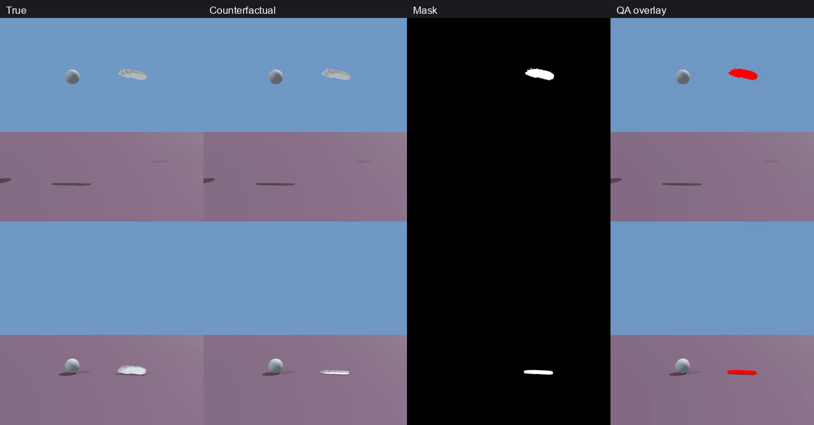

*Top row: the first frame that proves the violation. Bottom row: the last frame of the clip. Phenomenon id `free_fall_feather_iron_air_drag`.*

### An iron ball with an anomalous gravitational acceleration

Inside an evacuated chamber the ball and the feather fall straight down and land in the same frame or the next. The counterfactual gives the iron ball an anomalously larger gravitational acceleration, so it lands first while the feather is still in the air.

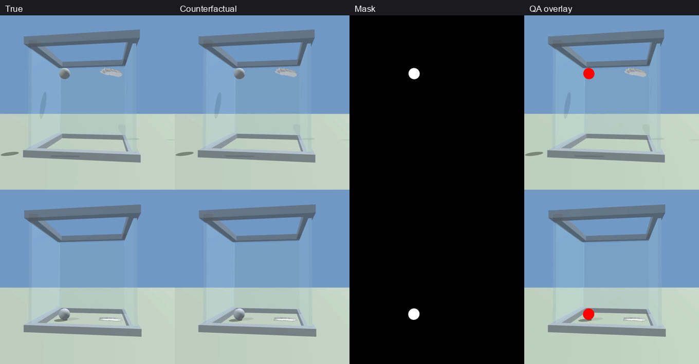

*Top row: the first frame that proves the violation. Bottom row: the last frame of the clip. Phenomenon id `free_fall_feather_iron_near_vacuum`.*

### An induced current that outlives the circuit

Two coils sit on the same iron core and one of them is wired to an alternating supply. In the true clip the induced current decays quickly once the supply is switched off; in the counterfactual the contribution of the mutual induction is kept, so a current is still flowing in the coil after the power is gone and the meter reading stays away from zero.

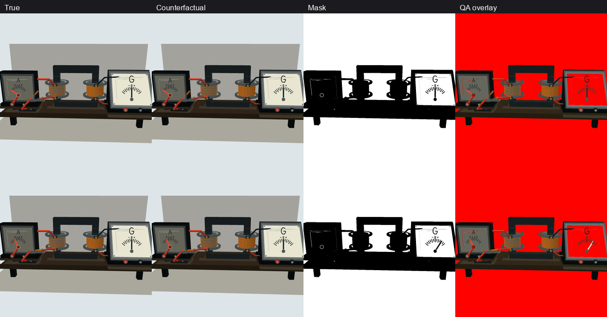

*Top row: the first frame that proves the violation. Bottom row: the last frame of the clip. Phenomenon id `mutual_induction_steady_current_persistence`.*

### The leaves of an electroscope do not close after the rod is taken away

A charged rod is brought near the metal ball of an electroscope and the leaves are pushed apart by the induced charge. In the true clip the leaves close again slowly once the rod is taken away; in the counterfactual the induced charge stays on the ball and the leaves keep standing open instead of closing.

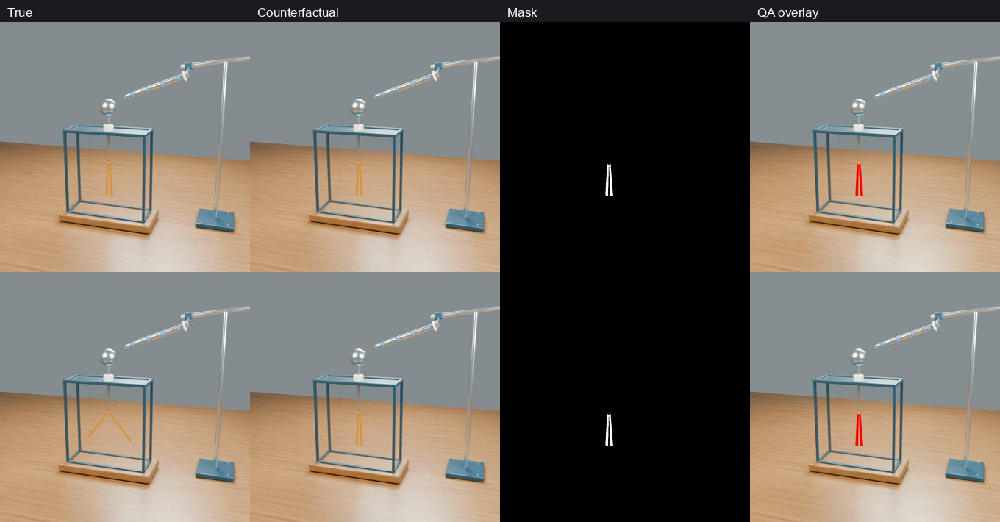

*Top row: the first frame that proves the violation. Bottom row: the last frame of the clip. Phenomenon id `electroscope_induction_no_leaf_divergence`.*

### A charged comb that does not pick up the neutral paper

A charged comb is brought near a neutral scrap of paper hanging in the air. In the true clip the gradient of the field picks the paper up and it follows the comb; in the counterfactual that polarisation does not happen, the paper only sways where it is and is never lifted.

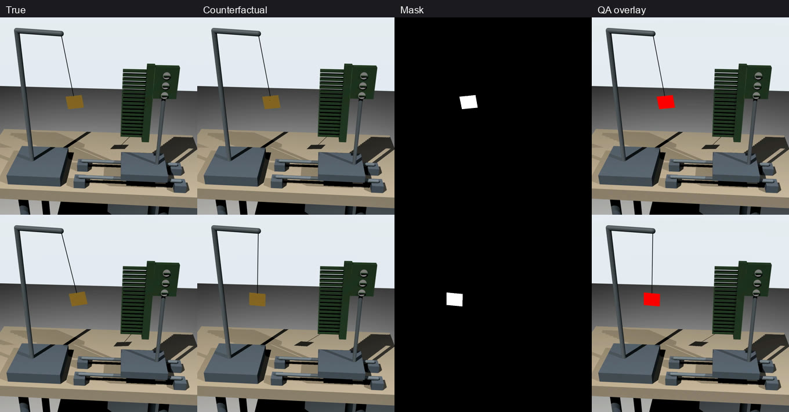

*Top row: the first frame that proves the violation. Bottom row: the last frame of the clip. Phenomenon id `charged_comb_neutral_paper_repulsion`.*

### A side-release buckle that unlocks under a sideways pull

Two halves of a nylon belt buckle seat and latch. In the true clip a sideways pull cannot separate them; in the counterfactual the lock never takes and the halves slide apart under the same pull.

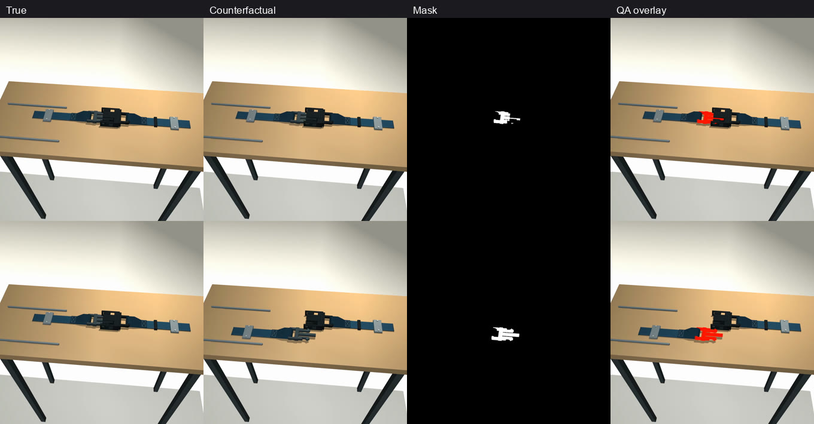

*Top row: the first frame that proves the violation. Bottom row: the last frame of the clip. Phenomenon id `backpack_side_release_buckle_locked_extraction`.*

### A towel that no longer drapes over the ball it lands on

A thick towel is released above a solid ball. In the true clip the cloth bulges into a visible bump over the top of the ball and the corners hang down to the table; in the counterfactual the towel passes through the ball and settles underneath it, and the bump the contact should have produced is gone.

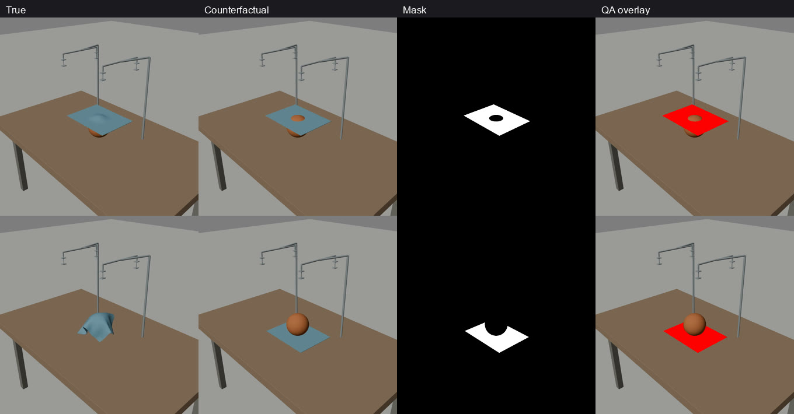

*Top row: the first frame that proves the violation. Bottom row: the last frame of the clip. Phenomenon id `towel_sphere_contact_bump_suppression`.*

### A thin aluminium can that wrinkles under axial load

A thin-walled aluminium can is held between two press plates under a steady axial load. In the true clip the load stays below the critical buckling load, the wall barely deforms and springs back when the plates release; in the counterfactual the same load makes the wall grow a Yoshimura-type diamond pattern, while the can itself stays intact.

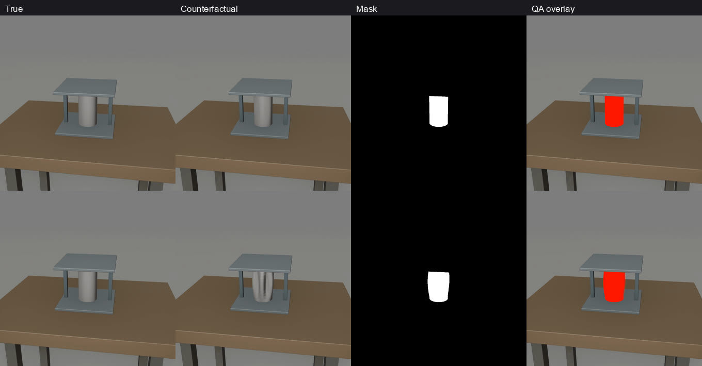

*Top row: the first frame that proves the violation. Bottom row: the last frame of the clip. Phenomenon id `thin_wall_aluminum_can_axial_buckling`.*

### A cotton strip that suddenly loses its axial stiffness

A tensile frame slowly pulls a low-extension woven cotton strip. The true clip shows a small extension; the counterfactual shows the strip losing most of its axial stiffness, stretching far further and narrowing in the middle.

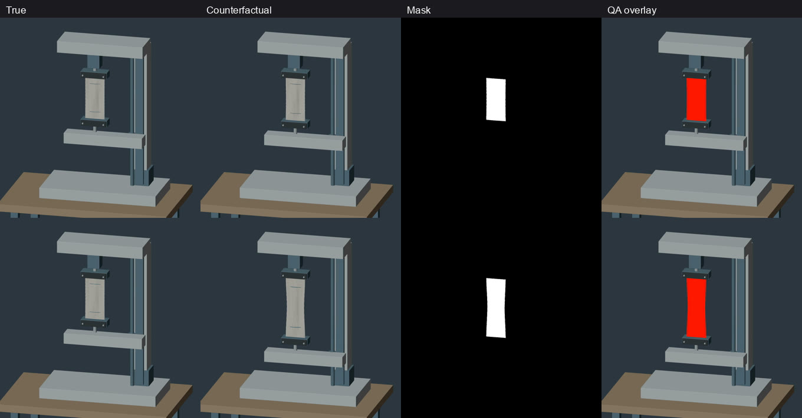

*Top row: the first frame that proves the violation. Bottom row: the last frame of the clip. Phenomenon id `cotton_strip_axial_compliance_failure`.*

### A pleated paper bridge that loses its bending stiffness

A flat sheet of paper and an accordion-pleated paper bridge stand on two pairs of supports, each carrying the same small weight. In the true clip the flat sheet collapses while the pleated bridge barely bends; in the counterfactual the pleated bridge suddenly loses the bending stiffness that the folds gave it and sinks as deep as the flat sheet — without unfolding, without tearing, and with the supports untouched.

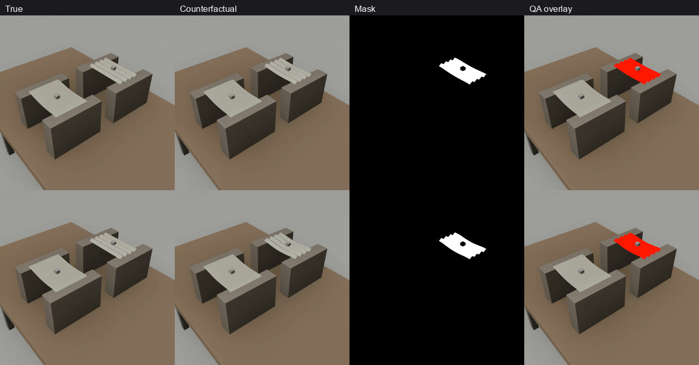

*Top row: the first frame that proves the violation. Bottom row: the last frame of the clip. Phenomenon id `accordion_paper_bridge_section_rigidity_failure`.*

### An electroscope shielded by a grounded mesh cage

A charged rod approaches two leaf electroscopes, one inside a grounded fine mesh cage. In the true clip the outside leaves spread while the shielded inside leaves stay closed; in the counterfactual the shielding fails and the inside leaves spread as well.

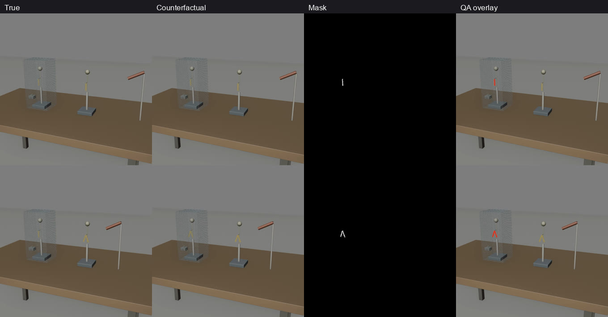

*Top row: the first frame that proves the violation. Bottom row: the last frame of the clip. Phenomenon id `grounded_faraday_cage_electroscope_shielding_failure`.*

### Three claws close on the doll and still fail to lift it

Three claws sit a hundred and twenty degrees apart, two of them gripping the widest part of a cloth doll and the third closing in from behind. In the true clip the claws lift the doll clear of the glass table and hold it under the claw hub; in the counterfactual the machine moves exactly the same way — it descends onto the doll and closes at the doll's waist — but the pads never grip the cloth, the hub rises empty and the doll stands on the table for the whole clip.

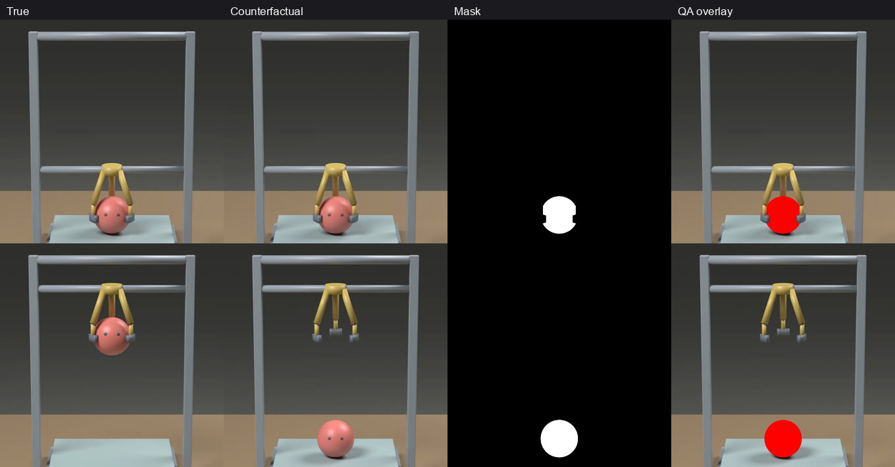

*Top row: the first frame that proves the violation. Bottom row: the last frame of the clip. Phenomenon id `claw_machine_doll_lift_failure`.*

### A typewriter that returns to the margin and feeds a line

While typing, the part of a typewriter that carries the print head walks slowly to the right margin; pressing the carriage lever pulls it back to the left margin and lifts the paper one line. In the counterfactual the lever is pressed exactly the same way, but the linkage misses the cam pin, the cam spins freely, the carriage stays at the right margin and the paper does not move.

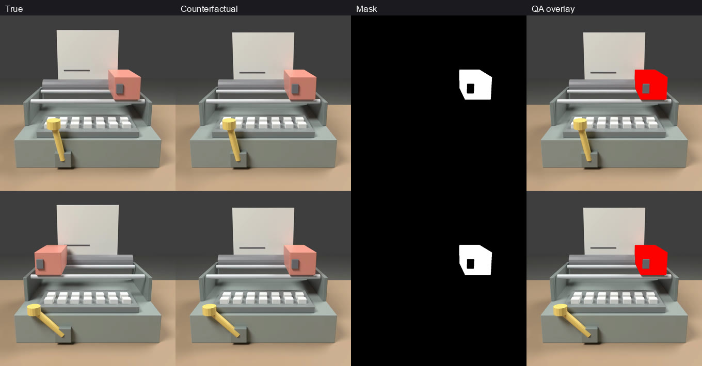

*Top row: the first frame that proves the violation. Bottom row: the last frame of the clip. Phenomenon id `typewriter_carriage_return_failure`.*

### A nickel tab that stays magnetised past the Curie point

A nickel pendulum tab is heated past the Curie point of roughly 354 °C while it rests against a fixed magnet. In the true clip the attraction weakens until the tab separates and swings; in the counterfactual it wrongly keeps its strong ferromagnetic grip.

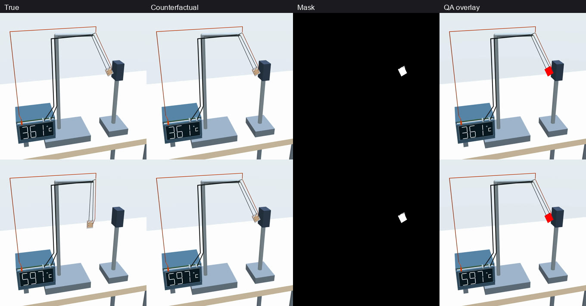

*Top row: the first frame that proves the violation. Bottom row: the last frame of the clip. Phenomenon id `curie_pendulum_high_temperature_attraction_persistence`.*

### A page block that shears backwards under the press

A motor-driven pad presses the outer edge of a clamped book. The page block shears away from the spine in the true clip; in the counterfactual the page block and the top cover shear back toward the spine, against the press.

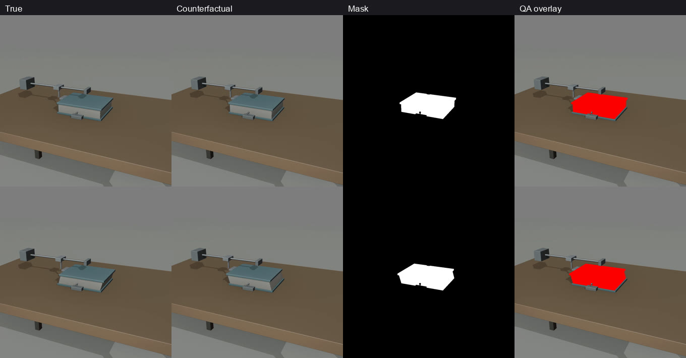

*Top row: the first frame that proves the violation. Bottom row: the last frame of the clip. Phenomenon id `book_page_shear_response_reversal`.*

### The upper string breaks first under a fast pull

A weight hangs from two equally strong strings. In the true clip the lower string reaches its breaking tension first and the weight stays suspended from the upper one; in the counterfactual the upper string breaks first and the weight falls with the lower string intact.

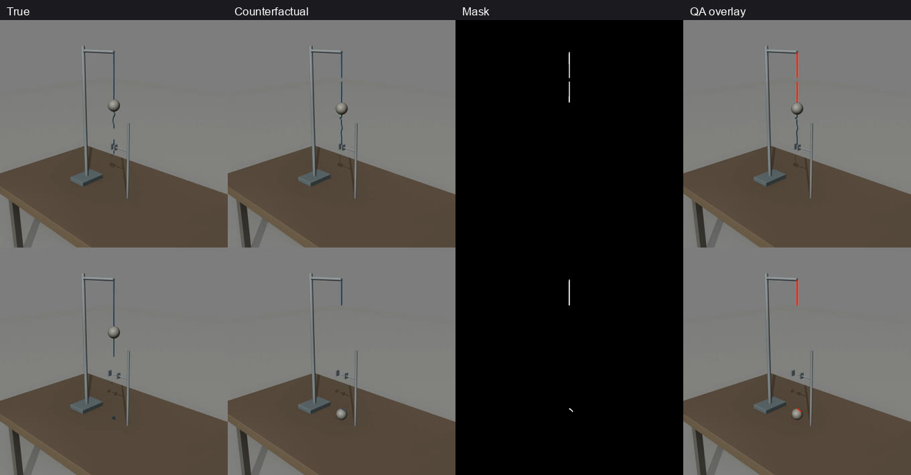

*Top row: the first frame that proves the violation. Bottom row: the last frame of the clip. Phenomenon id `quick_pull_two_string_upper_first_fracture`.*

### A newspaper's transient air resistance under a ruler

A ruler lies on a newspaper spread flat on the table, one end sticking out over the edge, and that end is pushed down once, briefly. In the true clip the air sealed under the paper gives a short-lived pressure difference that resists the lift, so the raised end comes up a few millimetres and is pushed back down; in the counterfactual that transient resistance is gone and the newspaper lifts clearly away from the table.

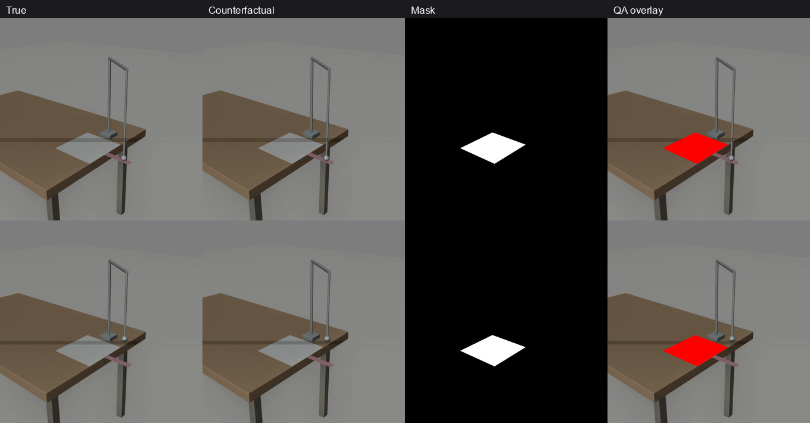

*Top row: the first frame that proves the violation. Bottom row: the last frame of the clip. Phenomenon id `newspaper_ruler_transient_pressure_resistance_failure`.*

### A motor whose torque stays wrong after the supply is reversed

A permanent-magnet brushed DC motor is cut open and driven from a battery through a visible two-pole switch that opens the contacts and closes them again with the opposite polarity, while the stator magnets stay put. In the true clip the rotor slows down through zero speed and then turns the other way, instead of stopping there; in the counterfactual the electromagnetic torque is still wrong after the reversal and the rotor keeps turning the way it was already turning.

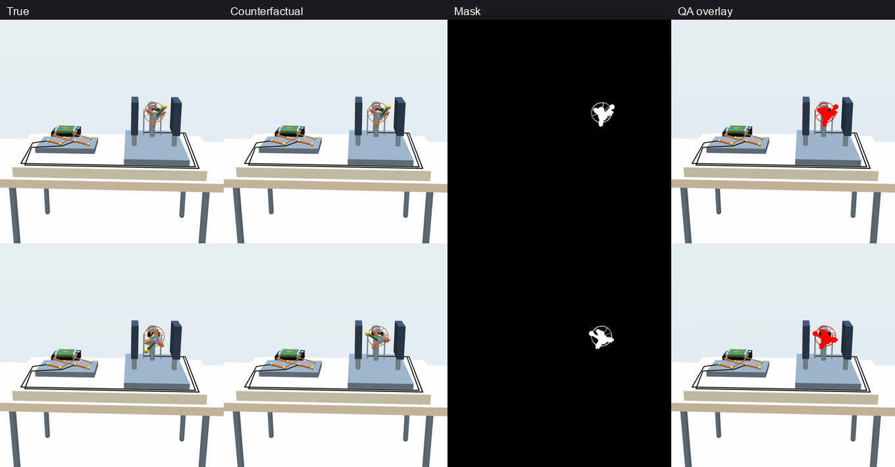

*Top row: the first frame that proves the violation. Bottom row: the last frame of the clip. Phenomenon id `counterfactual_reversed_supply_wrong_torque`.*

### A suction cup that leaks and never grips

Two hand-operated suction cups are pressed onto the top face of a glass sheet near one edge and linked by a lever to the cup plungers. In the true clip pressing the lever enlarges the cavity, the pressure falls, both cups grip the glass and a spring reel lifts the sheet off the table; in the counterfactual the cup rim leaks, no low pressure is built up, the cord never tightens and the glass stays lying on the table.

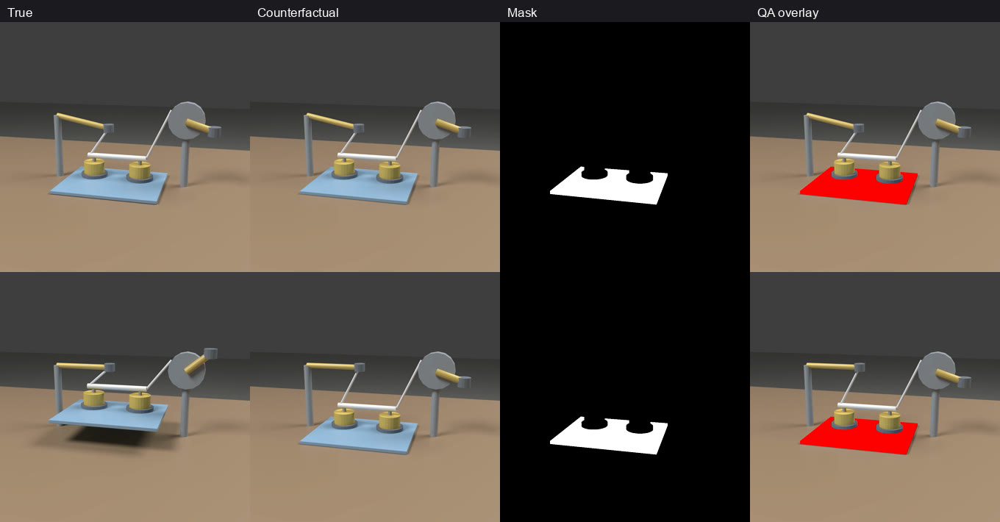

*Top row: the first frame that proves the violation. Bottom row: the last frame of the clip. Phenomenon id `suction_cup_glass_lift_failure`.*

### A row of pendulums whose phase cascade runs backwards

A row of six to eight pendulums hangs from a bar, the cord lengths growing geometrically so the periods form an arithmetic ladder. In the true clip the balls reach their turning points one after another, from the short end towards the long one; in the counterfactual the cord length no longer decides how fast a pendulum swings, the whole row is re-timed inside one 1.4 second window, the peaks collapse into a single shared swing and every ball gets the same restoring length and reaches the turning point together. Not one cord changed and the row never stopped and started again.

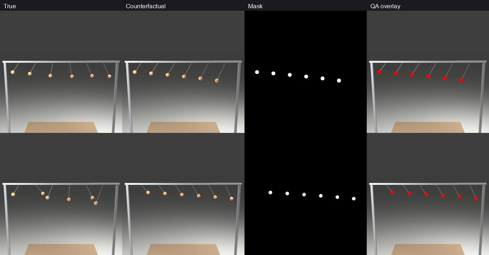

*Top row: the first frame that proves the violation. Bottom row: the last frame of the clip. Phenomenon id `pendulum_phase_cascade_direction_reversal`.*

### A coin that is not deflected by the turning table

The stop pin is pulled at the moment of intervention. In the true clip the coin leaves with the Coriolis term, bends away from the release radius painted on the table, sweeps around the axis and comes to rest clearly to one side at the rim; in the counterfactual only that coupling is removed and the coin runs straight out along the same rotating radius.

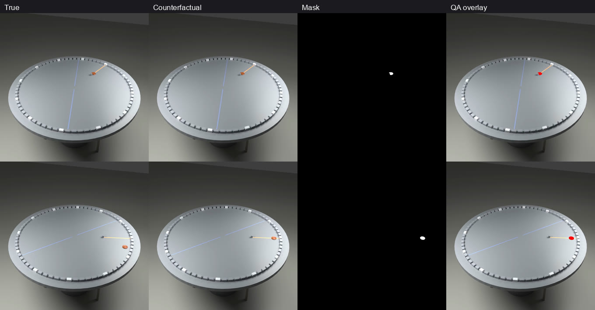

*Top row: the first frame that proves the violation. Bottom row: the last frame of the clip. Phenomenon id `turntable_coin_coriolis_deflection_reversal`.*

### A pencil that topples to the other side

The disc tilts down towards one side and the pencil falls that way. The counterfactual reverses only the direction the disc tilts; the pencil, its starting lean and the disc are otherwise identical.

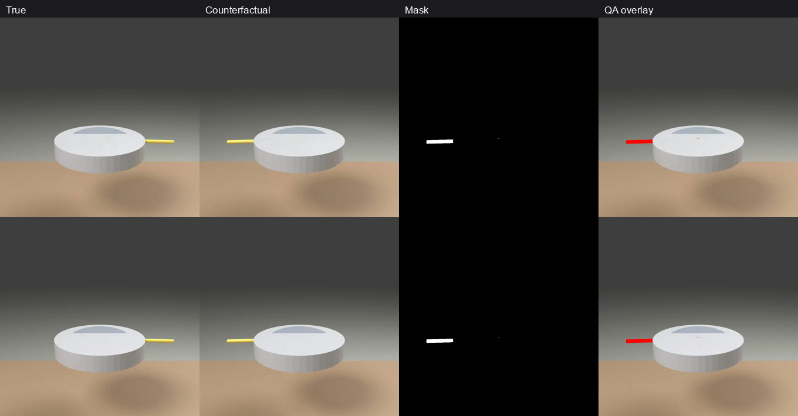

*Top row: the first frame that proves the violation. Bottom row: the last frame of the clip. Phenomenon id `pencil_tip_balance_topple_direction_reversal`.*

### The bar throws the ball clear, or only pushes it out of its seat

A steel catch releases and a torsion spring drives the bar over the top. In the true clip the head of the bar scoops the yellow ball from underneath and throws it in an arc back onto the table; in the counterfactual the catch releases and the bar sweeps over the top just the same, but the head does not get under the ball — it only pushes the ball sideways out of its seat, and the yellow ball drops straight down onto the table beside the post. Same machine, same release; the difference is only in the moment the bar meets the ball.

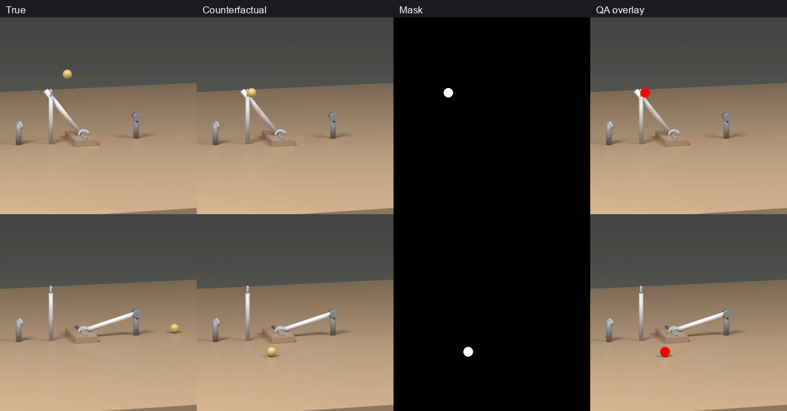

*Top row: the first frame that proves the violation. Bottom row: the last frame of the clip. Phenomenon id `mousetrap_snap_bar_launch_reversal`.*

### A rubber band that never unwinds

The release is the experiment and the fault is in the drive: in the true clip the catch falls over (its foot stays planted, only the top tips over), the rubber band unwinds turn by turn and drives the rear wheel, and the car rolls down the slope and stops halfway; in the counterfactual the catch falls over exactly the same way, but the rubber band stays tight, the wheel does not turn and the car sits at the top of the slope for the whole clip. Both branches have the same slope.

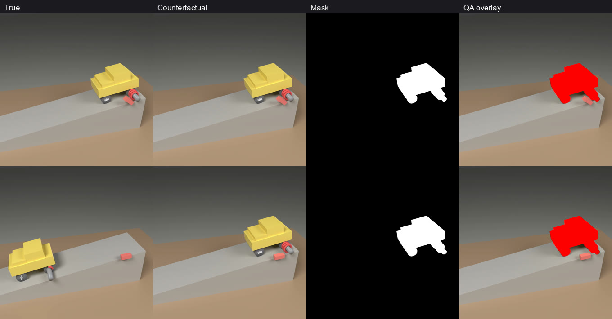

*Top row: the first frame that proves the violation. Bottom row: the last frame of the clip. Phenomenon id `rubber_band_stored_energy_car_drive_reversal`.*

### A freewheel that turns the pedals instead

The rear wheel of a bicycle accelerates on a roller rig with the chain slack and a dog clutch beside the chainring that can be engaged. In the true clip the clutch connects to the ratchet on the hub, so the ratchet freewheels while coasting and the crank and pedals hardly move; in the counterfactual the clutch locks the chainring straight onto the wheel, and the coasting wheel drives the crank the other way and turns the pedals by itself.

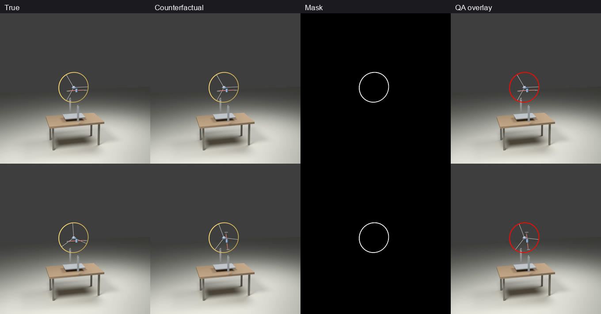

*Top row: the first frame that proves the violation. Bottom row: the last frame of the clip. Phenomenon id `bicycle_freewheel_coast_drag_reversal`.*

### The load leaves, and the platform does not answer

A steel weight presses on a spring platform that rises and falls for the whole clip. In the true clip a pusher slides the weight sideways off the platform and the weight drops into a catch tray on a separate stand: the load leaves, the spring rebounds, the platform rises and the period of the oscillation shortens, so the beat is clearly faster. In the counterfactual the pusher pushes exactly the same way and the drive is identical, but the platform does not answer the transfer at all: the spring stays on the same compressed step, the platform stays at the same low position and the oscillation keeps the slow beat it had while the weight was still there.

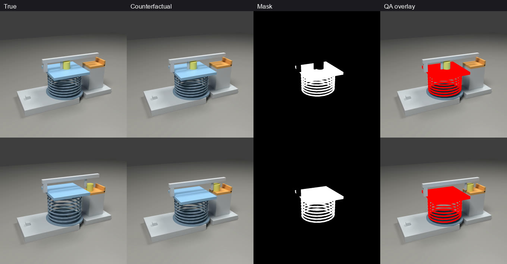

*Top row: the first frame that proves the violation. Bottom row: the last frame of the clip. Phenomenon id `spring_platform_weight_transfer_period_shortening`.*

### The seconds hand of a demonstration movement runs backwards

An open demonstration movement hangs on the workshop wall: a sixty-second dial (a brass ring, twelve marks, four raised numerals at 0, 15, 30 and 45), a large spoked wheel behind it with one spoke painted red, and a blued-steel seconds hand in front with a weighted tail. In the true clip the hand advances six degrees a second, sweeping clockwise from 0 through 15 and on towards 30, and the red spoke turns the same way; in the counterfactual the drive is taken to the other side, the hand turns back on itself, retreats through 0 and carries on towards 45, and the red spoke turns the other way at the same time.

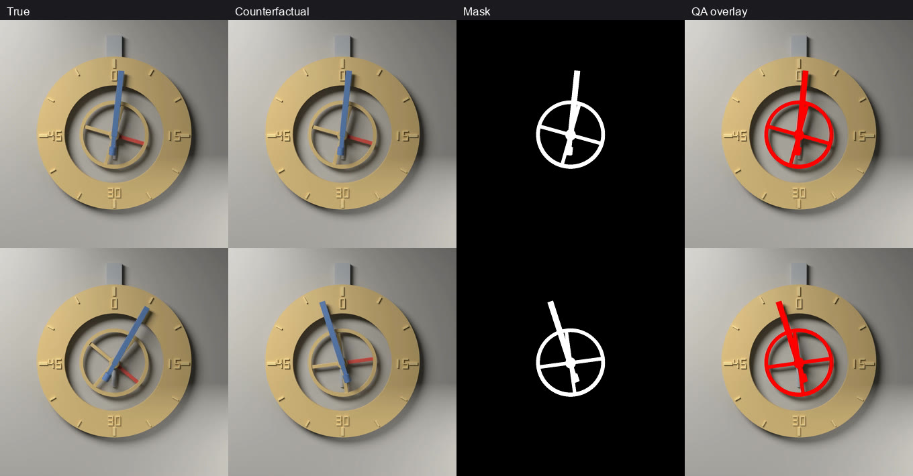

*Top row: the first frame that proves the violation. Bottom row: the last frame of the clip. Phenomenon id `clock_seconds_hand_runs_backwards`.*

### A lathe that does not cut the thread

A small lathe holds a steel bar in its chuck and spins it while a yellow round-bar cutting tool feeds towards the tailstock with its tip on the bar; a short dark paint mark near the chuck makes the rotation visible. In the true clip the edge is sound and the tip cuts a continuous helical groove into the bar: the floor of the groove is the width of the tip, two straight flanks rise to the surface, the groove is much wider than the tool and thread crests stand between the turns, level with the bar, cut out of the steel itself. In the counterfactual both branches travel and turn exactly the same way, but from the intervention frame the edge chips, stops cutting, slips on the bar and tears a dark mass of metal sideways across the same groove with ragged broken edges — the thread never forms.

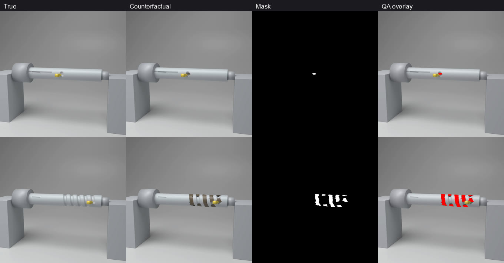

*Top row: the first frame that proves the violation. Bottom row: the last frame of the clip. Phenomenon id `lathe_thread_not_cut`.*

### An air jet that can no longer hold the ball up

In the true clip the blower stays at full speed and the column of air keeps the ball up: it bobs in the jet and never lands for the whole clip. In the counterfactual the airflow decays until it can no longer hold the ball, and the ball drops out of the jet into the catch tray.

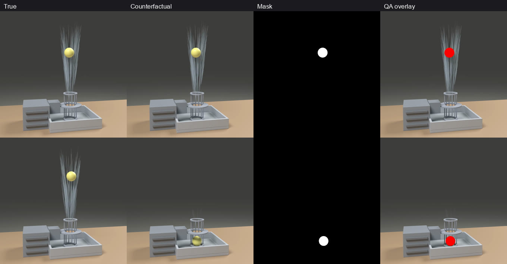

*Top row: the first frame that proves the violation. Bottom row: the last frame of the clip. Phenomenon id `air_jet_ping_pong_ball_lift_failure`.*

### The contact face freezes and drags both blocks along

Two ice blocks stand side by side on a steel table, the right one held by a steel clamp whose finger presses its outer face and whose foot rides the rails of the table; a steel cylinder at the left end of the rails pushes the clamp, and with it the right block, to the right. In the true clip the contact face between the two blocks never freezes into a bond, the right block slides straight off the contact and the left one stays on the table without moving; in the counterfactual a white frozen seam grows across the contact face, the bond carries the friction between the left block and the table, and the left block is dragged along with the right one.

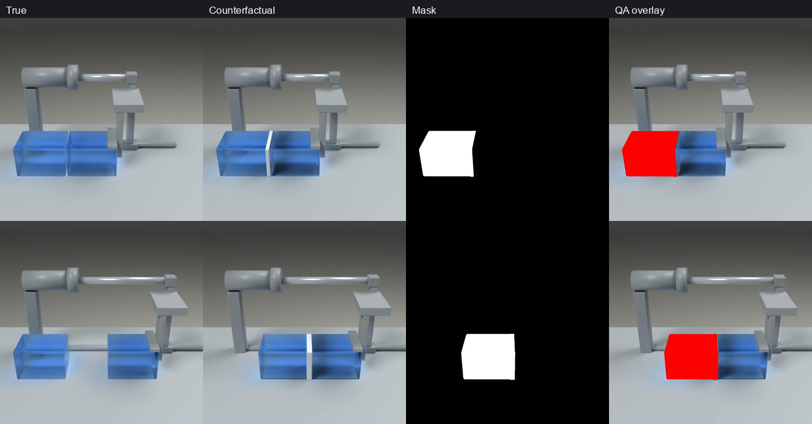

*Top row: the first frame that proves the violation. Bottom row: the last frame of the clip. Phenomenon id `two_ice_cubes_regelation_bond_drag_reversal`.*

### A cone of sand that slumps past its angle of repose

Coarse sand pours through a funnel onto a shallow round tray and piles into a cone steeper than the angle the sand can hold. In the true clip the cone cannot stand once the pouring stops: the top collapses, the base spreads out and it settles at the shallow angle the sand can really hold; in the counterfactual the grains do not slide past each other and the cone keeps its original steepness and height.

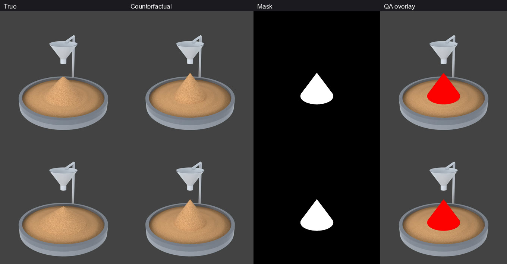

*Top row: the first frame that proves the violation. Bottom row: the last frame of the clip. Phenomenon id `sand_pile_angle_of_repose_slope_reversal`.*

### A paper plane that unfolds by itself

A folded paper plane lies on a dark desk mat and two small clip jaws release and withdraw. In the true clip the plane keeps its nose, its body and its two wings for the whole clip; in the counterfactual nothing is done to it, the folded structure lets go in one sudden move and the plane opens out into a flat sheet on the mat.

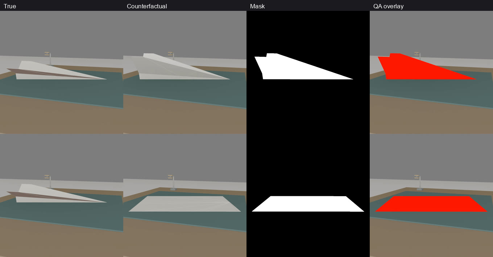

*Top row: the first frame that proves the violation. Bottom row: the last frame of the clip. Phenomenon id `paper_airplane_spontaneous_unfolding`.*

### A picture that settles crooked the other way

A framed picture hangs on a plaster wall from a nail and a wire, its centre of mass exactly below the nail, so it hangs square and still for the whole clip; the counterfactual puts a small balance offset into the same picture, the frame turns away from the nail, swings and comes to rest crooked with the lower right corner down.

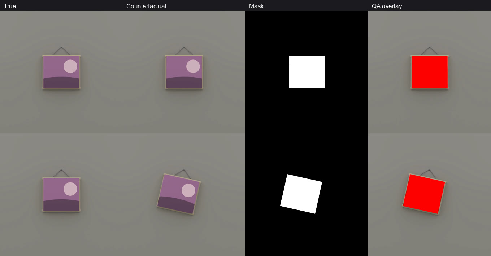

*Top row: the first frame that proves the violation. Bottom row: the last frame of the clip. Phenomenon id `hanging_picture_hook_tilt_reversal`.*

### A banner the wind streams downstream

The wind fills the flag along the flag equation and blows it downstream, and in the true clip the free edge sits below the pole; the counterfactual only flips the sign of the crosswind lift, and the same flag is lifted the other way, up past the top of the pole.

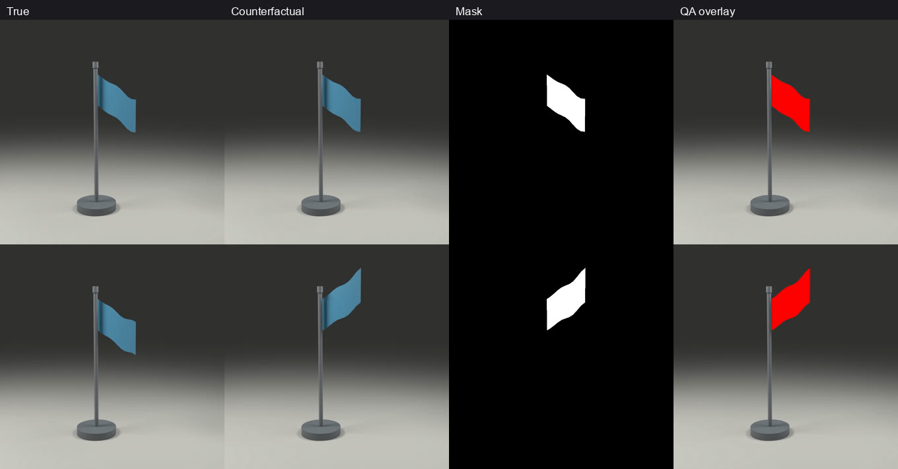

*Top row: the first frame that proves the violation. Bottom row: the last frame of the clip. Phenomenon id `wind_flag_deflection_reversal`.*

### A charged balloon that loses its grip on the wall

A statically charged rubber balloon sticks to a plaster wall, and when a draught passes it only leans a little and stays attached; in the counterfactual the dry air carries the charge off the rubber, the balloon leaves the wall and is pushed down onto the floor. The wooden crate on the floor is a prop that gives the balloon its scale, not a sampled axis.

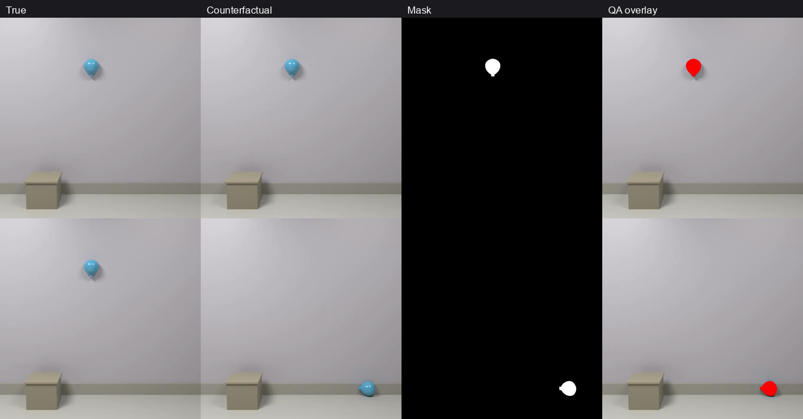

*Top row: the first frame that proves the violation. Bottom row: the last frame of the clip. Phenomenon id `static_balloon_wall_stick_failure`.*

### The clothespin holds the towel until the friction goes

A washing line runs across the frame, a wooden clothespin is clipped to it and one corner of a towel is caught in the jaws. In the true clip the friction between the jaws and the cloth carries the weight of the towel, so it hangs on the line and creeps down a little as the grip slackens; in the counterfactual only that friction is removed, the towel slides out of the jaws and falls to the floor in a heap. The clip, the line, the towel, the lighting and the camera are identical in both branches.

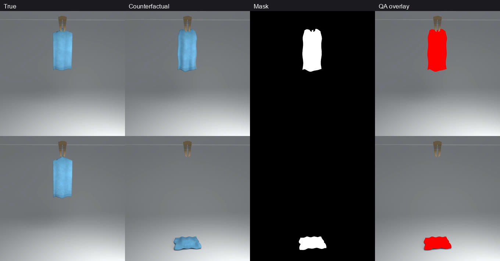

*Top row: the first frame that proves the violation. Bottom row: the last frame of the clip. Phenomenon id `clothespin_grip_loss_towel_falls_off_line_reversal`.*

### A chisel that splits the timber along the grain

A length of timber lies across a workbench with dark grain lines running along it, and a chisel is set at an angle against its end face and pushed in. In the true clip the timber splits along the grain and a long crack runs the length of it and opens up; in the counterfactual the fibres no longer hold each other, the chisel slides along them and the timber stays in one piece with only a shallow pit on the end face.

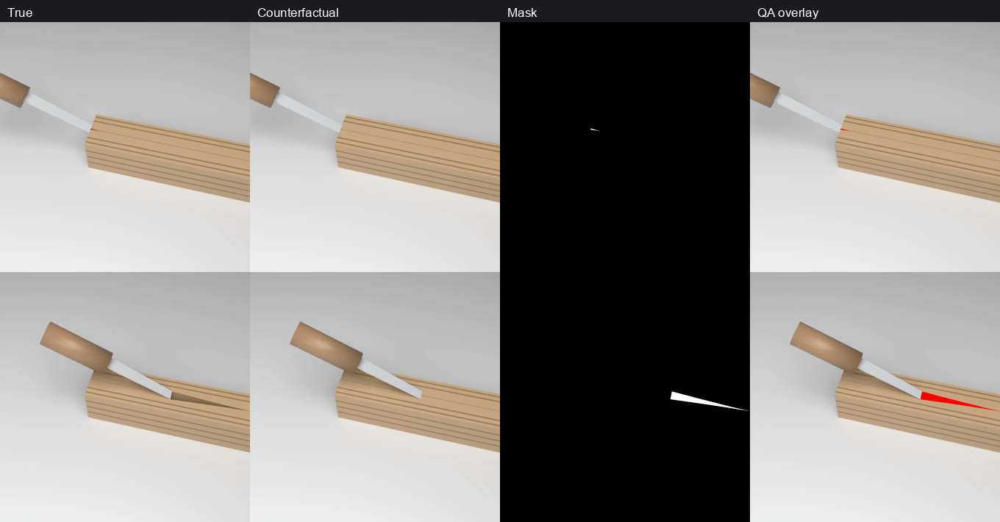

*Top row: the first frame that proves the violation. Bottom row: the last frame of the clip. Phenomenon id `chisel_grain_split_along_fiber_reversal`.*

### A hand plane that lifts one continuous shaving

A board lies flat on a workbench and a wooden hand plane is pushed along its near edge, the iron set at an angle in the body with its edge right on that edge of the board, so the shaving leaves the mouth, crosses the edge of the board and hangs down its side onto the bench. In the true clip the iron cuts the wood away as a whole and what comes out is one unbroken shaving that hangs over the edge and drops onto the bench; in the counterfactual the wood in front of the edge does not get cut away but breaks up, and out of the same strip come small chips that land on the edge of the board and on the bench — the continuous band is simply not there.

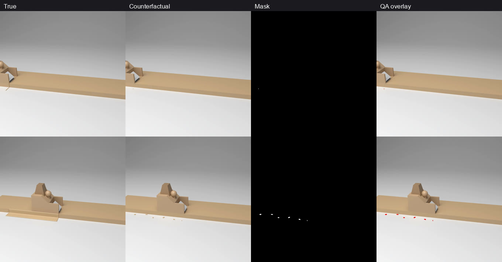

*Top row: the first frame that proves the violation. Bottom row: the last frame of the clip. Phenomenon id `hand_plane_continuous_shaving_reversal`.*

### A curling stone that curls across the ice

A pale blue sheet of ice fills the frame and a granite curling stone with a red handle slides away, spinning as it goes. In the true clip the stone slows down, the rotating running band pushes it sideways and it follows a curved path, so the handle ends up off the line it started on; in the counterfactual the rotating running band no longer pushes the stone sideways, it runs straight across the ice and the handle keeps pointing along the line it started on.

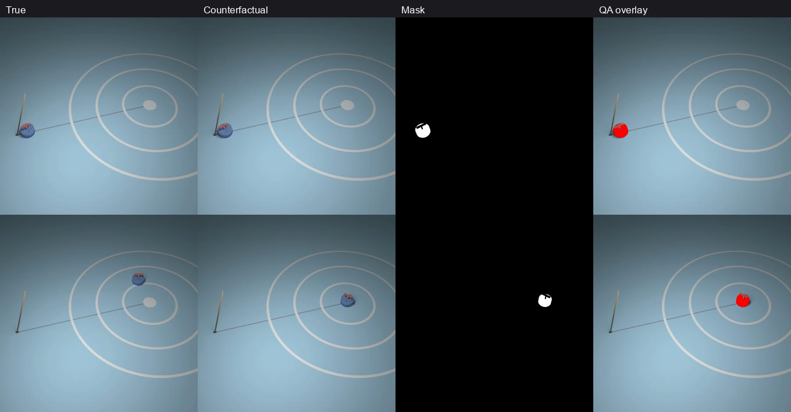

*Top row: the first frame that proves the violation. Bottom row: the last frame of the clip. Phenomenon id `curling_stone_curl_reversal`.*

### A coin on its edge that falls flat by itself

A coin stands on its edge on a table, spinning slowly and leaning a little further as it goes. In the true clip the rim grinds against the table, the spin is worn away, the lean grows and the coin finally slaps flat onto the surface; in the counterfactual the rim no longer grinds the table, the spin is not worn away, the lean does not grow and the coin spins upright for the whole clip, still standing on its edge at the end.

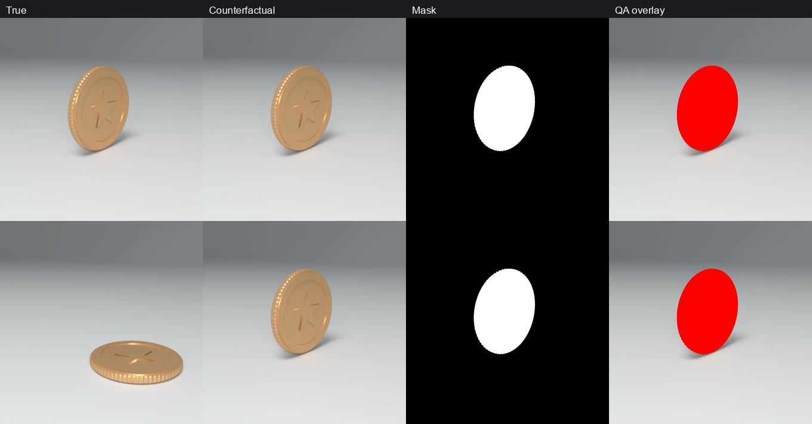

*Top row: the first frame that proves the violation. Bottom row: the last frame of the clip. Phenomenon id `spinning_coin_falls_flat_edge_friction_reversal`.*

## 7. What this data is for

Counterfactual samples exist for judgement: the model watches a clip and has to name which law was broken and where.

Positive examples alone cannot do that. A model can train very well on millions of ordinary clips and still have never seen "an object passing through a wall". It does not know that what it is looking at is wrong, because nothing like it was in the distribution.

The counterfactual pair makes it learnable: the same picture with one law changed, so the difference the model can see is the law itself, and the mask says where that difference is.

That is also the judgement I ended up with: **the hard part of this kind of data is not rendering, it is review.** Get the physics wrong and the model learns wrong physics; get the shot wrong and the model learns a false visual cue — and both mistakes look perfectly convincing in the finished clip. The only defence that works is to turn every property into a criterion a machine can decide, and then spend the human attention on the things the criteria cannot see.

## About this post

Every picture here was rendered by generators I wrote; the scripts and the review material live inside the team's workspace. Each one is a real run, the mask is the formal binary label that was delivered, and the red overlay is only a quality-assurance view for humans — the training data is the mask itself. The playable pairs live on the [sample of work page](/sample-of-work/).
