The hard part of training a physics model is not teaching it to read a video. It is teaching it to say "this is wrong" and to point at where. Counterfactual data exists for exactly that: the same scene, the same camera, the same time base, rendered twice.

In the first pass the physics is correct. In the second pass exactly one law changes — a ball passes through a wall, an object freezes in mid-air, a bounce gains energy, something vanishes.

The two clips are pixel-identical until the violation starts. So the only difference a model can possibly learn is the broken physics itself.

The second clip also carries a pixel-level mask that says where the violating object is and from which frame the violation becomes visible. Plus a pair of prompts: two ways of describing the same scene, one of which obeys the physics and one of which does not.

This post is about how that data is produced, and about the thirty-two generators I wrote, each with a real sample.

### One case, four streams

Every case ships four streams: the true clip, the counterfactual clip, the formal binary mask, and the QA overlay that marks the region the generator changed. Here they are in one row, in the order they are delivered, taken from the versions merged into main.

**A side-release buckle that unlocks under a sideways pull**

%%PANELS:/assets/generator-samples/pr680-buckle-true.mp4|/assets/generator-samples/pr680-buckle-counterfactual.mp4|/assets/generator-samples/pr680-buckle-mask.mp4|/assets/generator-samples/pr680-buckle-overlay.mp4%%

Two halves of a nylon belt buckle seat and latch. In the true clip a sideways pull cannot separate them; in the counterfactual the lock never takes and the halves slide apart under the same pull.

## 1. One generator, one phenomenon

A generator is one scene plus one broken law. A ball bouncing off a wall (scene) paired with pass-through (law) is the pass-through phenomenon; free fall paired with freeze is the freeze phenomenon. Scene and law are separate parts, so they can be recombined.

Each generator owns exactly one operator, one mask definition and one scoring rule. The directory name is the phenomenon, and the first paragraph of its README says what it is comparing.

The benefit is direct: **a mistake has an address.** When a sample is wrong, the problem is in one specific part, not somewhere in "this scene feels off".

## 2. The matched control is constructed

"True and counterfactual differ by one law" cannot be achieved by aligning two videos by hand. One pixel of camera drift and the prefixes stop matching.

So the order is the other way around:

1. Compute the true trajectory first and store it.
2. Before the intervention frame, the counterfactual **reuses the true poses**; only afterwards does it change.
3. Both clips are encoded all-intra, so identical frames survive compression.

What comes out is not "looks the same" but "decodes to identical pixels". The review criterion is equally blunt: every frame before the intervention must be exactly equal, and no tolerance comparison is accepted.

## 3. The mask comes for free, and is also the strictest gate

Because we inject the violation ourselves, we always know which entity violates and when. The renderer emits entity-level segmentation next to every RGB frame, so the mask is the visible pixels of the violating entity intersected with the violation window.

That means zero hand labelling, and no shadows, background or unrelated objects.

It also means the mask becomes a very strict gate. One extra ring of pixels means the renderer's entity scope disagrees with the declaration; a missing region means the segmentation and the geometry disagree. So the review includes a geometric check: take the intrinsics and extrinsics the renderer actually used, re-project the target geometry onto the pixel plane, and compare it item by item with the decoded formal mask.

A cross-check that assumes a sphere misjudges non-spherical targets, and when the camera block differs from the camera the render actually used it catches nothing at all. Only re-projecting through the renderer's own camera closes that hole.

## 4. Six hard gates

Every sample passes a set of criteria before it can be published; today that is between 85 and 104 per sample, and all of them have to pass. A few representative ones:

- **Output contract**: 2048×2048, 24 fps, 120 frames, 5.000 seconds, H.264.
- **Matched control**: every frame before the intervention is exactly equal after decoding.
- **The mask only covers the violating target**: black before the intervention, non-empty in every frame after it, and the overlay replaces mask pixels with pure red. The masked entity must be the declared target.
- **Time base**: physics step × steps per frame ÷ frame rate has to equal the declared value, and the evidence frame must be computed, not defaulted, and must come after the intervention.
- **Prompt against trajectory**: recompute from the stored trajectory which way the phenomenon goes, then require each prompt to carry its own direction marker and neither prompt to carry the other's. This project had two prompts stating the same direction, and this is the gate that caught it.
- **Exposure and colour**: no more than 2% of the frame clipped, a median saturation of at least 40 in the delivered pixels of the masked target, and channel order matching the declared authored colour.
- **Single error**: exactly one operator, two different prompts, and the entity named by the mask must be the declared target.

There is also a noise gate that was added later. A render at 8 samples without denoising shimmers like television static across large flat surfaces, and every hard gate above still passes — only this one, and a human eye, notice it. The cause turned out not to be sampling noise but the renderer's 8-bit output dither: it adds half a level of jitter to every pixel, and on a flat surface all the remaining neighbour differences are that half level. The right fix is to change the render setting and turn the dither off, not to relax the threshold — loosening it would let real noise in other cases sneak through.

## 5. The picture has to hold up too

The physics can be right and the frame still be worthless. Everything in this section is something that was actually sent back.

**Equipment needs support.** In an early version the rail rods stuck out of the body and hung in mid air, and the return lever pointed straight at the camera and was compressed into a dot — there was no way for a viewer to tell it was a lever. Both of those can be decided before rendering, with pure geometry: check that every rod endpoint lands inside the bounding box of some entity, then project it through the camera and measure how much of the frame it covers. Below 6% it is unreadable.

**Support checks cannot stop at rods.** In the rerun, two pillars pinched only a small strip of the top edge of the body and 84% of their base floated free, and the earlier check reported nothing — it only looked at rod endpoints, so it could not see a box part with a floating base. The follow-up check takes the bottom face of every box, measures how much of it is actually carried by another entity at the same height, and reports float below 60%.

**A measuring tool has to look like a measuring tool.** The prompt asked for a straightedge to compare the slope, and the frame showed a yellow rod leaning against the cone. Length and angle were both right and the reader still could not tell what it was. A tool carries the feature that identifies it: a straightedge is a flat blade with tick marks, a protractor has a dial.

**The process has to be visible.** The prompt described tipping, leaning, lifting, releasing and withdrawing, and the delivered clip showed a cone of sand that was already finished in frame one, a straightedge that never moved, and a funnel floating above the cone. Every gate passed — the gates do not look at support, and they do not check whether the process the prompt describes happens on screen.

**There is a clock on top of the time base.** Early review pages had the four videos interrupt each other: each one paused the other three on its own play event and re-seeked them on every timeupdate. The play button started nothing and the panel looked like it refused to play. The next version gave one panel the clock, but the clock was then stolen by whichever panel emitted play last — with file sizes two orders of magnitude apart, the 30 KB mask stream became the clock and the multi-megabyte panels were dragged backwards. The version that shipped pins the clock first: the driver is chosen once and never changes, all four start at the same instant, and a follower that drifts is pulled back to the driver.

**Things on screen have to look right.** A balloon stuck to a wall by static charge, with a draught blowing through the room — would a balloon really fall off? In one version the wind blew the balloon visibly further off the wall than it should, and in another the balloon hung from a pole instead of sitting against the paint. Nothing in the gates notices this kind of thing. Only a person does.

## 6. The gallery

Below are thirty-two real samples, one per generator. Each one has four panels: true, counterfactual, the formal binary mask, and the red QA overlay. The top row is the first frame that proves the violation, the bottom row is the last frame of the clip. The same thirty-two generators are also on the [sample of work page](/sample-of-work/); where a generator has the full four-stream delivery, the same four clips play in one row there.

### A feather that loses its air drag

A silver iron ball and a white feather are released together in still air. The true clip keeps the feather's drag so it drifts down slowly; the counterfactual removes that drag and the feather lands within a few frames of the ball.

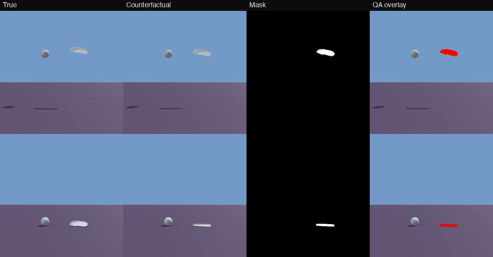

*Top row: the first frame that proves the violation. Bottom row: the last frame of the clip.Phenomenon id `free_fall_feather_iron_air_drag`. *

### An iron ball with an anomalous gravitational acceleration

Inside an evacuated chamber the ball and the feather fall straight down and land in the same frame or the next. The counterfactual gives the iron ball an anomalously larger gravitational acceleration, so it lands first while the feather is still in the air.

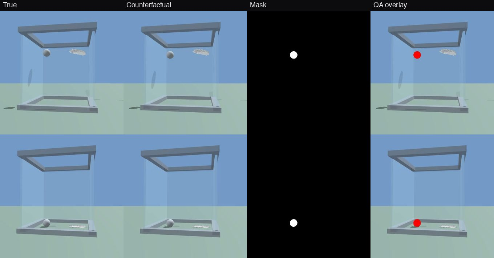

*Top row: the first frame that proves the violation. Bottom row: the last frame of the clip.Phenomenon id `free_fall_feather_iron_near_vacuum`. *

### A side-release buckle that unlocks under a sideways pull

Two halves of a nylon belt buckle seat and latch. In the true clip a sideways pull cannot separate them; in the counterfactual the lock never takes and the halves slide apart under the same pull.

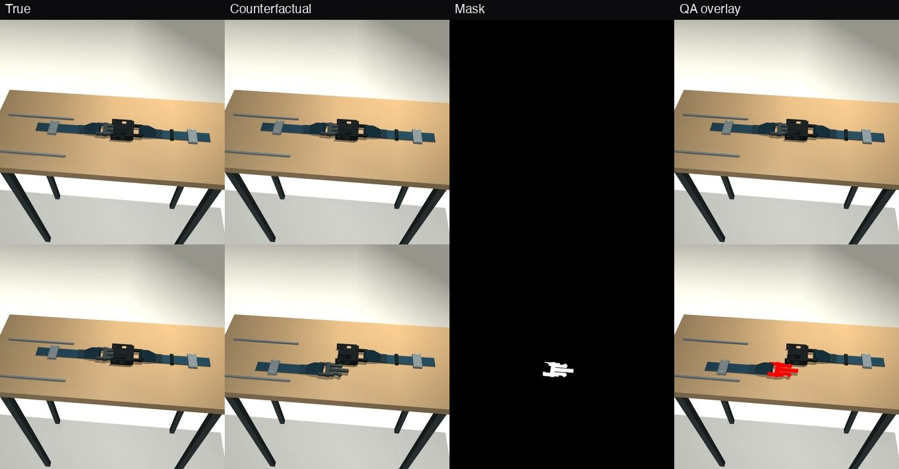

*Top row: the first frame that proves the violation. Bottom row: the last frame of the clip.Phenomenon id `backpack_side_release_buckle_locked_extraction`. *

### A towel that no longer drapes over the ball it lands on

A thick towel is released above a solid ball. The true clip keeps a visible raised bump above the ball; the counterfactual lets the towel pass through and settle under it.

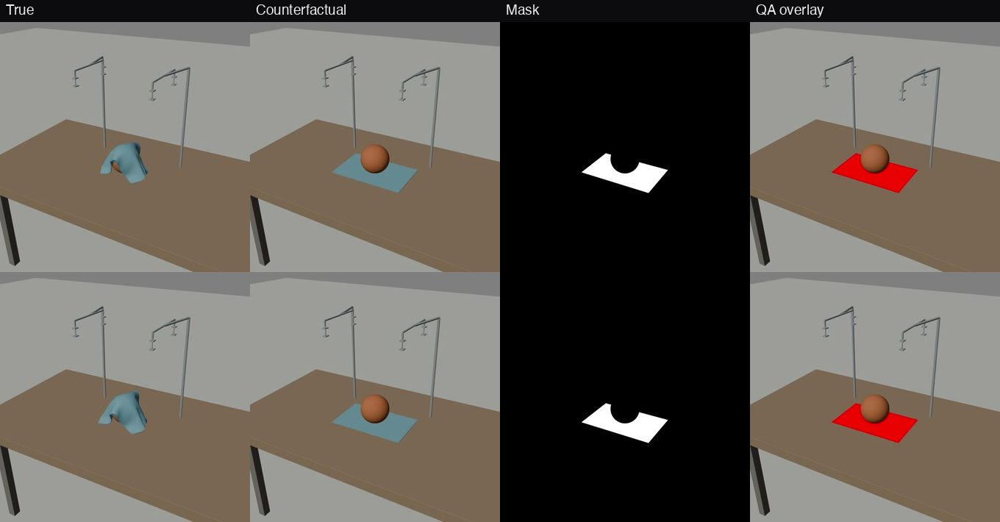

*Top row: the first frame that proves the violation. Bottom row: the last frame of the clip.Phenomenon id `towel_sphere_contact_bump_suppression`. *

### A thin aluminium can that wrinkles under axial load

A thin-wall can sits between two plates under sustained axial load. Below the buckling threshold the wall stays unchanged; the counterfactual shows Yoshimura-pattern diamond folds appearing in the same wall.

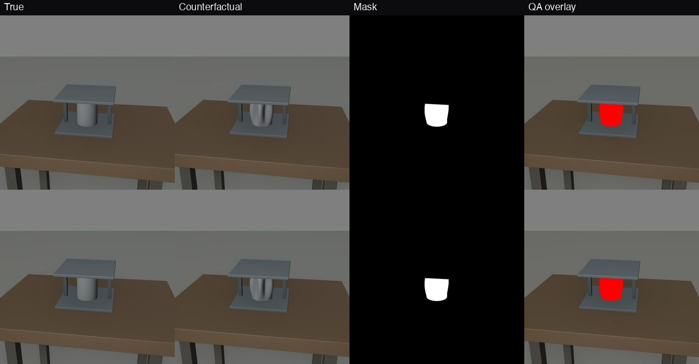

*Top row: the first frame that proves the violation. Bottom row: the last frame of the clip.Phenomenon id `thin_wall_aluminum_can_axial_buckling`. *

### A cotton strip that suddenly loses its axial stiffness

A tensile frame slowly pulls a low-extension woven cotton strip. The true clip shows a small extension; the counterfactual shows the strip losing most of its axial stiffness, stretching far further and narrowing in the middle.

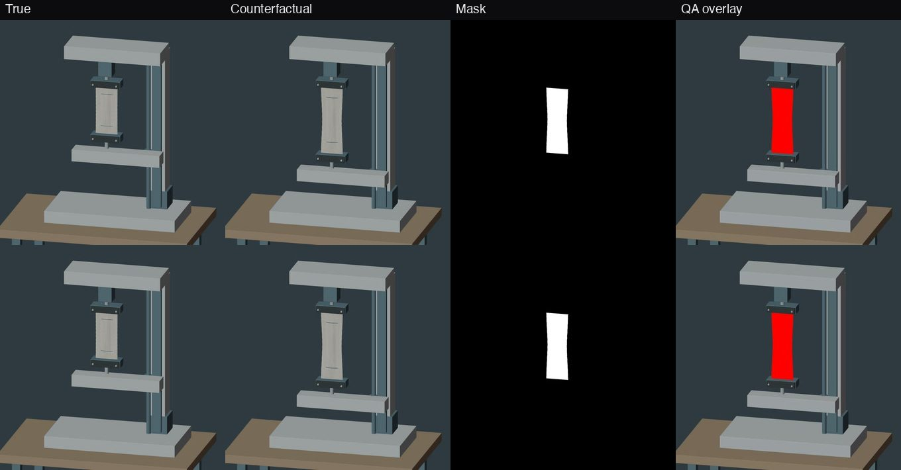

*Top row: the first frame that proves the violation. Bottom row: the last frame of the clip.Phenomenon id `cotton_strip_axial_compliance_failure`. *

### A pleated paper bridge that loses its bending stiffness

A flat paper card and an equally pleated card carry the same small weight. The pleated one stays almost straight in the true clip; in the counterfactual it suddenly loses the bending stiffness of its folds and sags as deep as the flat card.

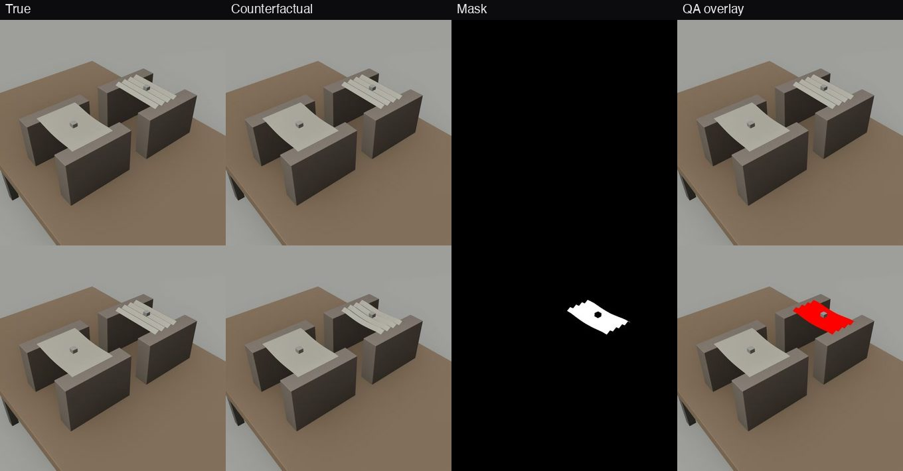

*Top row: the first frame that proves the violation. Bottom row: the last frame of the clip.Phenomenon id `accordion_paper_bridge_section_rigidity_failure`. *

### An electroscope shielded by a grounded mesh cage

A charged rod approaches two leaf electroscopes, one inside a grounded fine mesh cage. In the true clip the outside leaves spread while the shielded inside leaves stay closed; in the counterfactual the shielding fails and the inside leaves spread as well.

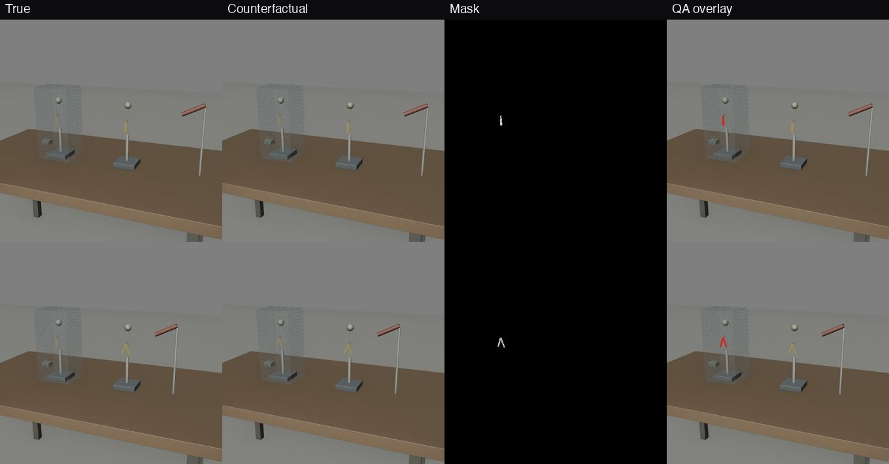

*Top row: the first frame that proves the violation. Bottom row: the last frame of the clip.Phenomenon id `grounded_faraday_cage_electroscope_shielding_failure`. *

### A claw that closes before it reaches the doll

The three jaws of an arcade claw drop over a plush doll. In the true clip they pause above it, close and lift it clear of the glass; in the counterfactual the grab cycle fires early, the jaws shut in the air, and the doll stays on the platform.

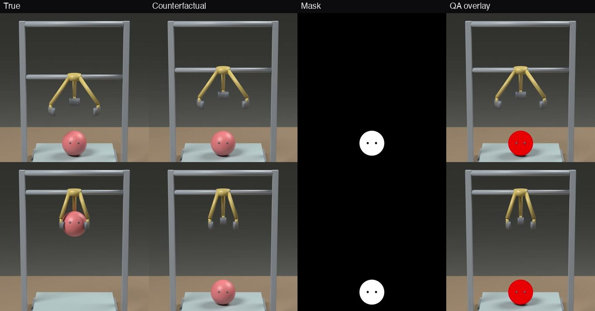

*Top row: the first frame that proves the violation. Bottom row: the last frame of the clip.Phenomenon id `claw_machine_doll_lift_failure`. 102/102 independent criteria pass. *

### A typewriter whose carriage never returns

The carriage of a typewriter reaches the right margin and the return lever is pushed. In the true clip the draw band pulls it back to the left margin and the paper steps up a line; in the counterfactual the linkage travels and moves nothing.

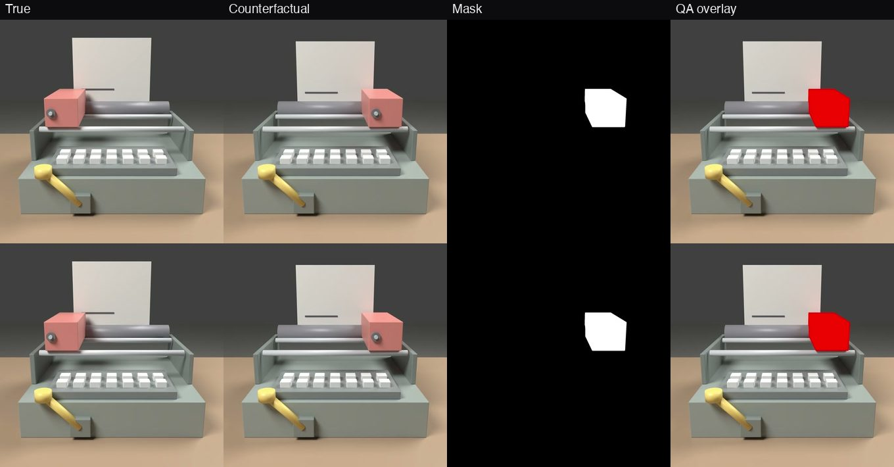

*Top row: the first frame that proves the violation. Bottom row: the last frame of the clip.Phenomenon id `typewriter_carriage_return_failure`. 102/102 independent criteria pass. *

### A nickel tab that stays magnetised past the Curie point

A nickel pendulum tab is heated past the Curie point of roughly 354 °C while it rests against a fixed magnet. In the true clip the attraction weakens until the tab separates and swings; in the counterfactual it wrongly keeps its strong ferromagnetic grip.

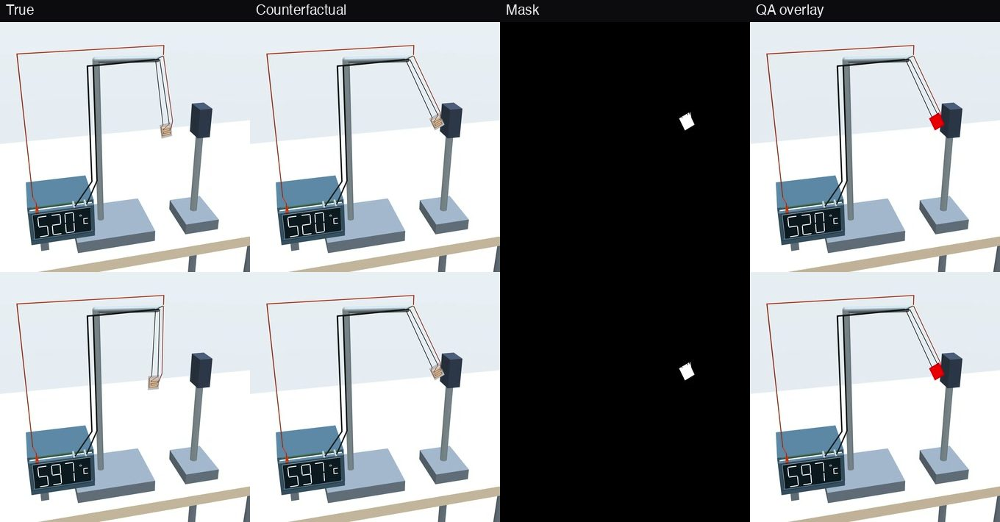

*Top row: the first frame that proves the violation. Bottom row: the last frame of the clip.Phenomenon id `curie_pendulum_high_temperature_attraction_persistence`. *

### A page block that shears backwards under the press

A motor-driven pad presses the outer edge of a clamped book. The page block shears away from the spine in the true clip; in the counterfactual the page block and the top cover shear back toward the spine, against the press.

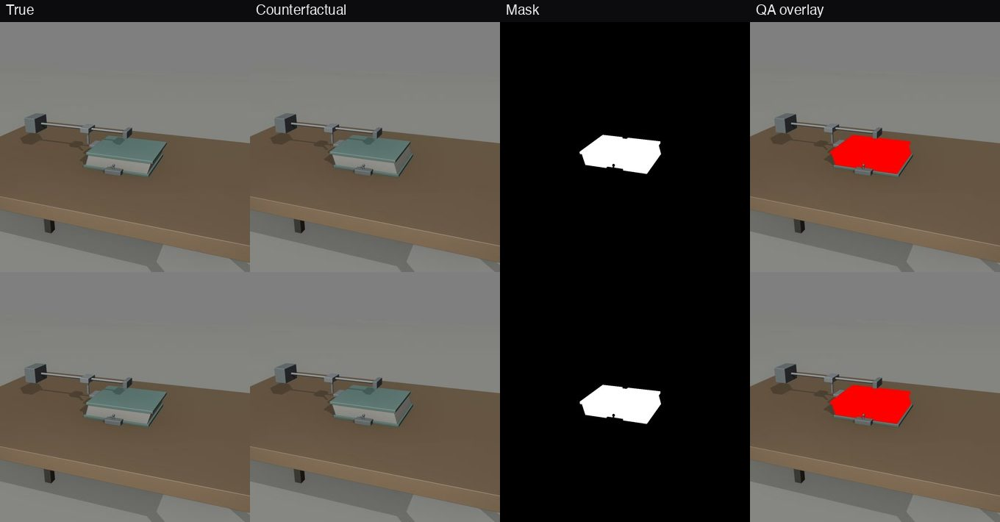

*Top row: the first frame that proves the violation. Bottom row: the last frame of the clip.Phenomenon id `book_page_shear_response_reversal`. *

### The upper string breaks first under a fast pull

A weight hangs from two equally strong strings. In the true clip the lower string reaches its breaking tension first and the weight stays suspended from the upper one; in the counterfactual the upper string breaks first and the weight falls with the lower string intact.

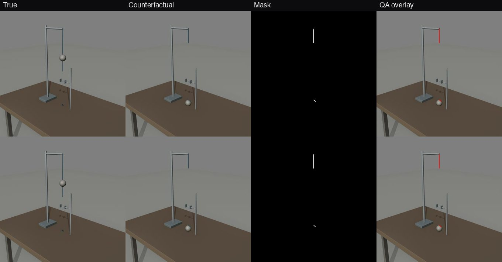

*Top row: the first frame that proves the violation. Bottom row: the last frame of the clip.Phenomenon id `quick_pull_two_string_upper_first_fracture`. *

### A newspaper's transient air resistance under a ruler

A ruler under a flat newspaper lifts its covered end only a few millimetres because the sealed air pocket resists. In the counterfactual that transient resistance is gone and the paper comes up clear of the table.

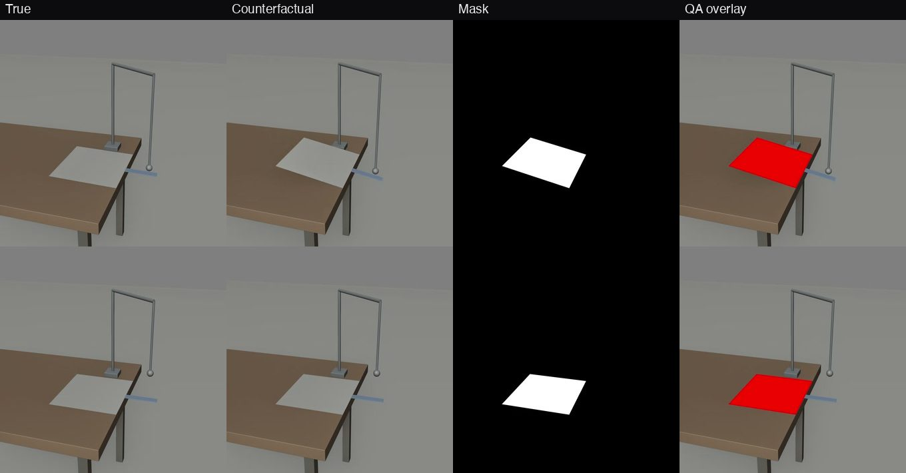

*Top row: the first frame that proves the violation. Bottom row: the last frame of the clip.Phenomenon id `newspaper_ruler_transient_pressure_resistance_failure`. 98/98 independent criteria pass. *

### A motor whose torque stays wrong after the supply is reversed

A cutaway brushed DC motor is reconnected with the opposite supply polarity. In the true clip the rotor decelerates through zero and reverses; in the counterfactual the torque acts the wrong way and the rotor keeps turning in its original direction.

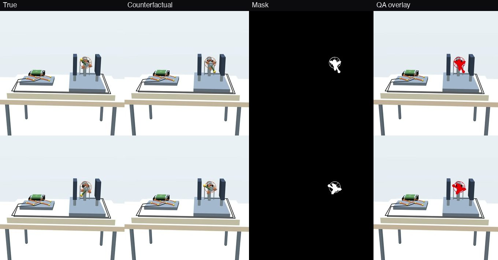

*Top row: the first frame that proves the violation. Bottom row: the last frame of the clip.Phenomenon id `counterfactual_reversed_supply_wrong_torque`. *

### A suction cup that leaks and never grips

Two manual vacuum cups sit on a glass plate under a lever. In the true clip they bite the glass and the return spring lifts the plate clear of the bench; in the counterfactual the rims leak, the cord never goes taut and the plate never leaves the bench.

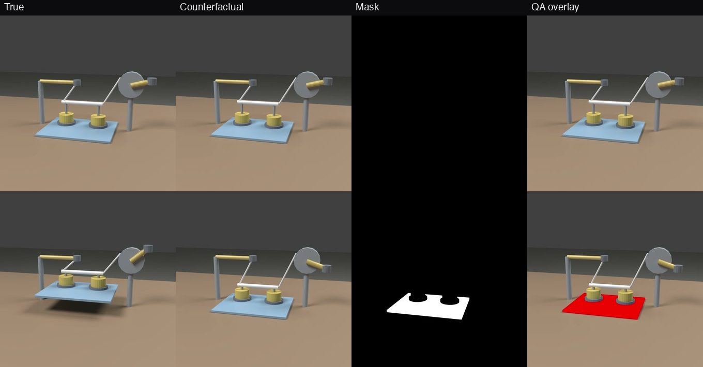

*Top row: the first frame that proves the violation. Bottom row: the last frame of the clip.Phenomenon id `suction_cup_glass_lift_failure`. 99/99 independent criteria pass. *

### A row of pendulums whose phase cascade runs backwards

A row of pendulums with steadily increasing string length is released at the same angle. The true clip falls out of step in one direction along the rail; in the counterfactual the bobs exchange their rates and the progression runs the other way.

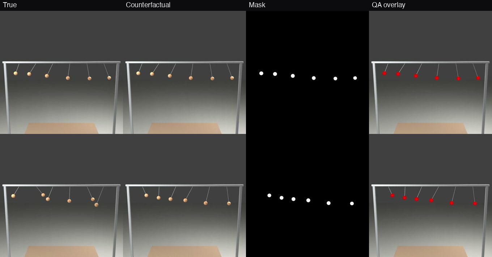

*Top row: the first frame that proves the violation. Bottom row: the last frame of the clip.Phenomenon id `pendulum_phase_cascade_direction_reversal`. 87/87 independent criteria pass. *

### A coin that is not deflected by the turning table

A coin is released on a steadily turning turntable. In the true clip the turning surface bends its path and it sweeps around the hub before resting on the rim; in the counterfactual it runs straight along the marked release radius.

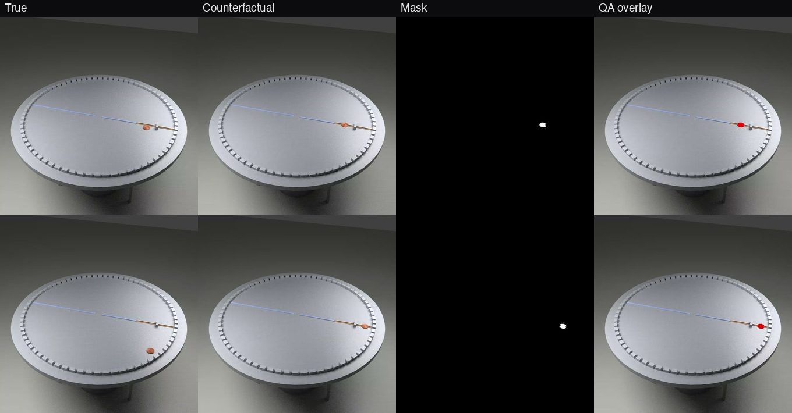

*Top row: the first frame that proves the violation. Bottom row: the last frame of the clip.Phenomenon id `turntable_coin_coriolis_deflection_reversal`. 85/85 independent criteria pass. *

### A pencil that topples to the other side

A pencil stands on its tip in a socket and is held by a slim arm while the platform turns. In the true clip it goes over downhill with its point still in the socket; in the counterfactual the platform turns the other way and the point ends up on the opposite side.

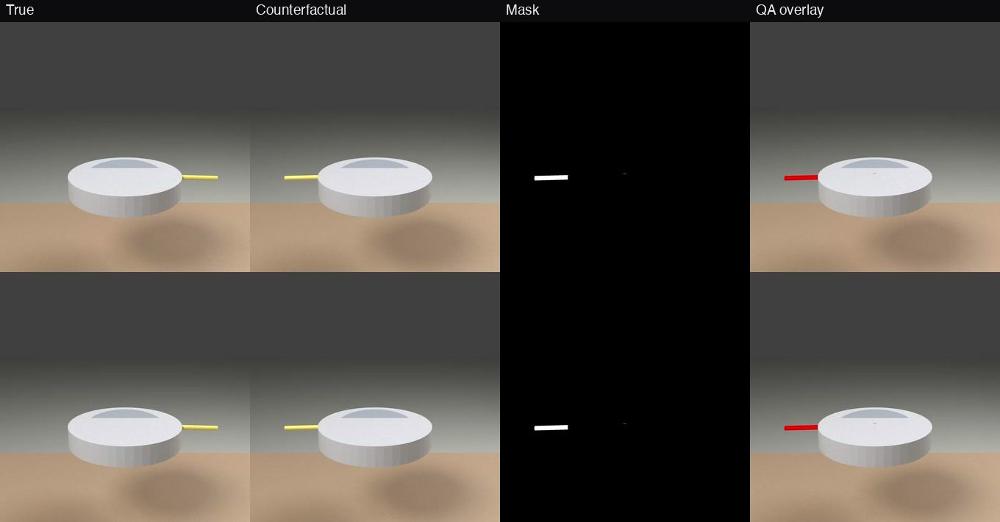

*Top row: the first frame that proves the violation. Bottom row: the last frame of the clip.Phenomenon id `pencil_tip_balance_topple_direction_reversal`. 85/85 independent criteria pass. *

### A mousetrap that never releases

A steel ball rests in a cradle beside a mousetrap held by a red latch. In the true clip the latch opens and the bar clips the ball out of its cradle; in the counterfactual nothing is released and the ball stays in the cradle.

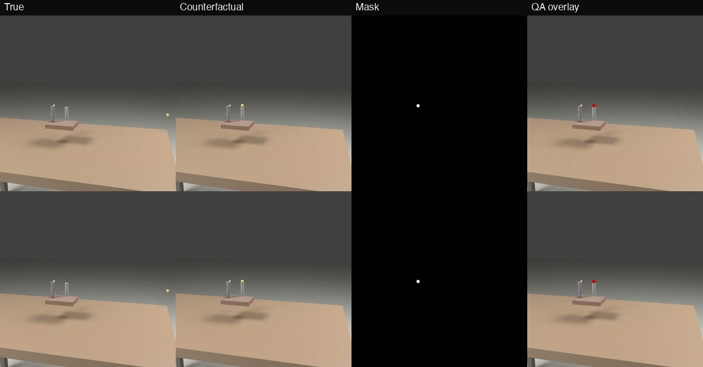

*Top row: the first frame that proves the violation. Bottom row: the last frame of the clip.Phenomenon id `mousetrap_snap_bar_launch_reversal`. 85/85 independent criteria pass. *

### A rubber band that never unwinds

A toy car carries a rubber band wound around its rear axle and held by a catch. In the true clip the catch lifts and the band unwinds to drive the car down the track; in the counterfactual the catch never lifts and the car stays parked.

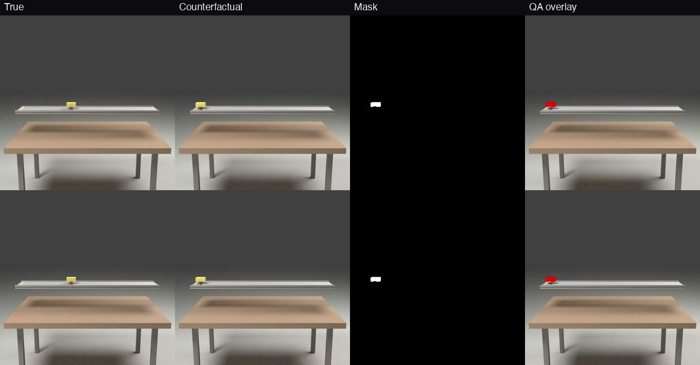

*Top row: the first frame that proves the violation. Bottom row: the last frame of the clip.Phenomenon id `rubber_band_stored_energy_car_drive_reversal`. 85/85 independent criteria pass. *

### A freewheel that turns the pedals instead

A rear wheel spins up on a roller stand while a dog clutch beside the sprocket is open. In the true clip the clutch engages the freewheel hub and the crank stays still while the wheel coasts; in the counterfactual it locks the sprocket to the wheel and the crank is back-driven.

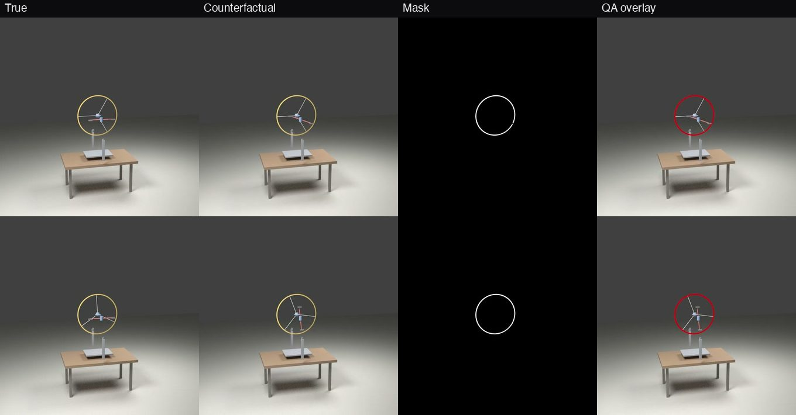

*Top row: the first frame that proves the violation. Bottom row: the last frame of the clip.Phenomenon id `bicycle_freewheel_coast_drag_reversal`. 85/85 independent criteria pass. *

### A diving board that bounces faster than it should

A diver bounces on a springy board whose knee brace is left free. In the true clip the brace gives way and the bounce is deep and slow; in the counterfactual the brace locks, the bounce turns quick and shallow, and the cycle shortens.

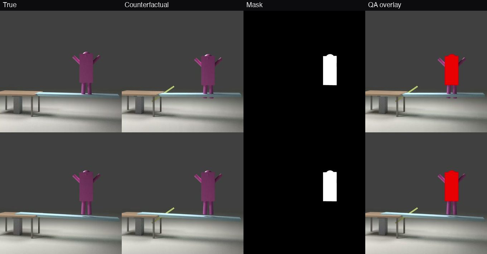

*Top row: the first frame that proves the violation. Bottom row: the last frame of the clip.Phenomenon id `diving_board_bounce_frequency_mass_reversal`. 85/85 independent criteria pass. *

### A shuttlecock that is not caught by the drag spike

A shuttlecock is struck low and flat. In the true clip the skirt bellies out, the shuttle meets the air broadside and is pulled up short; in the counterfactual it never meets the air broadside and sails the length of the court.

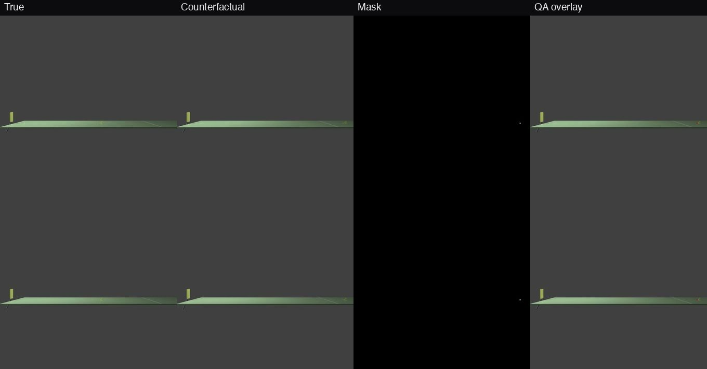

*Top row: the first frame that proves the violation. Bottom row: the last frame of the clip.Phenomenon id `badminton_shuttlecock_drag_spike_reversal`. 85/85 independent criteria pass. *

### A steel needle that sinks

A thin steel needle is laid flat on perfectly still water. In the true clip it floats where it was put for the whole clip; in the counterfactual nothing holds it up and it sinks straight through the surface to the bottom.

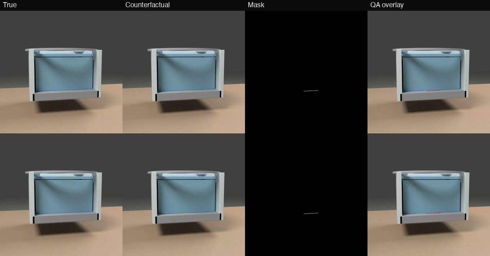

*Top row: the first frame that proves the violation. Bottom row: the last frame of the clip.Phenomenon id `needle_surface_tension_float_failure`. 85/85 independent criteria pass. *

### An air jet that can no longer hold the ball up

A nozzle blows a steady column of air straight up with a ping-pong ball in it. In the true clip the blower stays at full flow and the ball bobs inside the column; in the counterfactual the flow weakens and the ball drops into the tray.

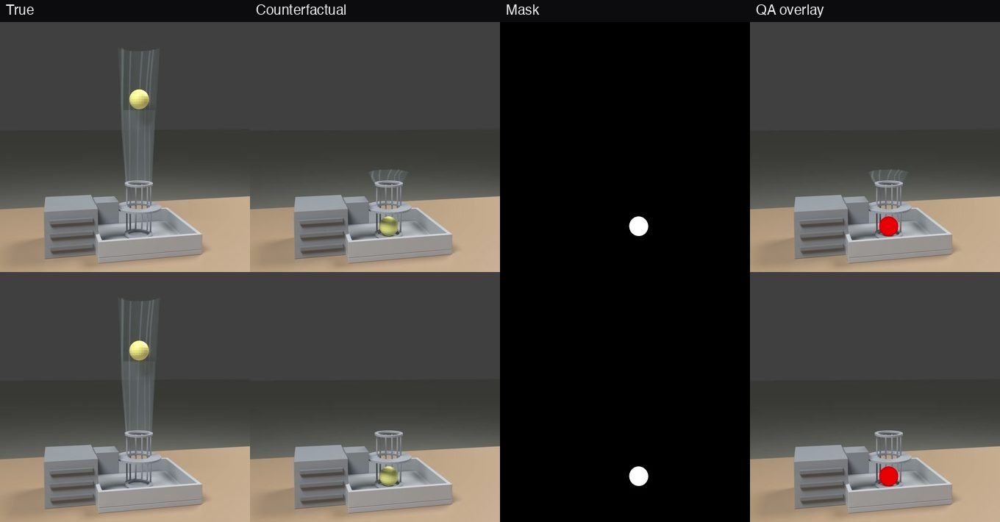

*Top row: the first frame that proves the violation. Bottom row: the last frame of the clip.Phenomenon id `air_jet_ping_pong_ball_lift_failure`. 102/102 independent criteria pass. *

### A string loop that slips on the ice

A loop of string is draped over a block of ice with a brass weight on its ends. In the true clip the string grips and lifts the block clear of the bench; in the counterfactual it slides down both faces and the block never lifts.

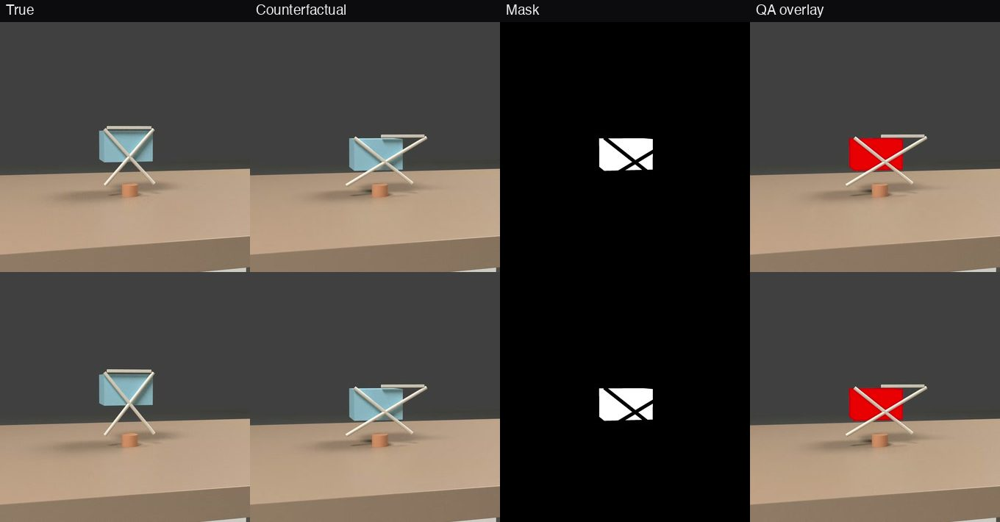

*Top row: the first frame that proves the violation. Bottom row: the last frame of the clip.Phenomenon id `ice_loop_regelation_string_lift_reversal`. 85/85 independent criteria pass. *

### A sand cone that refuses to slump

Dry sand is poured into a steep cone next to a marked straightedge that shows the angle. In the true clip the cone cannot hold that face and slumps to the shallow angle of repose; in the counterfactual it keeps its steep sides and height from first frame to last.

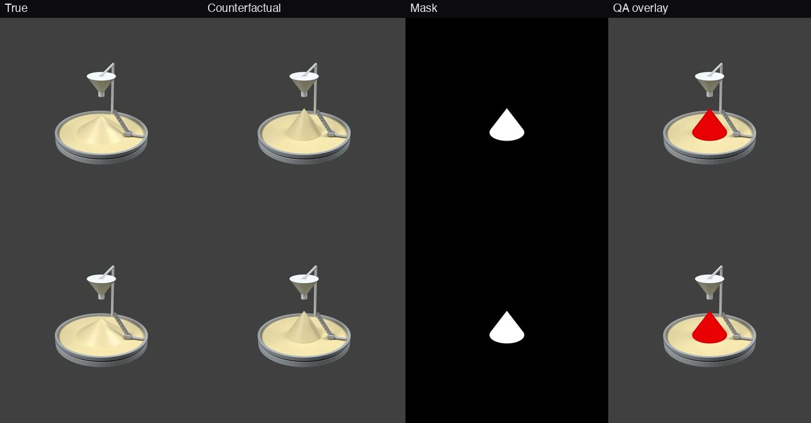

*Top row: the first frame that proves the violation. Bottom row: the last frame of the clip.Phenomenon id `sand_pile_angle_of_repose_slope_reversal`. 99/99 independent criteria pass. *

### A paper plane that unfolds by itself

A folded paper dart rests on a dark mat while two wing grips release. In the true clip it keeps its nose, body and wings; in the counterfactual the folded structure suddenly loosens in one burst and spreads into a flat sheet.

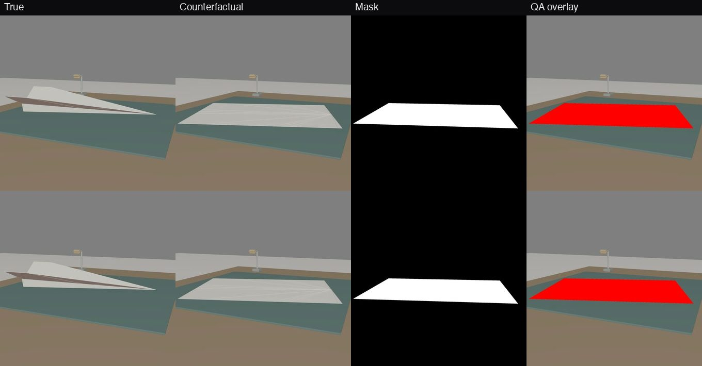

*Top row: the first frame that proves the violation. Bottom row: the last frame of the clip.Phenomenon id `paper_airplane_spontaneous_unfolding`. *

### A picture that settles crooked the other way

A framed picture hangs from a single hook and is not balanced on it. In the true clip its weight sits to the right and it rests with the right-hand corner lower; in the counterfactual it rests with the left-hand corner lower.

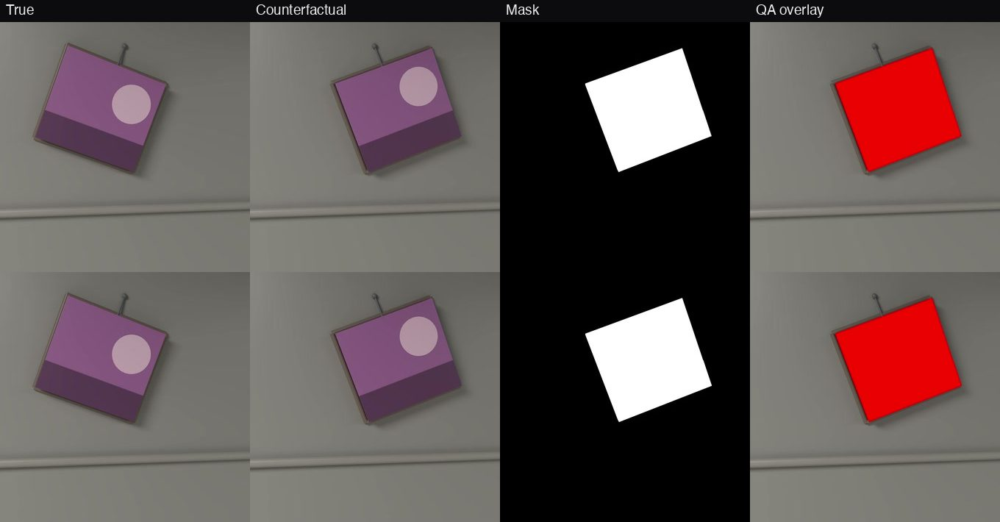

*Top row: the first frame that proves the violation. Bottom row: the last frame of the clip.Phenomenon id `hanging_picture_hook_tilt_reversal`. 99/99 independent criteria pass. *

### A banner the wind lifts up the pole

A stiff banner is laced to a tall pole. In the true clip a steady wind streams it away from the pole and down; in the counterfactual the wind lifts it on the other side so the free edge rises above the lacing and the banner points up the pole.

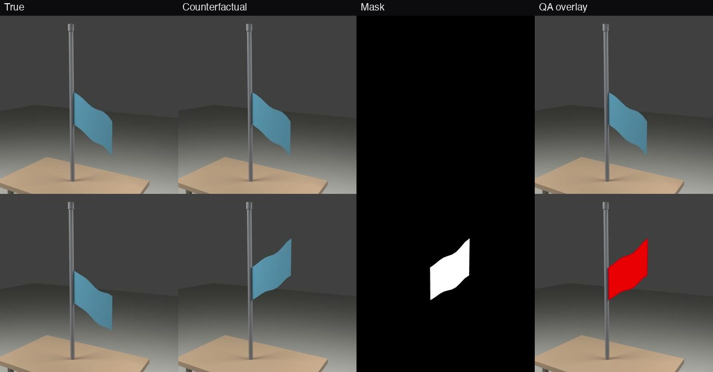

*Top row: the first frame that proves the violation. Bottom row: the last frame of the clip.Phenomenon id `wind_flag_deflection_reversal`. 99/99 independent criteria pass. *

### A charged balloon that loses its grip on the wall

A rubber balloon is held on a plaster wall by its static charge. In the true clip a draught only rocks it and it keeps its grip; in the counterfactual the dry air strips the charge, it lets go and falls the height of the wall.

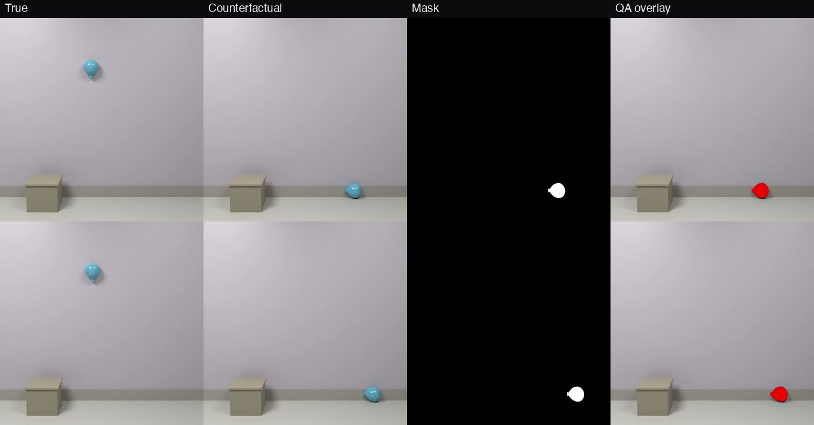

*Top row: the first frame that proves the violation. Bottom row: the last frame of the clip.Phenomenon id `static_balloon_wall_stick_failure`. 99/99 independent criteria pass. *

## 7. What this data is for

Counterfactual samples exist for judgement: the model watches a clip and has to name which law was broken and where.

Positive examples alone cannot do that. A model can train very well on millions of ordinary clips and still have never seen "an object passing through a wall". It does not know that what it is looking at is wrong, because nothing like it was in the distribution.

The counterfactual pair makes it learnable: the same picture with one law changed, so the difference the model can see is the law itself, and the mask says where that difference is.

That is also the judgement I ended up with: **the hard part of this kind of data is not rendering, it is review.** Get the physics wrong and the model learns wrong physics; get the shot wrong and the model learns a false visual cue — and both mistakes look perfectly convincing in the finished clip. The only defence that works is to turn every property into a criterion a machine can decide, and then spend the human attention on the things the criteria cannot see.

## About this post

Every picture here was rendered by generators I wrote; the scripts and the review material live inside the team's workspace. Each one is a real run, the mask is the formal binary label that was delivered, and the red overlay is only a quality-assurance view for humans — the training data is the mask itself. The playable pairs live on the [sample of work page](/sample-of-work/).
