训练一个"物理常识"模型，难的从来不是让它看懂一段视频，而是让它能说出"这里不对"，并且指得出错在哪。反事实数据就是为这件事设计的：同一段场景、同一个机位、同一条时间基，渲染两遍。

第一遍，物理是对的。第二遍，只改一条规律——球穿过墙、物体在半空冻结、弹跳越来越有劲、东西凭空消失。

两段视频在违规发生之前是逐像素相同的。也就是说，模型唯一能学到的差异就是被改掉的那条物理规律本身。

第二遍还多带一样东西：一个逐像素的掩膜，写明违规物体在画面里的位置，以及从哪一帧开始不对。再加一对提示词：同一段场景的两种说法，一种符合物理，一种不符合。

这一篇写的是这套数据的生产方法，以及我做的 32 个生成器，每个配一条真实样本。

### 先看三段

左边是真值，右边是反事实。三段都是正式交付的那一路，不是截图。

**钢针浮在水面 / 钢针沉到缸底**

%%VIDEO:/assets/research/counterfactual/pr753-needle-true.mp4|/assets/research/counterfactual/pr753-needle-counterfactual.mp4%%

真值里表面张力托住那根钢针，它一直浮着；反事实里没有东西托住它，针直接穿过水面沉到缸底。

**爪机夹起娃娃 / 空爪升起**

%%VIDEO:/assets/research/counterfactual/pr686-claw-true.mp4|/assets/research/counterfactual/pr686-claw-counterfactual.mp4%%

真值里爪在娃娃上方停住、合拢、把它夹离台面；反事实里抓取循环提前触发，爪在空中合拢，娃娃整段留在台面上。

**气球贴在墙上 / 气球掉到地上**

%%VIDEO:/assets/research/counterfactual/pr764-balloon-true.mp4|/assets/research/counterfactual/pr764-balloon-counterfactual.mp4%%

真值里过堂风只让气球晃两下，静电仍然吸着它；反事实里干风剥走了电荷，气球脱开、被吹着沉下去，最后落在地板上。

## 一、一个生成器只讲一个现象

一个生成器 = 一个场景 + 一条被破坏的规律。球在墙上反弹（场景）配穿墙（规律），就是"穿墙"这一个现象；自由落体配"冻结"，就是"冻结"。场景和规律是两个独立零件，可以换着配。

一个生成器对应一个操作符、一个掩膜定义、一套打分规则。目录名就是现象名，进去读 README 第一段就知道它在比什么。

这么设计有一个直接好处：**错误可以定位。** 一条样本不合格，问题一定落在某一个具体零件上，而不是"这个场景感觉不太对"。

## 二、匹配对照是构造出来的

"真值和反事实只差一条规律"这句话，如果只靠人工对齐，是做不到的——两条视频只要有一个像素的相机抖动不同，前缀就不再相同。

所以顺序是反过来的：

1. 先把真值轨迹算完，存下来。
2. 反事实在介入帧之前**直接复用真值的姿态**，介入之后才换算。
3. 两段视频都按全帧内编码，压缩后相同帧仍然相同。

这样得到的不只是"看起来一样"，而是解码之后逐像素相等。审核时的判据也很硬：介入之前每一帧必须完全相等，不接受任何容差比较。

## 三、掩膜是白送的，但也是最严的门

因为违规是我们自己注入的，我们本来就知道是哪个实体、从哪一帧开始违规。渲染器同时输出实体级分割，掩膜就是"违规实体的可见像素"和"违规时间窗"的交集。

好处是零人工标注，而且不会带上影子、背景和无关物体。

坏处是它同时变成了一道非常严的门。掩膜只要多了一圈像素，就说明渲染器里的实体范围和声明的不一致；如果掩膜少了，说明分割和几何对不上。所以审核里加了一道几何核对：把渲染相机真正用的内外参拿来，把目标几何重新投影到像素平面，再和解码出来的正式掩膜逐项比对。

只看球形的交叉核对会误判非球形目标，相机块和渲染实际用的相机不一致时更是完全查不出来——这两件事都只有"按渲染器真正用的相机投影"才能抓住。

## 四、六道硬门

每个样本在发布前要过一整套判据，现在每个样本是 85 到 104 条，全过才算数。挑几条代表性的：

- **输出契约**：2048×2048，24 fps，120 帧，5.000 秒，H.264。
- **匹配对照**：介入前逐帧解码后完全相等。
- **掩膜只圈违规目标**：介入帧之前全黑，之后每帧非空，叠加只把掩膜像素换成纯红；被圈的必须是声明的那个目标。
- **时间基**：物理步长 × 每帧步数 ÷ 帧率必须等于声明值，证据帧必须是算出来的、且在介入帧之后。
- **提示词与轨迹一致**：从存储的轨迹重算现象往哪边走，再要求两条提示词各自带着自己的方向标记、而且互不携带对方的标记。这个项目里两条提示词写了同一个方向，就是这条抓住的。
- **曝光与颜色**：整帧过曝不超过 2%，掩膜目标的交付像素中位色饱和度至少 40，通道顺序和声明的作者色一致。
- **单一错误**：只能有一个操作符，两条提示词必须不同，掩膜点名的目标必须就是声明的目标。

还有一条是后来才加的噪点门。8 采样、不开降噪的渲染，在大平面上会飘电视雪花，所有硬门都会过，只有这条和肉眼能发现。查下来发现噪声的来源不是采样，是渲染器的 8 bit 输出抖动：它给每个像素加半级抖动，平整面上剩下的全部邻域差就是这半级。正确做法是改渲染设置，把抖动强度置 0，而不是为了让门过去放宽阈值——那样会让别的 case 的真噪点蒙混过关。

## 五、画面本身也要过关

物理对了，画面照样可能是废的。这一段写的都是审核里真实打回过的例子。

**器材要有支撑。** 旧版的导轨杆伸出机身外、悬在半空，回车杆正对镜头被压成一个点——观众根本看不出它是操纵杆。这两件事都能在渲染前用纯几何判定出来：检查每个杆件的端点是否落在某个实体的包围盒内，再按相机投影算出它占画面的比例，低于 6% 判为不可读。

**支撑不能只查杆。** 返工版里两根立柱只在机身顶边压住一小条，底面 84% 悬空，但上面那条检查完全没报——因为它只查杆件端点，看不见 box 类零件的底面悬空。于是补了一条：取底面网格，算有多少比例真的被同高度的其他实体托住，低于 60% 报悬空。

**量具要画得像量具。** 提示词说用直尺比坡角，画面里却是一根斜靠在锥体上的黄杆——长度和角度都对，但读者读不出它是工具。工具必须带着能认出它的那个特征：直尺是带刻度的扁片，量角器有表盘。

**过程要看得见。** 提示词里写了倒、靠、抬起、释放、退回，交付画面里砂从第一帧起就是堆好的锥体，直尺从头到尾没动过，漏斗悬在锥体上方。门全过——门不看支撑，也不看提示词写的过程是否在画面里。

**时间基之外还有时钟。** 审核页面早期版本里四路视频互相打断：每个都在自己的 play 事件上暂停其它三个，又在每次 timeupdate 时重新定位。结果播放按钮什么都没开始，面板看起来像拒绝播放。下一版改成一路当主时钟，但主时钟会被最后一个发出 play 的面板抢走——四路文件大小差了三个数量级，30 KB 的掩膜流成了时钟，几兆的 RGB 面板被拖着倒退。最后的版本把时钟先钉死：主时钟只选一次不再变，四路同一瞬间启动，跑偏的从主时钟拉回来。

**画面里的东西得看起来对。** 一个气球贴在墙上、过堂风吹过——气球真的会因为静电被吹掉吗？气球从墙上掉下来的那一版，风把气球吹得比真实更歪；还有一版气球变成了挂在杆上而不是贴在墙上。这类"看起来不对但门过得去"的问题，只能靠人眼看。

## 六、样本馆

下面 32 条，每条一个生成器、一条真实样本。每个样本四栏：真值、反事实、正式二值掩膜、红色 QA 叠加层。上排是第一帧能证明违例的画面，下排是片段最后一帧。同样这 32 个生成器也在[作品样本页](/sample-of-work/)，那里真值与反事实两条片子并排播放。

### 羽毛的空气阻力被去掉

银铁球和白羽毛从同一高度同时释放。真值里空气阻力让羽毛慢慢飘落，铁球先落地；反事实里羽毛的空气阻力在介入帧被去掉，它掉得和铁球一样快，几帧之内先后落地。

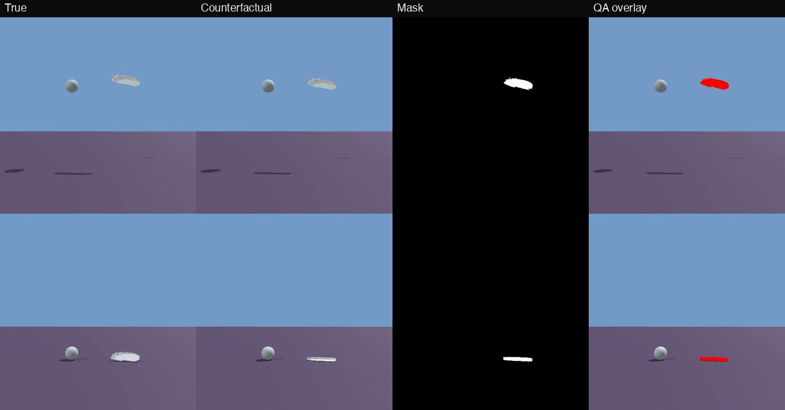

*上排：第一帧能证明违例的画面；下排：片段最后一帧。现象标识 `free_fall_feather_iron_air_drag`。*

### 真空舱里铁球拿到异常大的重力加速度

透明真空舱里铁球和羽毛从同一高度同时释放。真值里几乎没有空气阻力，两者直直落下、几乎同时落地。反事实里铁球得到异常大的重力加速度，抢先落地，羽毛还在上面。

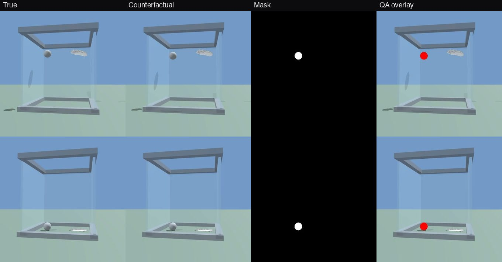

*上排：第一帧能证明违例的画面；下排：片段最后一帧。现象标识 `free_fall_feather_iron_near_vacuum`。*

### 插扣扣合之后横向拉不动

尼龙腰带两半先沿插合轴推进，钩鼻让弹簧臂缩回、再卡到肩台后面扣合；真值里随后横向一拉，两半保持扣住、高度不变。反事实里锁止没有生效，横向一拉两半就错开脱开。

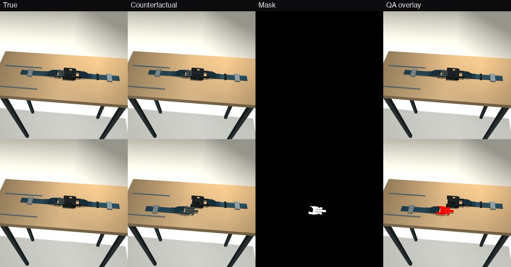

*上排：第一帧能证明违例的画面；下排：片段最后一帧。现象标识 `backpack_side_release_buckle_locked_extraction`。*

### 毛巾盖到球上，接触的隆起消失

厚毛巾落到实心球上。真值里布面在球顶撑出一个明显的隆起，四角垂到桌面。反事实里毛巾直接穿过球，铺在球下面，接触该产生的隆起没有了。

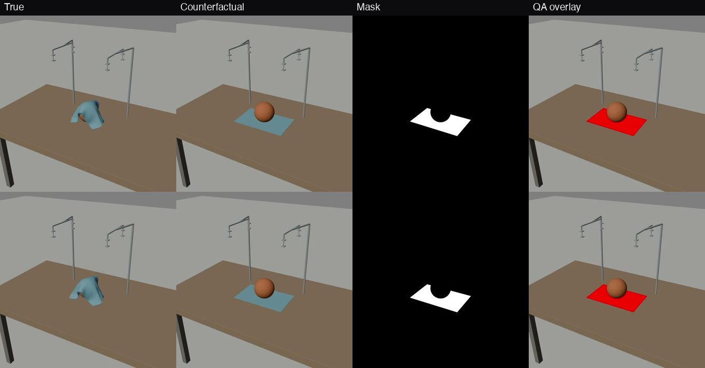

*上排：第一帧能证明违例的画面；下排：片段最后一帧。现象标识 `towel_sphere_contact_bump_suppression`。*

### 薄壁铝罐在轴向压力下长出皱褶

薄壁铝罐夹在两块压板之间受持续的轴向压力。真值里载荷低于临界屈曲，罐壁基本不变形、松开后恢复原状。反事实里同样的载荷让罐壁长出吉村型的菱形皱褶，而罐仍然是完整的。

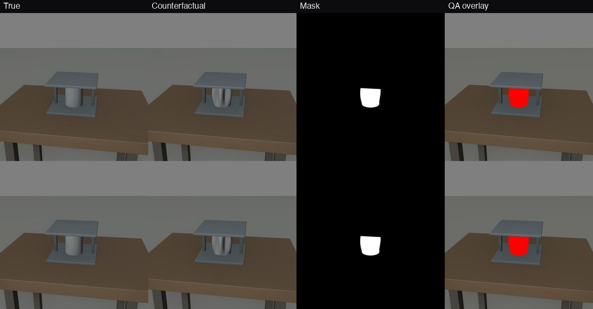

*上排：第一帧能证明违例的画面；下排：片段最后一帧。现象标识 `thin_wall_aluminum_can_axial_buckling`。*

### 棉布条突然失去轴向刚度

机架缓慢拉一条低伸长织棉布并保持住。真值里只有轻微伸长。反事实里棉条突然失去大部分轴向刚度，显著拉长，下夹具跟着下降更多，中部随伸长而收窄。

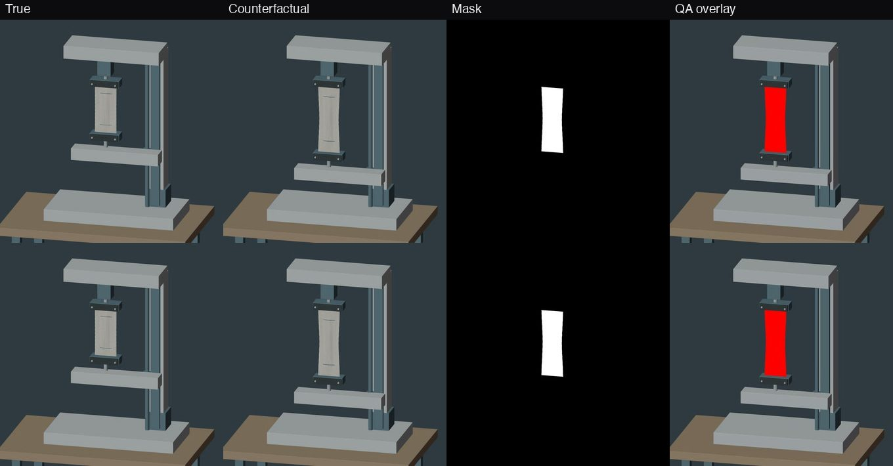

*上排：第一帧能证明违例的画面；下排：片段最后一帧。现象标识 `cotton_strip_axial_compliance_failure`。*

### 手风琴折纸桥失去抗弯刚度

同样纸做的平板和手风琴折纸桥各架在两组支座上，放上同样重的小砝码。真值里平板塌下去，折纸桥几乎不弯。反事实里折纸桥突然失去折叠带来的抗弯刚度，塌到和平板一样深——没有展开、没有撕裂、支座也没动。

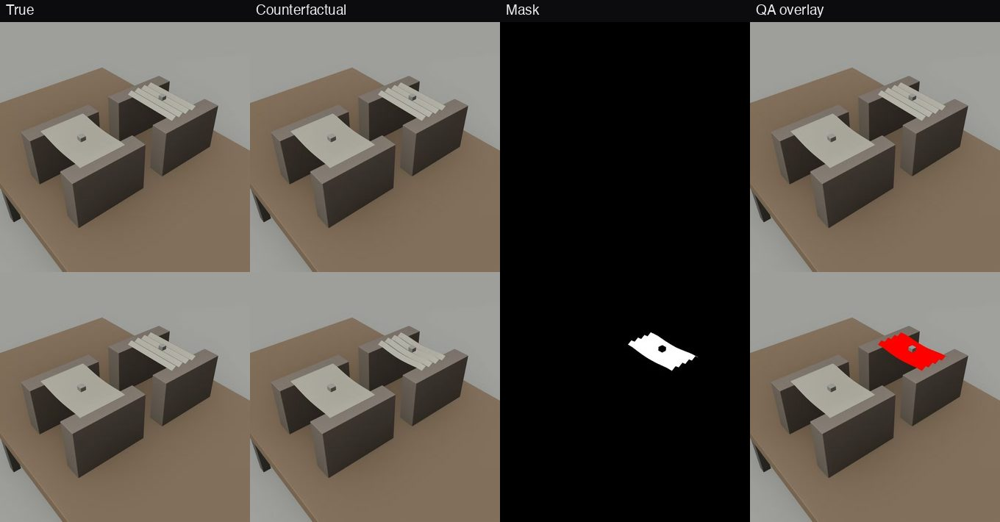

*上排：第一帧能证明违例的画面；下排：片段最后一帧。现象标识 `accordion_paper_bridge_section_rigidity_failure`。*

### 接地铁网笼里的验电器不该被带电棒影响

带电棒靠近两只叶验电器：一只在接地的细金属网笼里，一只在外面。真值里笼外那副叶片张开，笼内那副保持闭合；反事实里屏蔽失效，笼内的叶片也跟着张开。

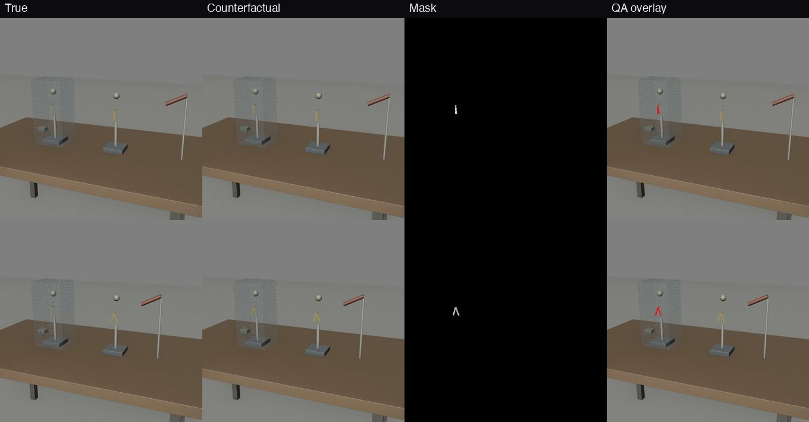

*上排：第一帧能证明违例的画面；下排：片段最后一帧。现象标识 `grounded_faraday_cage_electroscope_shielding_failure`。*

### 夹娃娃的爪在够到之前就合拢

爪机的三爪下降罩住布娃娃。真值里爪在娃娃上方停住，三个带垫的爪合拢并把娃娃夹离玻璃台面。反事实里抓取循环提前触发，爪在空中合拢、从未碰到娃娃，空爪升起，娃娃整段留在台面上。

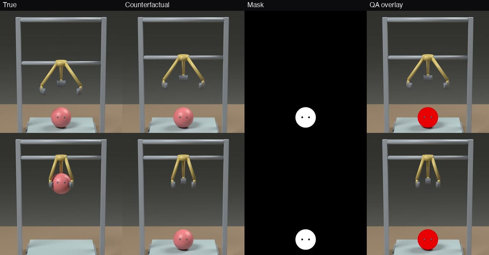

*上排：第一帧能证明违例的画面；下排：片段最后一帧。现象标识 `claw_machine_doll_lift_failure`。独立判据 102/102 通过。 *

### 打字机回车之后不回行

打字机的字车随输入向右爬，到右边距停下，回车杆被按下。真值里拉带把字车拉回左边距，擒纵机构把纸升一行，落在新的书写位置。反事实里连杆空转，字车不回、纸不升，两样都停在原地。

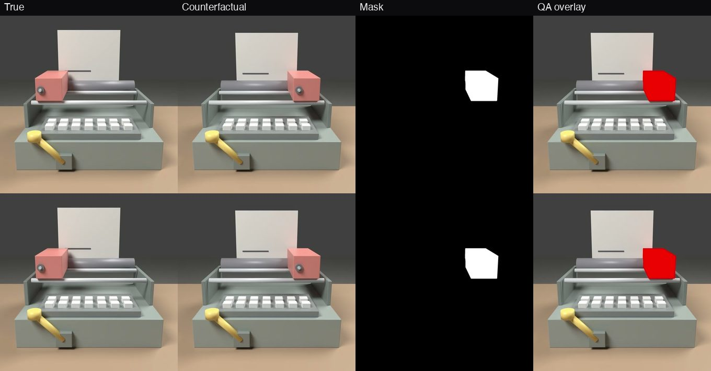

*上排：第一帧能证明违例的画面；下排：片段最后一帧。现象标识 `typewriter_carriage_return_failure`。独立判据 102/102 通过。 *

### 镍摆片过了居里点仍然吸住磁铁

一片镍摆片贴在固定磁铁上，正面的电阻加热器把它加热到超过约 354 °C 的居里点，旁边有高温计读数。真值里磁性变弱，摆片脱开磁铁、在重力下摆动。反事实里高温下错误地保持强铁磁性，摆片仍然贴在磁铁上。

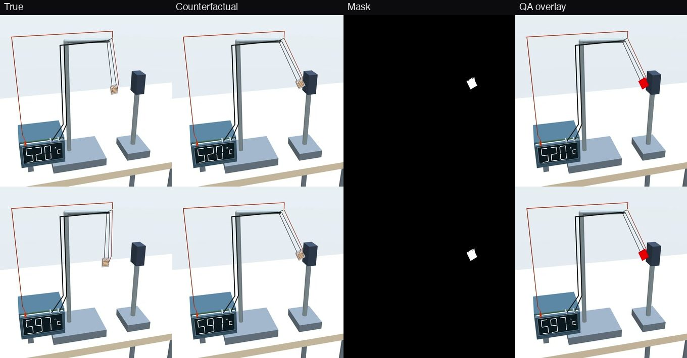

*上排：第一帧能证明违例的画面；下排：片段最后一帧。现象标识 `counterfactual_high_temperature_ferromagnetic_retention`。*

### 书页受压却朝书脊方向错动

一本书平放在台上，背封被两个夹爪压平，电机压垫压住封面外缘。真值里书页朝远离书脊的方向错动。反事实里书页与封面朝书脊方向错动，和压的方向正好相反，而底封和夹爪保持完整。

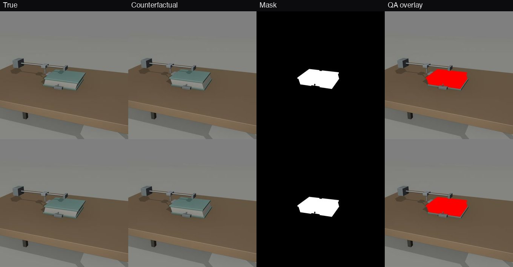

*上排：第一帧能证明违例的画面；下排：片段最后一帧。现象标识 `book_page_shear_response_reversal`。*

### 快速下拉时先断的是上面那根绳

一个重物用两根强度相同的绳吊住，上面一根、下面一根。真值里快速下拉，先到极限的是下面那根：它先断，安全扣释放，重物仍然吊在上面那根绳上。反事实里只有下绳达到极限，却先断的是上绳，重物带着完好的下绳一起掉下去。

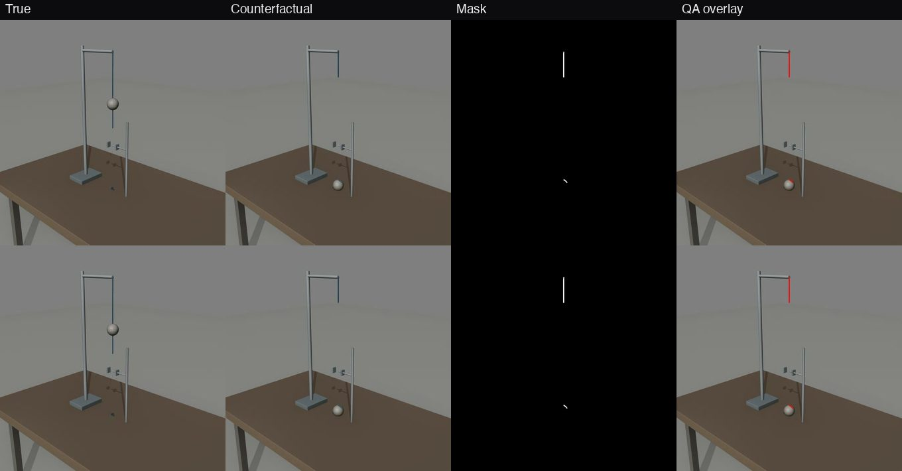

*上排：第一帧能证明违例的画面；下排：片段最后一帧。现象标识 `quick_pull_two_string_upper_first_fracture`。*

### 报纸压尺的瞬态气阻失效

直尺压在平摊的报纸下面，一端伸出桌沿，对露出的一端做一次短促下压。真值里报纸下面那层被封住的空气给出短暂的压差阻力，抬起的一端只起来几毫米就被压回去。反事实里这层瞬态阻力消失，报纸明显抬起、离开桌面。

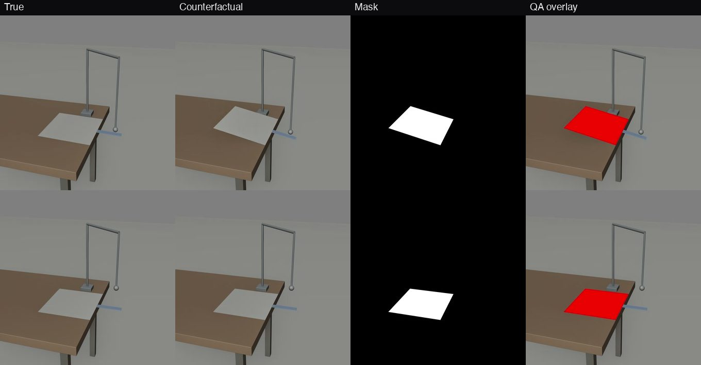

*上排：第一帧能证明违例的画面；下排：片段最后一帧。现象标识 `newspaper_ruler_transient_pressure_resistance_failure`。独立判据 98/98 通过。 *

### 电源反接之后转矩方向还是错的

剖视的永磁有刷直流电机由电池供电，一个看得见的双极开关断开触点再以相反极性接回，定子磁铁不动。真值里转子减速穿过零速然后反向转，不会在零速停住。反事实里反接之后电磁转矩方向仍然错，转子继续按原来的方向转。

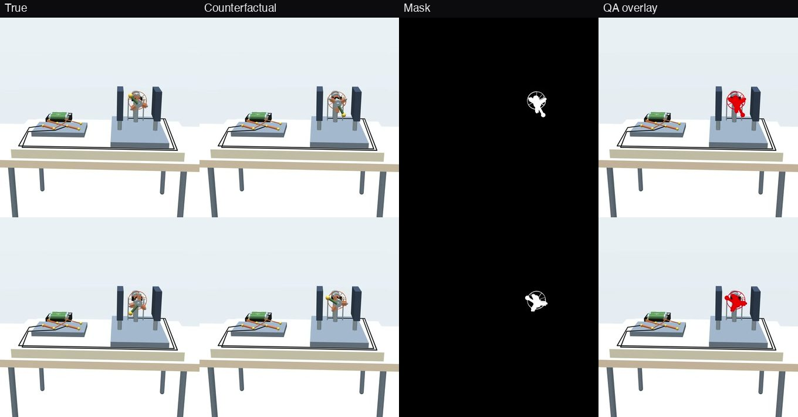

*上排：第一帧能证明违例的画面；下排：片段最后一帧。现象标识 `counterfactual_reversed_supply_wrong_torque`。*

### 吸盘漏气，玻璃板抬不起来

两个手动吸盘扣在玻璃板顶面靠近一边的位置，用杠杆连到吸盘柱塞。真值里按下杠杆，杯腔扩大、压力下降，两个吸盘咬住玻璃，松手后回弹弹簧收绳把板吊离台面。反事实里杯口漏气、建立不起低压，绳始终不绷紧，玻璃板一直躺在台面上。

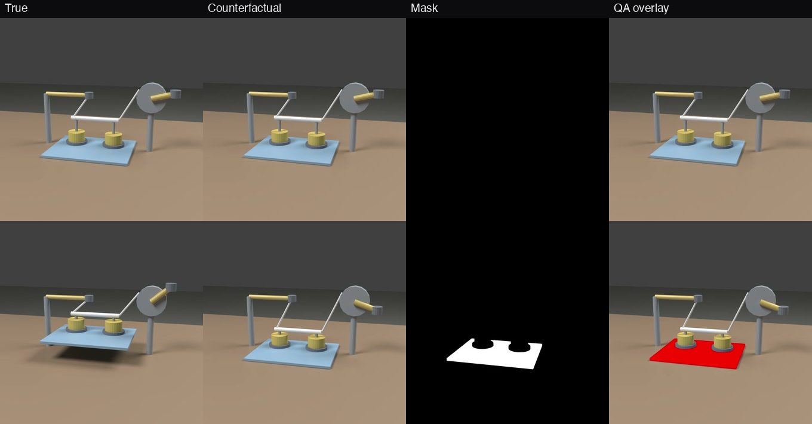

*上排：第一帧能证明违例的画面；下排：片段最后一帧。现象标识 `suction_cup_glass_lift_failure`。独立判据 99/99 通过。 *

### 一排单摆的相位级联方向反转

横杆上挂着一排单摆，绳长从一端到另一端逐个变长，同时从同一角度释放。真值里短绳摆得快、长绳摆得慢，整排错步沿着杆按一个方向推进。反事实里各摆交换了自己的摆率，级联方向整体倒过来。

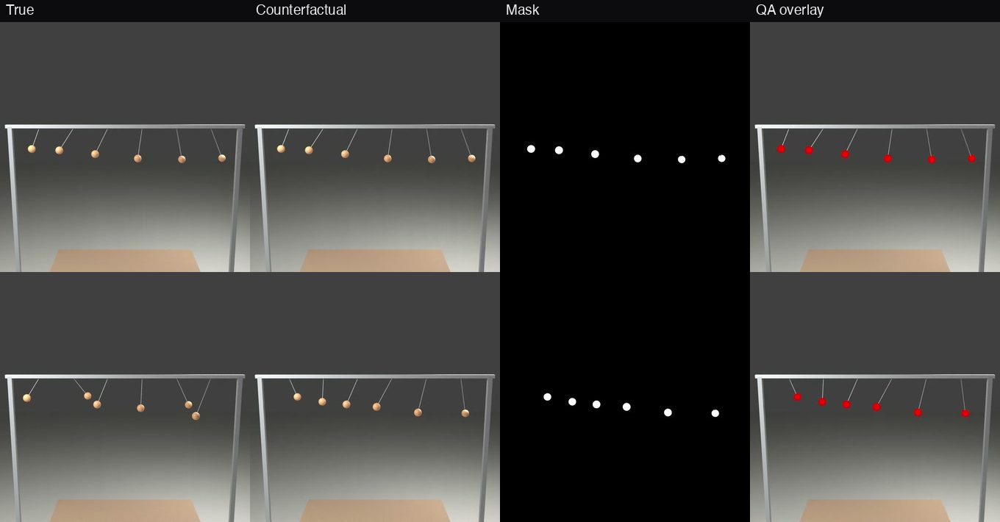

*上排：第一帧能证明违例的画面；下排：片段最后一帧。现象标识 `pendulum_phase_cascade_direction_reversal`。独立判据 87/87 通过。 *

### 转盘上的硬币不再被科里奥利偏转

硬币靠在一个可收回的小柱上，转盘已经匀速转动；柱退开，硬币朝边缘的矮环滑出。真值里转动的台面把硬币的路径拉弯，绕着轴扫向一边停在边缘。反事实里台面完全不弯折路径，硬币沿释放半径走一条直线。

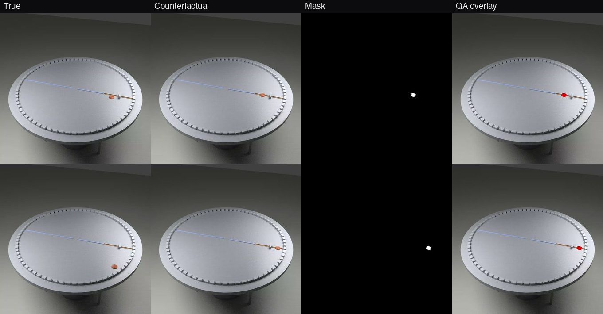

*上排：第一帧能证明违例的画面；下排：片段最后一帧。现象标识 `turntable_coin_coriolis_deflection_reversal`。独立判据 85/85 通过。 *

### 铅笔笔尖倒向相反的一侧

铅笔以削尖的一端站在圆台中央的小窝里，靠一根细支撑臂扶着，台面上画着黄色的下坡箭头。真值里台面转向箭头落下的一侧，铅笔顺着它倒下去，笔尖仍留在窝里。反事实里台面朝另一侧转，笔尖倒向相反的方向。

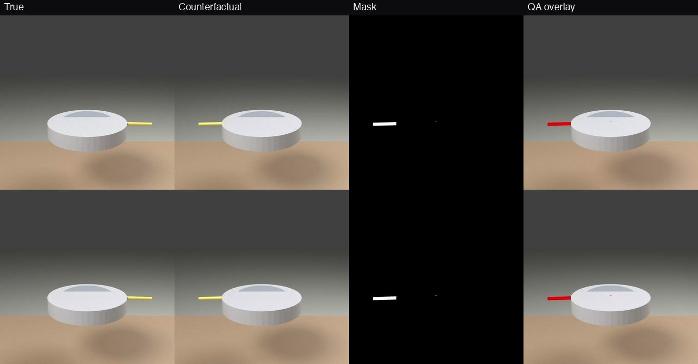

*上排：第一帧能证明违例的画面；下排：片段最后一帧。现象标识 `pencil_tip_balance_topple_direction_reversal`。独立判据 85/85 通过。 *

### 扣杆没有释放，钢球没有被打出去

钢球搁在柱子上的小托架里，旁边是扣杆被红色闩挡住的捕鼠夹。真值里闩打开，扣杆在扭簧作用下扫下，把球从托架里打出去，落点离夹子有一段距离。反事实里闩没有打开，扣杆不动、弹簧不释放，球一直待在托架上。

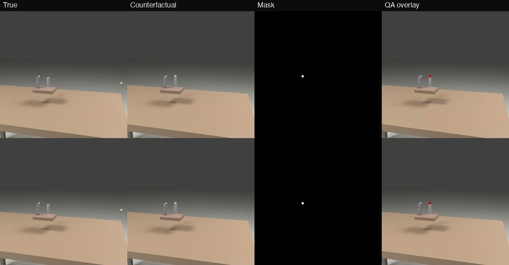

*上排：第一帧能证明违例的画面；下排：片段最后一帧。现象标识 `mousetrap_snap_bar_launch_reversal`。独立判据 85/85 通过。 *

### 橡皮筋没有解开，车没有动

小玩具车的后轴上缠着几圈红色橡皮筋，用红色扣子卡住轴。真值里扣子抬起，橡皮筋解缠到轴上、驱动后轮，车被推着沿轨道走，橡皮筋放完后靠惯性滑行一段停下。反事实里扣子不抬，橡皮筋保持缠紧，车停在起点。

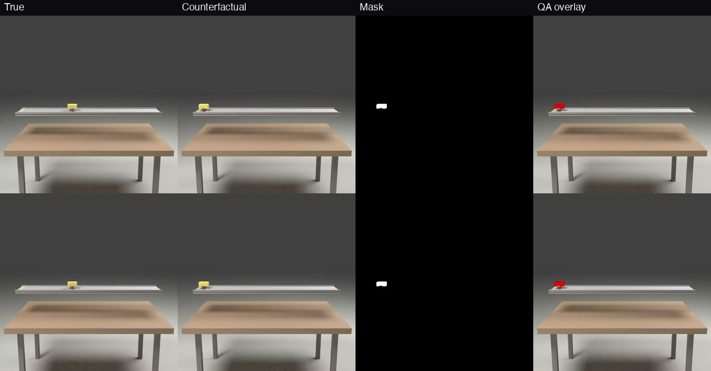

*上排：第一帧能证明违例的画面；下排：片段最后一帧。现象标识 `rubber_band_stored_energy_car_drive_reversal`。独立判据 85/85 通过。 *

### 滑行的后轮反过来带动脚踏

自行车后轮在滚筒架上加速，链条松着，牙盘旁边有一个可接通的狗牙离合器。真值里离合器接的是花鼓上的棘轮，滑行时棘轮空转，曲柄和脚踏几乎不动。反事实里离合器把牙盘直接锁在轮上，滑行的轮子反过来驱动曲柄，踏板自己转起来。

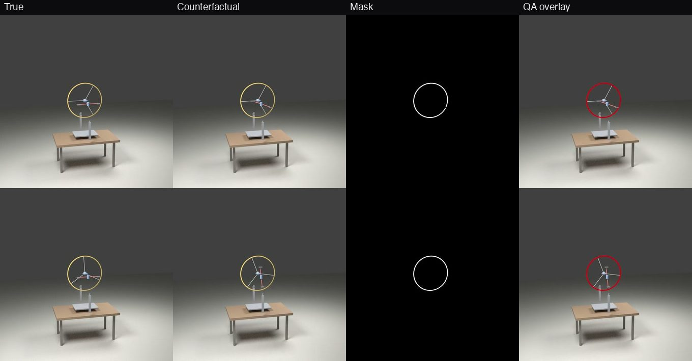

*上排：第一帧能证明违例的画面；下排：片段最后一帧。现象标识 `bicycle_freewheel_coast_drag_reversal`。独立判据 85/85 通过。 *

### 起跳板的回弹周期变短了

运动员站在支点上的弹性跳板末端，板下有一个没锁死的黄色膝托。真值里膝托让开，运动员的重量压在板上，回弹又深又慢，一个周期明显超过一秒。反事实里膝托锁死、重量被架高，回弹变浅变快，周期明显变短。

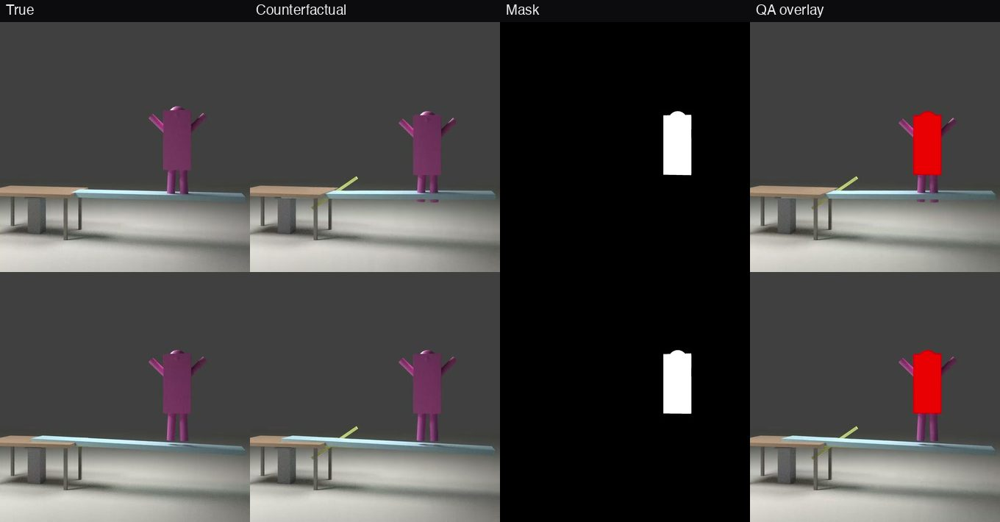

*上排：第一帧能证明违例的画面；下排：片段最后一帧。现象标识 `diving_board_bounce_frequency_mass_reversal`。独立判据 85/85 通过。 *

### 羽毛球不再被阻力尖峰拽住

羽毛球被低平击出，橡木头领先一小段后羽裙张开，正面迎风。真值里空气阻力出现尖峰，把球拽住：球只爬升一点就落回场内，离球拍只有几米。反事实里羽裙不张开，球一路飞穿球场，落在远端。

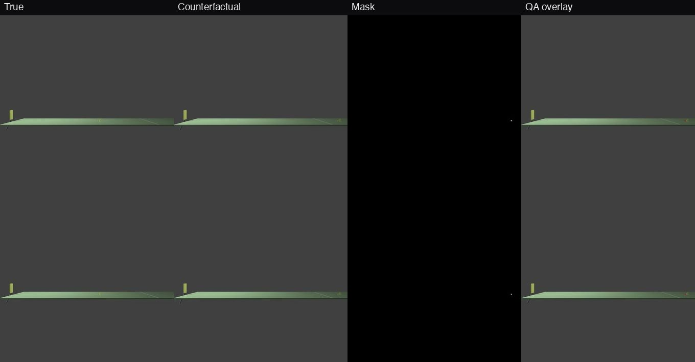

*上排：第一帧能证明违例的画面；下排：片段最后一帧。现象标识 `badminton_shuttlecock_drag_spike_reversal`。独立判据 85/85 通过。 *

### 钢针沉进水里

一根细钢针平放在玻璃缸里完全静止的水面上，离缸壁半厘米。真值里水面始终平静，针一直浮在原处，只在水面投下一点阴影。反事实里没有表面张力托住它，针直接穿过水面，慢慢下沉，最后躺在缸底。

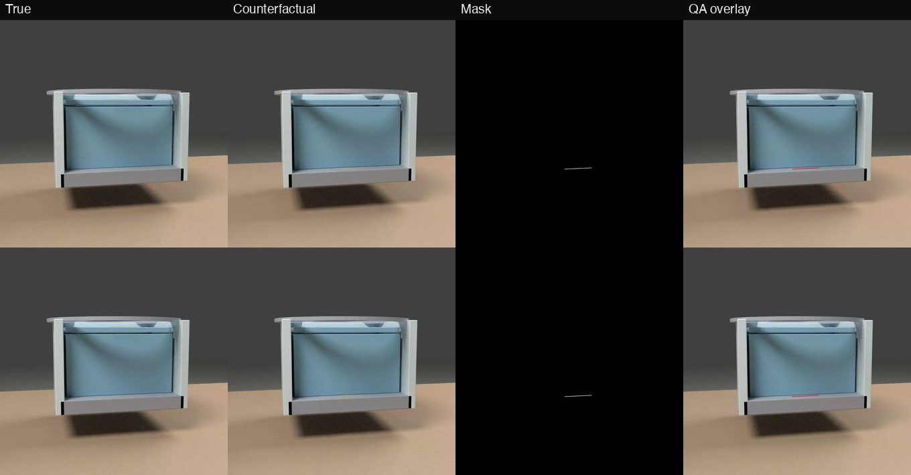

*上排：第一帧能证明违例的画面；下排：片段最后一帧。现象标识 `needle_surface_tension_float_failure`。独立判据 85/85 通过。 *

### 气流托不住乒乓球

工作台上的喷嘴向上吹一道稳定气流柱，乒乓球停在气流里。真值里风机维持全速，气柱一直托得住球，球在柱里上下晃动、整段不落地。反事实里气流衰减到托不住，球脱出气流，掉进下面的接球盘。

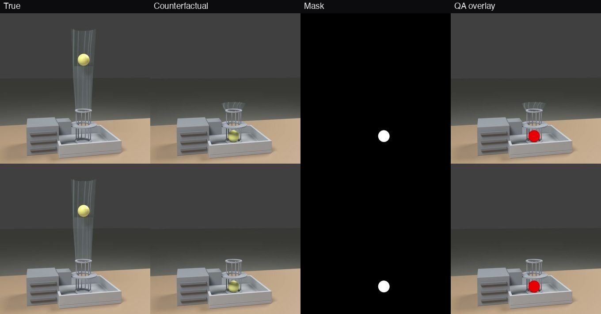

*上排：第一帧能证明违例的画面；下排：片段最后一帧。现象标识 `air_jet_ping_pong_ball_lift_failure`。独立判据 102/102 通过。 *

### 棉线环在冰块上打滑

棉线环搭在工作台上的冰块上，两个垂下的线头挂着铜配重。真值里配重把线压紧在冰块上，线咬住冰面，冰块被干净地提离台面。反事实里完全没有摩擦，线顺着冰块两面滑到底并从远端脱开，冰块始终没动。

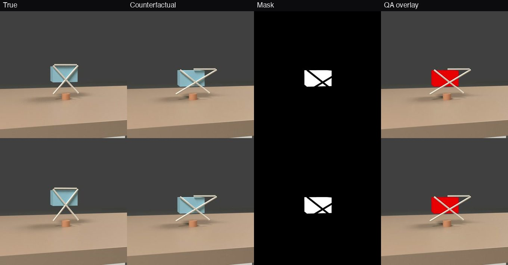

*上排：第一帧能证明违例的画面；下排：片段最后一帧。现象标识 `ice_loop_regelation_string_lift_reversal`。独立判据 85/85 通过。 *

### 砂堆不再坍塌

干砂经漏斗堆到浅托盘上，堆成一个明显超过砂子休止角的陡锥；旁边立着一把带刻度的直尺和水平基准杆，量出锥面的角度。真值里锥体站不住，自己塌下去，锥顶下降、底部摊开，最后停在浅角度上。反事实里锥体从第一帧到最后一帧一直保持原来的陡面。

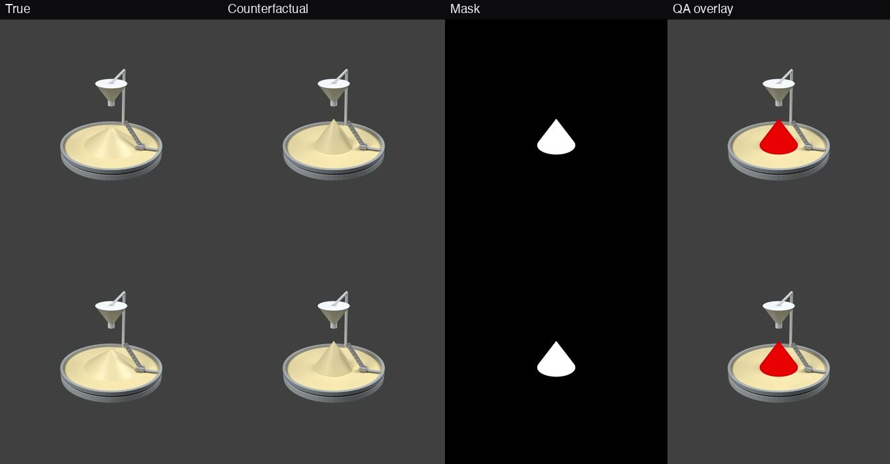

*上排：第一帧能证明违例的画面；下排：片段最后一帧。现象标识 `sand_pile_angle_of_repose_slope_reversal`。独立判据 99/99 通过。 *

### 纸飞机自己摊开了

折好的纸飞机放在深色桌垫上，两个小夹翼爪松开并退开。真值里飞机保持机头、机身和两翼，整段不变。反事实里没有任何操作，折叠结构突然一下松开，摊成桌垫上的一张纸。

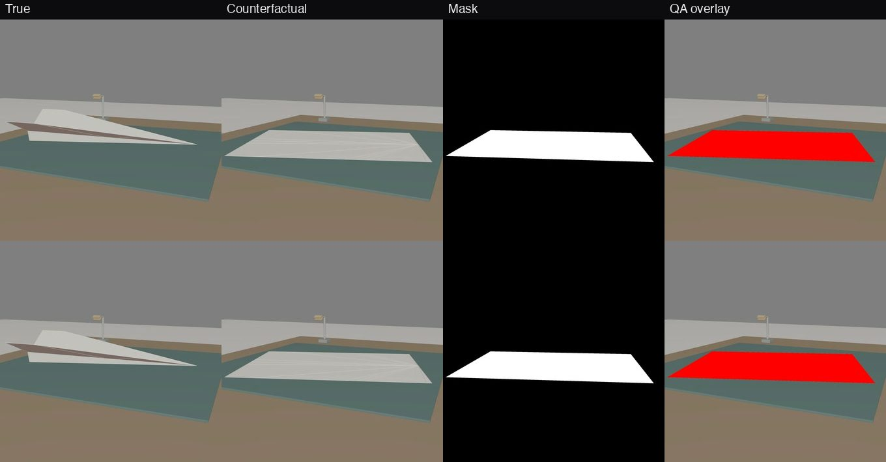

*上排：第一帧能证明违例的画面；下排：片段最后一帧。现象标识 `paper_airplane_spontaneous_unfolding`。*

### 挂画向相反的一侧歪过去

一幅带画的框用短铁丝挂在墙上的一个钩子下面。真值里画的重心在钩子右边，放开时它绕钩子转过去，右下角明显更低。反事实里重心在另一边，最后变成左下角更低。

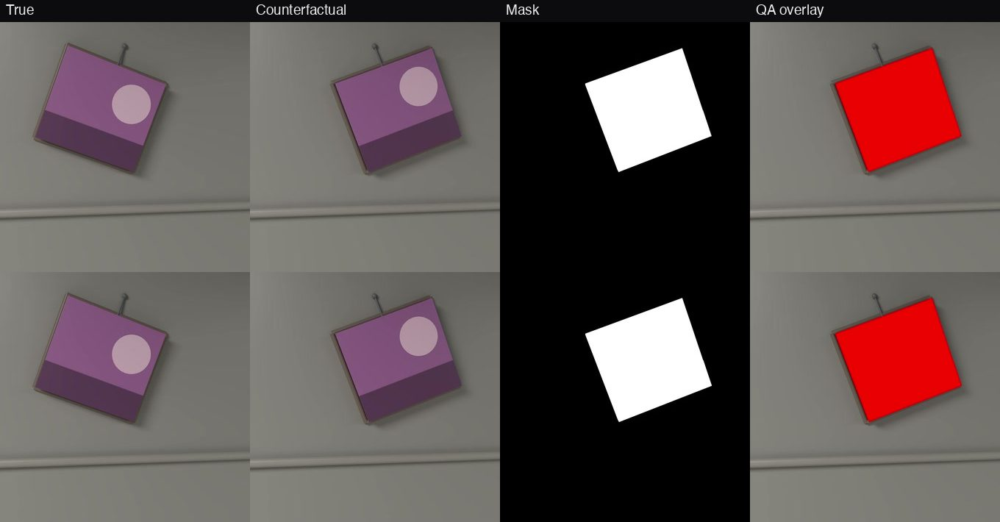

*上排：第一帧能证明违例的画面；下排：片段最后一帧。现象标识 `hanging_picture_hook_tilt_reversal`。独立判据 99/99 通过。 *

### 风把旗子吹上了杆

一面硬质长方形旗面绑在高杆上，旁边是工作台。真值里稳风把旗面顺风拉向地面，斜挂着，一道浅波纹从杆传向自由边。反事实里风从另一侧掀起旗面，自由边抬到系点之上，旗子指向杆顶，杆本身不动。

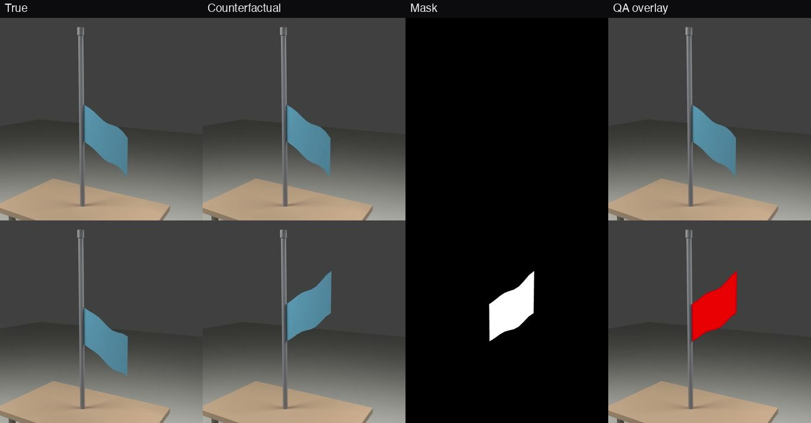

*上排：第一帧能证明违例的画面；下排：片段最后一帧。现象标识 `wind_flag_deflection_reversal`。独立判据 99/99 通过。 *

### 带电气球从墙上掉下来了

一只橡胶气球靠静电贴在墙面上，贴着漆的那面被压平。真值里过堂风扫过时气球只是歪一点、在接触斑上晃两下，仍然挂在墙上。反事实里干风剥走橡胶上的电荷，气球先倾倒、再脱开，被风横向带着沉下去，最后落在地板上。

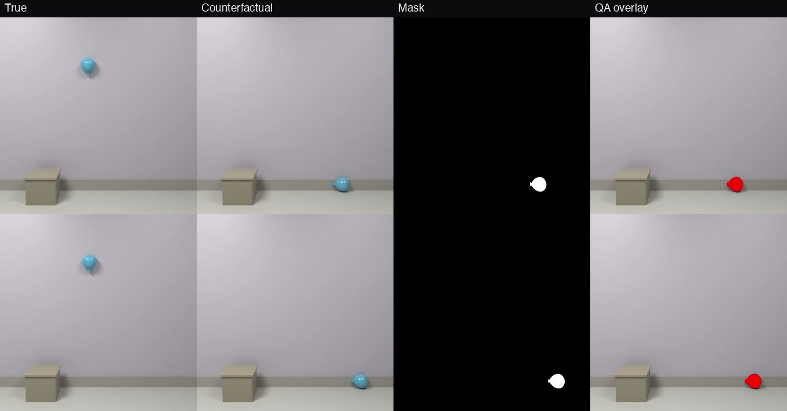

*上排：第一帧能证明违例的画面；下排：片段最后一帧。现象标识 `static_balloon_wall_stick_failure`。独立判据 99/99 通过。 *

## 七、这批数据想解决什么

反事实样本是给"判断"用的：模型看一段视频，要能指出这里违反了哪条规律，并且给出位置。

光有正例做不到这件事。一个模型可以在几百万条正常视频上训练得很好，却从没见过"物体穿过墙"；它不会知道自己看到的东西不对，因为训练分布里根本没有这种东西。

反事实对把这件事变成可学的：同一段画面，只改一条规律，模型看到的差异就是规律本身，掩膜告诉它差异在哪里。

这也是我最后留下的判断：**这类数据的难点不在渲染，在审核。** 物理写错了，模型学到的是错的物理；画面拍错了，模型学到的是错误的视觉证据；而这两件事在成片里都长得"挺像那么回事"。唯一有效的防线是把每一件事都变成一条能自动判定的判据，然后让人去看那些判据看不到的地方。

## 关于这篇

这些画面都由我自己写的生成器渲出来，脚本和评审材料在团队的内部空间里。图里的每一条都是真实跑出来的样本，掩膜是正式交付的那份二值标签，红色叠加层只是给人看的质检视图——正式训练用的是掩膜本身。可播放的真值与反事实成对样本在[作品样本页](/sample-of-work/)。
