训练一个"物理常识"模型，难的从来不是让它看懂一段视频，而是让它能说出"这里不对"，并且指得出错在哪。反事实数据就是为这件事设计的：同一段场景、同一个机位、同一条时间基，渲染两遍。

第一遍，物理是对的。第二遍，只改一条规律——球穿过墙、物体在半空冻结、弹跳越来越有劲、东西凭空消失。

两段视频在违规发生之前是逐像素相同的。也就是说，模型唯一能学到的差异就是被改掉的那条物理规律本身。

第二遍还多带一样东西：一个逐像素的掩膜，写明违规物体在画面里的位置，以及从哪一帧开始不对。再加一对提示词：同一段场景的两种说法，一种符合物理，一种不符合。

这一篇写的是这套数据的生产方法，以及我做的 40 个生成器，每个配一条真实样本。

### 一条样本，四路

每个样本交付四路：真值、反事实、正式二值掩膜，以及标出生成器改动区域的 QA 叠加层。下面按交付顺序排成一行，取的是每个生成器当前审过的那一版。

**插扣扣合之后横向拉不动**

%%PANELS:/assets/generator-samples/pr680-buckle-true.mp4|/assets/generator-samples/pr680-buckle-counterfactual.mp4|/assets/generator-samples/pr680-buckle-mask.mp4|/assets/generator-samples/pr680-buckle-overlay.mp4%%

尼龙腰带两半先扣合。真值里随后横向一拉，两半保持扣住；反事实里锁止没有生效，同样的拉力就把两半错开脱开。

## 一、一个生成器只讲一个现象

一个生成器 = 一个场景 + 一条被破坏的规律。球在墙上反弹（场景）配穿墙（规律），就是"穿墙"这一个现象；自由落体配"冻结"，就是"冻结"。场景和规律是两个独立零件，可以换着配。

一个生成器对应一个操作符、一个掩膜定义、一套打分规则。目录名就是现象名，进去读 README 第一段就知道它在比什么。

这么设计有一个直接好处：**错误可以定位。** 一条样本不合格，问题一定落在某一个具体零件上，而不是"这个场景感觉不太对"。

## 二、匹配对照是构造出来的

"真值和反事实只差一条规律"这句话，如果只靠人工对齐，是做不到的——两条视频只要有一个像素的相机抖动不同，前缀就不再相同。

所以顺序是反过来的：

1. 先把真值轨迹算完，存下来。
2. 反事实在介入帧之前**直接复用真值的姿态**，介入之后才换算。
3. 两段视频都按全帧内编码，压缩后相同帧仍然相同。

这样得到的不只是"看起来一样"，而是解码之后逐像素相等。审核时的判据也很硬：介入之前每一帧必须完全相等，不接受任何容差比较。

## 三、掩膜是白送的，但也是最严的门

因为违规是我们自己注入的，我们本来就知道是哪个实体、从哪一帧开始违规。渲染器同时输出实体级分割，掩膜就是"违规实体的可见像素"和"违规时间窗"的交集。

好处是零人工标注，而且不会带上影子、背景和无关物体。

坏处是它同时变成了一道非常严的门。掩膜只要多了一圈像素，就说明渲染器里的实体范围和声明的不一致；如果掩膜少了，说明分割和几何对不上。所以审核里加了一道几何核对：把渲染相机真正用的内外参拿来，把目标几何重新投影到像素平面，再和解码出来的正式掩膜逐项比对。

只看球形的交叉核对会误判非球形目标，相机块和渲染实际用的相机不一致时更是完全查不出来——这两件事都只有"按渲染器真正用的相机投影"才能抓住。

## 四、六道硬门

每个样本在发布前要过一整套判据，现在每个样本是 85 到 104 条，全过才算数。挑几条代表性的：

- **输出契约**：2048×2048，24 fps，120 帧，5.000 秒，H.264。
- **匹配对照**：介入前逐帧解码后完全相等。
- **掩膜只圈违规目标**：介入帧之前全黑，之后每帧非空，叠加只把掩膜像素换成纯红；被圈的必须是声明的那个目标。
- **时间基**：物理步长 × 每帧步数 ÷ 帧率必须等于声明值，证据帧必须是算出来的、且在介入帧之后。
- **提示词与轨迹一致**：从存储的轨迹重算现象往哪边走，再要求两条提示词各自带着自己的方向标记、而且互不携带对方的标记。这个项目里两条提示词写了同一个方向，就是这条抓住的。
- **曝光与颜色**：整帧过曝不超过 2%，掩膜目标的交付像素中位色饱和度至少 40，通道顺序和声明的作者色一致。
- **单一错误**：只能有一个操作符，两条提示词必须不同，掩膜点名的目标必须就是声明的目标。

还有一条是后来才加的噪点门。8 采样、不开降噪的渲染，在大平面上会飘电视雪花，所有硬门都会过，只有这条和肉眼能发现。查下来发现噪声的来源不是采样，是渲染器的 8 bit 输出抖动：它给每个像素加半级抖动，平整面上剩下的全部邻域差就是这半级。正确做法是改渲染设置，把抖动强度置 0，而不是为了让门过去放宽阈值——那样会让别的 case 的真噪点蒙混过关。

## 五、画面本身也要过关

物理对了，画面照样可能是废的。这一段写的都是审核里真实打回过的例子。

**器材要有支撑。** 旧版的导轨杆伸出机身外、悬在半空，回车杆正对镜头被压成一个点——观众根本看不出它是操纵杆。这两件事都能在渲染前用纯几何判定出来：检查每个杆件的端点是否落在某个实体的包围盒内，再按相机投影算出它占画面的比例，低于 6% 判为不可读。

**支撑不能只查杆。** 返工版里两根立柱只在机身顶边压住一小条，底面 84% 悬空，但上面那条检查完全没报——因为它只查杆件端点，看不见 box 类零件的底面悬空。于是补了一条：取底面网格，算有多少比例真的被同高度的其他实体托住，低于 60% 报悬空。

**量具要画得像量具。** 提示词说用直尺比坡角，画面里却是一根斜靠在锥体上的黄杆——长度和角度都对，但读者读不出它是工具。工具必须带着能认出它的那个特征：直尺是带刻度的扁片，量角器有表盘。

**过程要看得见。** 提示词里写了倒、靠、抬起、释放、退回，交付画面里砂从第一帧起就是堆好的锥体，直尺从头到尾没动过，漏斗悬在锥体上方。门全过——门不看支撑，也不看提示词写的过程是否在画面里。

**时间基之外还有时钟。** 审核页面早期版本里四路视频互相打断：每个都在自己的 play 事件上暂停其它三个，又在每次 timeupdate 时重新定位。结果播放按钮什么都没开始，面板看起来像拒绝播放。下一版改成一路当主时钟，但主时钟会被最后一个发出 play 的面板抢走——四路文件大小差了三个数量级，30 KB 的掩膜流成了时钟，几兆的 RGB 面板被拖着倒退。最后的版本把时钟先钉死：主时钟只选一次不再变，四路同一瞬间启动，跑偏的从主时钟拉回来。

**画面里的东西得看起来对。** 一个气球贴在墙上、过堂风吹过——气球真的会因为静电被吹掉吗？气球从墙上掉下来的那一版，风把气球吹得比真实更歪；还有一版气球变成了挂在杆上而不是贴在墙上。这类"看起来不对但门过得去"的问题，只能靠人眼看。

## 六、样本馆

下面 40 条，每条一个生成器、一条真实样本。每个样本四栏：真值、反事实、正式二值掩膜、红色 QA 叠加层。上排是第一帧能证明违例的画面，下排是片段最后一帧。同样这 40 个生成器也在[作品样本页](/sample-of-work/)；交付了完整四路的生成器，在那一页也是四路并排播放。

### 羽毛的空气阻力被去掉

银铁球和白羽毛从同一高度同时释放。真值里空气阻力让羽毛慢慢飘落，铁球先落地；反事实里羽毛的空气阻力在介入帧被去掉，它掉得和铁球一样快，几帧之内先后落地。

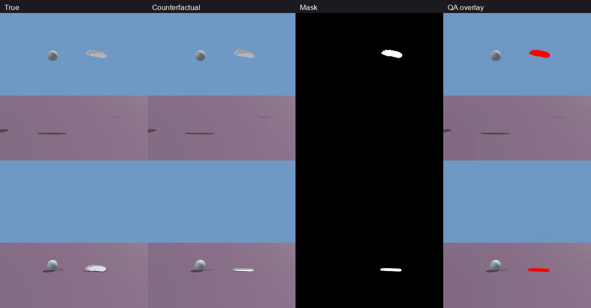

*上排：第一帧能证明违例的画面；下排：片段最后一帧。现象标识 `free_fall_feather_iron_air_drag`。*

### 真空舱里铁球拿到异常大的重力加速度

透明真空舱里铁球和羽毛从同一高度同时释放。真值里几乎没有空气阻力，两者直直落下、几乎同时落地。反事实里铁球得到异常大的重力加速度，抢先落地，羽毛还在上面。

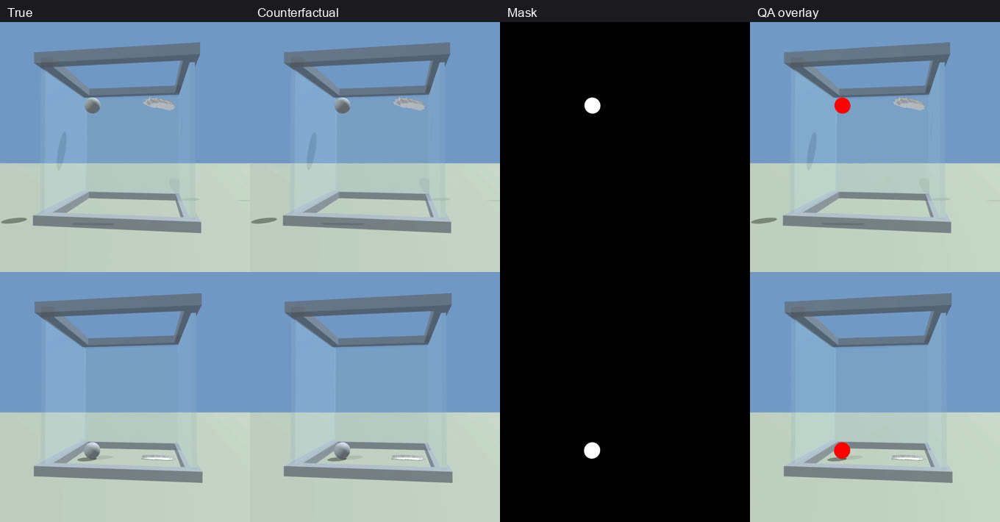

*上排：第一帧能证明违例的画面；下排：片段最后一帧。现象标识 `free_fall_feather_iron_near_vacuum`。*

### 互感电流在断电后仍然留着

两只线圈套在同一根铁芯上，其中一只接在交流电源上。真值里断电之后感应电流很快衰减掉；反事实里互感的贡献被保留下来，断电之后线圈里仍然有一份电流在走，测量表上的读数停在非零的位置。

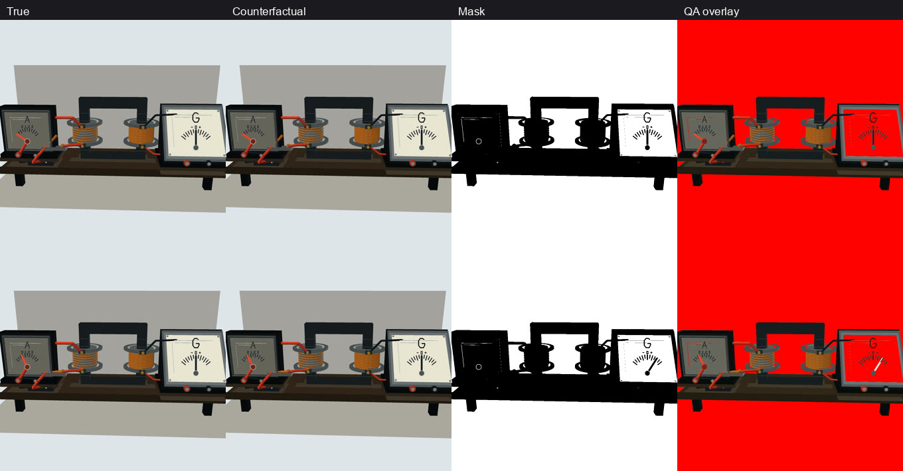

*上排：第一帧能证明违例的画面；下排：片段最后一帧。现象标识 `mutual_induction_steady_current_persistence`。*

### 带电棒移开以后，验电器的叶片没有合上

一支带电棒靠近验电器的金属球，叶片被感应电荷推开。真值里棒移开以后叶片慢慢合回；反事实里感应的电荷留在了球上，叶片一直张着，合不回去。

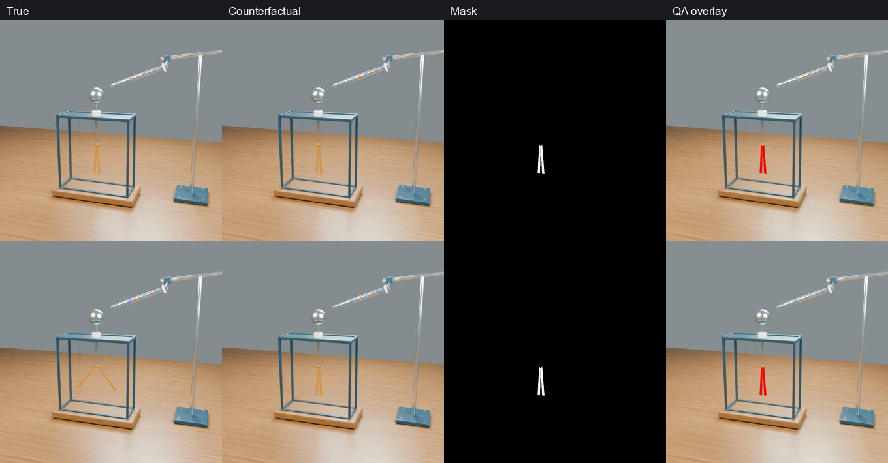

*上排：第一帧能证明违例的画面；下排：片段最后一帧。现象标识 `electroscope_induction_no_leaf_divergence`。*

### 带电梳子没有把中性纸片吸起来

一把带电的梳子靠近悬空的中性纸片。真值里纸片被电荷梯度吸起来，跟着梳子走；反事实里这层极化没有发生，纸片在原地轻轻晃着，不被吸起。

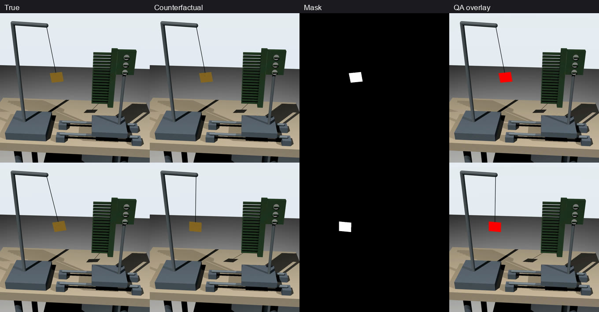

*上排：第一帧能证明违例的画面；下排：片段最后一帧。现象标识 `charged_comb_neutral_paper_repulsion`。*

### 插扣扣合之后横向拉不动

尼龙腰带两半先沿插合轴推进，钩鼻让弹簧臂缩回、再卡到肩台后面扣合；真值里随后横向一拉，两半保持扣住、高度不变。反事实里锁止没有生效，横向一拉两半就错开脱开。

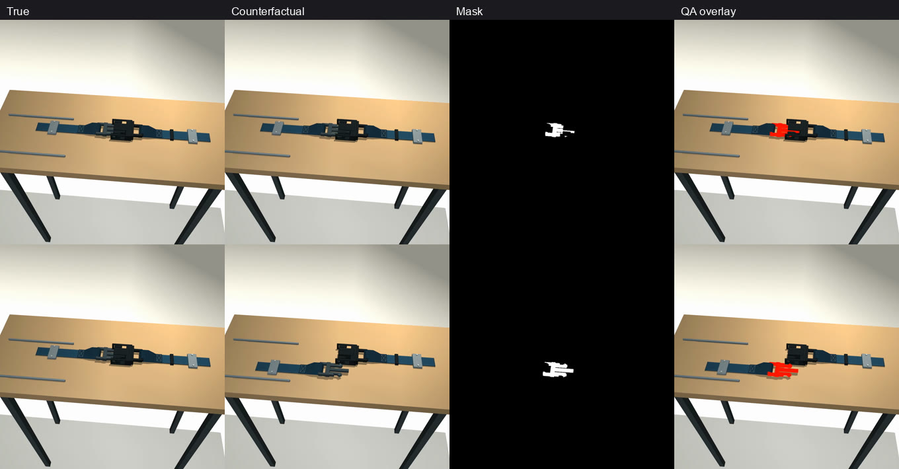

*上排：第一帧能证明违例的画面；下排：片段最后一帧。现象标识 `backpack_side_release_buckle_locked_extraction`。*

### 毛巾盖到球上，接触的隆起消失

厚毛巾落到实心球上。真值里布面在球顶撑出一个明显的隆起，四角垂到桌面；反事实里毛巾直接穿过球，铺在球下面，接触该产生的隆起没有了。

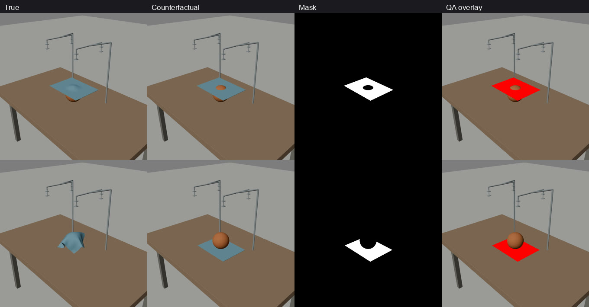

*上排：第一帧能证明违例的画面；下排：片段最后一帧。现象标识 `towel_sphere_contact_bump_suppression`。*

### 薄壁铝罐在轴向压力下长出皱褶

薄壁铝罐夹在两块压板之间受持续的轴向压力。真值里载荷低于临界屈曲，罐壁基本不变形、松开后恢复原状；反事实里同样的载荷让罐壁长出吉村型的菱形皱褶，而罐仍然是完整的。

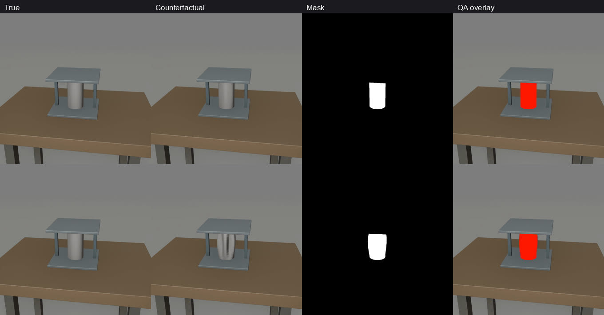

*上排：第一帧能证明违例的画面；下排：片段最后一帧。现象标识 `thin_wall_aluminum_can_axial_buckling`。*

### 棉布条突然失去轴向刚度

机架缓慢拉一条低伸长织棉布并保持住。真值里只有轻微伸长。反事实里棉条突然失去大部分轴向刚度，显著拉长，下夹具跟着下降更多，中部随伸长而收窄。

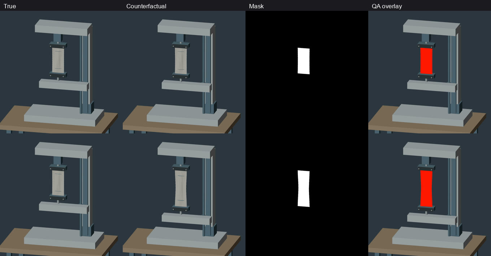

*上排：第一帧能证明违例的画面；下排：片段最后一帧。现象标识 `cotton_strip_axial_compliance_failure`。*

### 手风琴折纸桥失去抗弯刚度

同样纸做的平板和手风琴折纸桥各架在两组支座上，放上同样重的小砝码。真值里平板塌下去，折纸桥几乎不弯；反事实里折纸桥突然失去折叠带来的抗弯刚度，塌到和平板一样深——没有展开、没有撕裂、支座也没动。

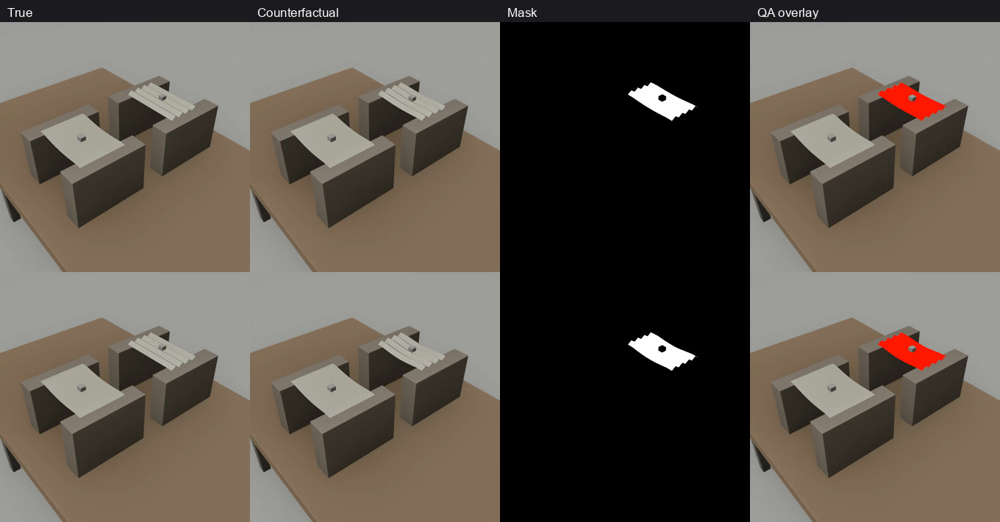

*上排：第一帧能证明违例的画面；下排：片段最后一帧。现象标识 `accordion_paper_bridge_section_rigidity_failure`。*

### 接地铁网笼里的验电器不该被带电棒影响

带电棒靠近两只叶验电器：一只在接地的细金属网笼里，一只在外面。真值里笼外那副叶片张开，笼内那副保持闭合；反事实里屏蔽失效，笼内的叶片也跟着张开。

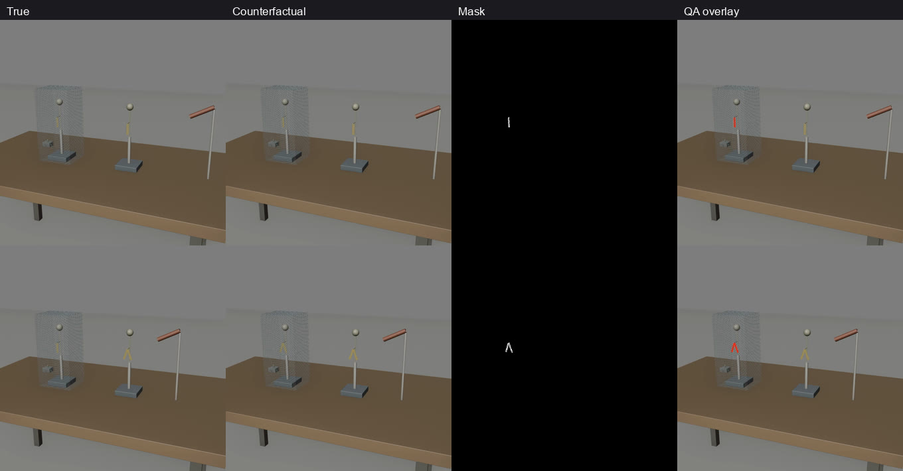

*上排：第一帧能证明违例的画面；下排：片段最后一帧。现象标识 `grounded_faraday_cage_electroscope_shielding_failure`。*

### 三爪合拢夹住娃娃却没把它抬起来

三只爪子每一百二十度一只，相机这一侧的两只各咬住娃娃一侧最宽的地方，第三只从背后咬住；粗爪臂从爪心伸出、绕过娃娃肩膀再收回来，矮而宽的弧形胶垫贴着娃娃最宽的一圈合拢。真值支里爪子把娃娃整体抬离玻璃台面、悬在爪心下方；反事实支里爪子的走法一模一样：同样降到娃娃身上、同样合拢在娃娃腰上，可是胶垫始终没有咬住布娃娃，爪心空着升起，娃娃一整段视频一直站在台面上。

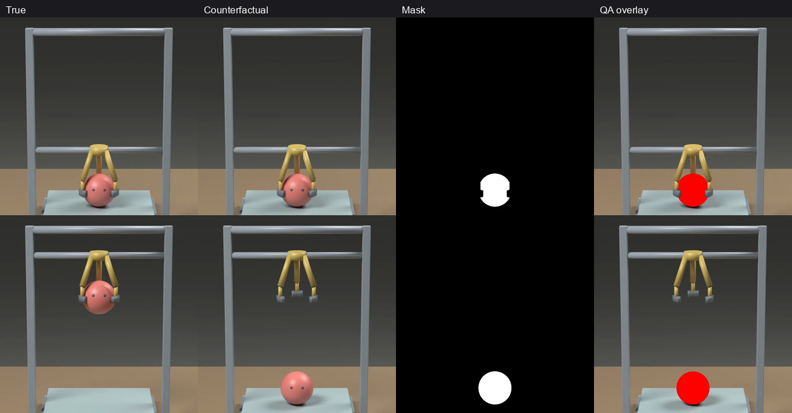

*上排：第一帧能证明违例的画面；下排：片段最后一帧。现象标识 `claw_machine_doll_lift_failure`。*

### 打字机回车后滑回行首并换行

打字机打字时，带着打印头的那部分会慢慢往右走到行尾；按一下回车杆，联动带把它拉回行首，同时纸往上走一行。反事实里回车杆照样压下去，但联动带没套住凸轮销，凸轮空转，带着打印头的那部分停在行尾不回来，纸也不走。

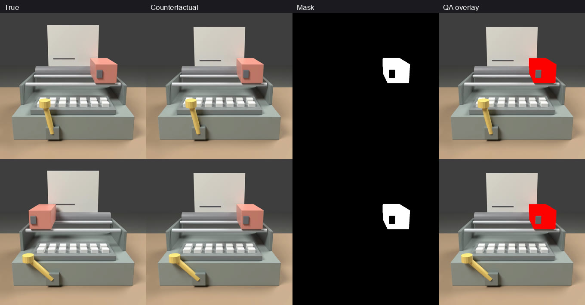

*上排：第一帧能证明违例的画面；下排：片段最后一帧。现象标识 `typewriter_carriage_return_failure`。*

### 镍摆片过了居里点仍然吸住磁铁

一片镍摆片贴在固定磁铁上，正面的电阻加热器把它加热到超过约 354 °C 的居里点，旁边有高温计读数。真值里磁性变弱，摆片脱开磁铁、在重力下摆动。反事实里高温下错误地保持强铁磁性，摆片仍然贴在磁铁上。

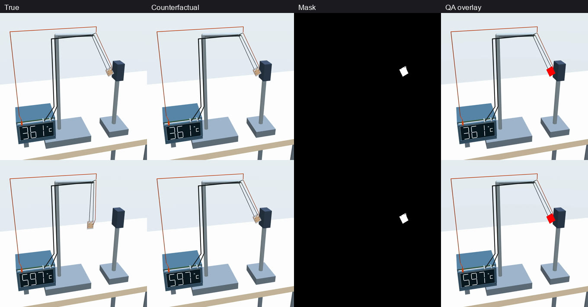

*上排：第一帧能证明违例的画面；下排：片段最后一帧。现象标识 `curie_pendulum_high_temperature_attraction_persistence`。*

### 书页受压却朝书脊方向错动

一本书平放在台上，背封被两个夹爪压平，电机压垫压住封面外缘。真值里书页朝远离书脊的方向错动。反事实里书页与封面朝书脊方向错动，和压的方向正好相反，而底封和夹爪保持完整。

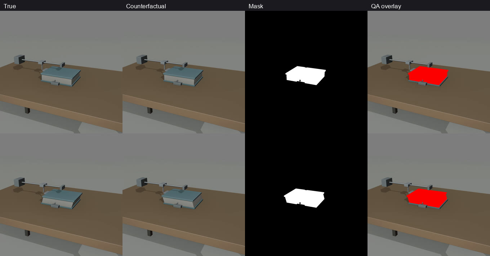

*上排：第一帧能证明违例的画面；下排：片段最后一帧。现象标识 `book_page_shear_response_reversal`。*

### 快速下拉时先断的是上面那根绳

一个重物用两根强度相同的绳吊住，上面一根、下面一根。真值里快速下拉，先到极限的是下面那根：它先断，安全扣释放，重物仍然吊在上面那根绳上。反事实里只有下绳达到极限，却先断的是上绳，重物带着完好的下绳一起掉下去。

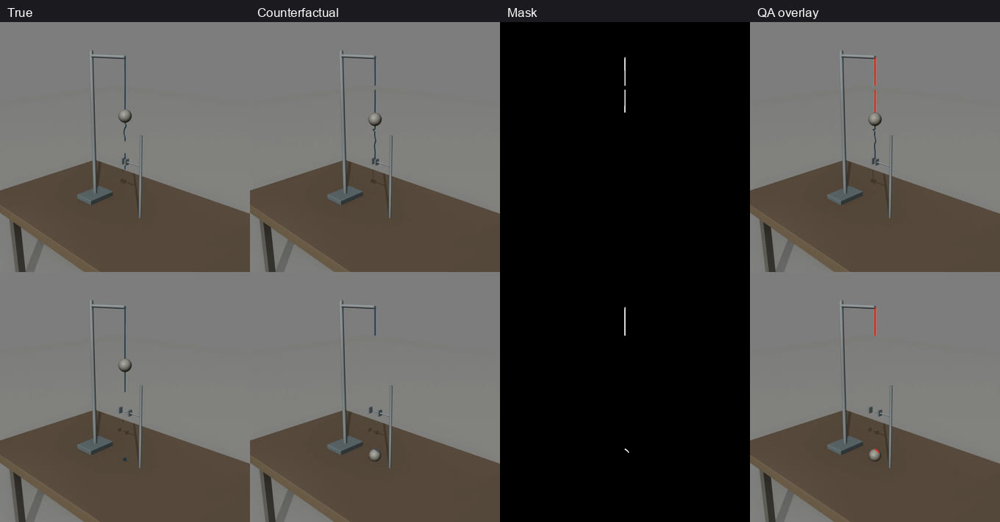

*上排：第一帧能证明违例的画面；下排：片段最后一帧。现象标识 `quick_pull_two_string_upper_first_fracture`。*

### 报纸压尺的瞬态气阻失效

直尺压在平摊的报纸下面，一端伸出桌沿，对露出的一端做一次短促下压。真值里报纸下面那层被封住的空气给出短暂的压差阻力，抬起的一端只起来几毫米就被压回去；反事实里这层瞬态阻力消失，报纸明显抬起、离开桌面。

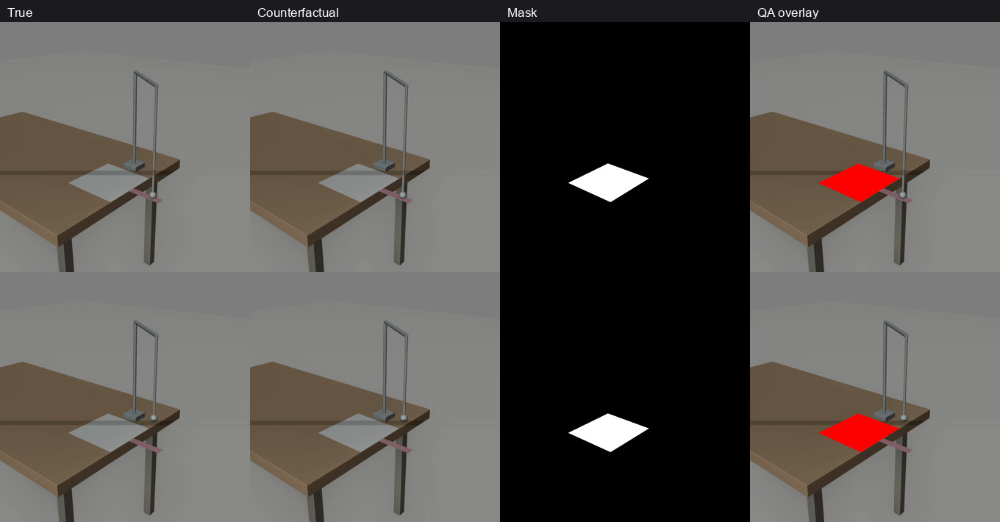

*上排：第一帧能证明违例的画面；下排：片段最后一帧。现象标识 `newspaper_ruler_transient_pressure_resistance_failure`。*

### 电源反接之后转矩方向还是错的

剖视的永磁有刷直流电机由电池供电，一个看得见的双极开关断开触点再以相反极性接回，定子磁铁不动。真值里转子减速穿过零速然后反向转，不会在零速停住。反事实里反接之后电磁转矩方向仍然错，转子继续按原来的方向转。

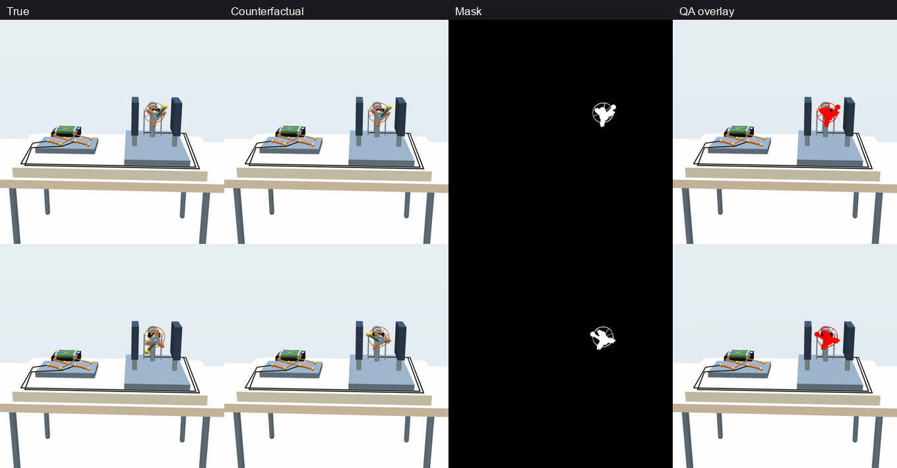

*上排：第一帧能证明违例的画面；下排：片段最后一帧。现象标识 `counterfactual_reversed_supply_wrong_torque`。*

### 吸盘漏气，玻璃板抬不起来

两个手动吸盘扣在玻璃板顶面靠近一边的位置，用杠杆连到吸盘柱塞。真值里按下杠杆，杯腔扩大、压力下降，两个吸盘咬住玻璃，松手后回弹弹簧收绳把板吊离台面。反事实里杯口漏气、建立不起低压，绳始终不绷紧，玻璃板一直躺在台面上。

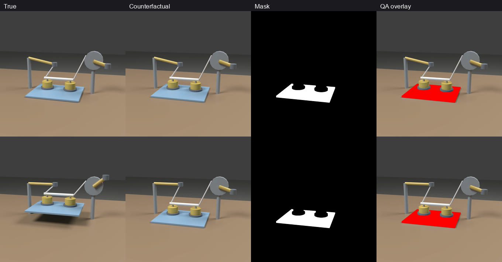

*上排：第一帧能证明违例的画面；下排：片段最后一帧。现象标识 `suction_cup_glass_lift_failure`。*

### 一排单摆的相位级联方向反转

一排 6–8 个单摆，绳长按几何级数递增所以周期呈等差阶梯。True 里各球依次到达摆动端点，从短绳端走向长绳端；反事实里绳长不再决定摆动快慢，整排在一个 1.4 秒的窗口里被重新计时，波峰收拢成一次共同的摆动，每个球都拿到同一个恢复长度，一起到达摆动端点。绳子一根没变，整排没有停过再重新起摆。

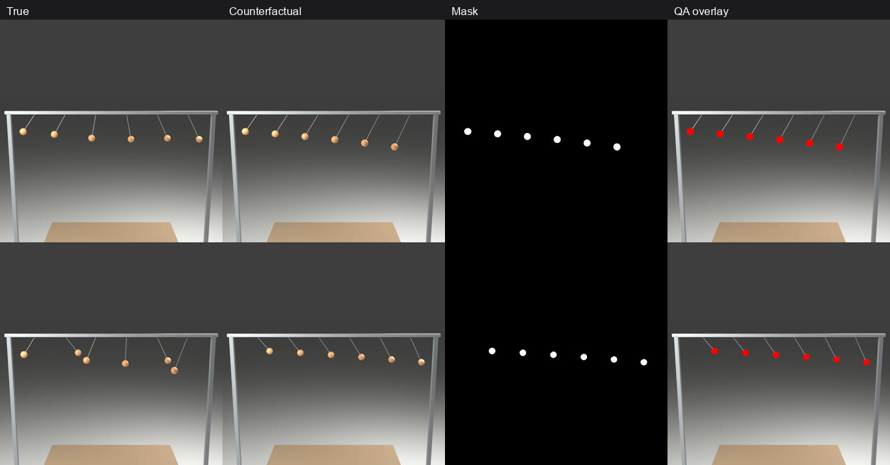

*上排：第一帧能证明违例的画面；下排：片段最后一帧。现象标识 `pendulum_phase_cascade_direction_reversal`。*

### 转盘上的硬币不再被科里奥利偏转

挡销在介入时刻撤开。True 里硬币带着科里奥利项从画在盘面上、跟着盘一起转的释放半径弯开、绕着轴心扫过去，停在盘缘时明显偏到一侧；反事实只去掉这一项耦合，硬币沿同一条转动的半径直着出去。

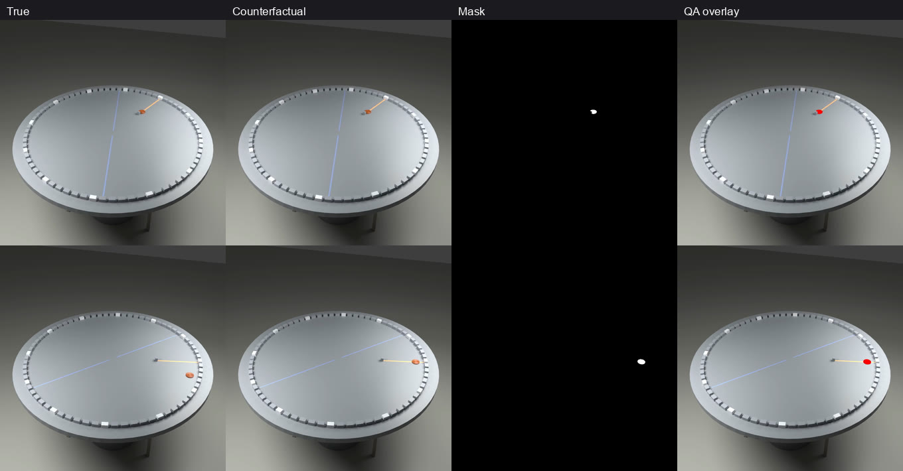

*上排：第一帧能证明违例的画面；下排：片段最后一帧。现象标识 `turntable_coin_coriolis_deflection_reversal`。*

### 铅笔笔尖倒向相反的一侧

圆盘转到某一侧下倾，铅笔随即朝下倾的那一侧倒下。反事实只把圆盘的下倾方向反过来，铅笔、初始倾角和圆盘完全相同。

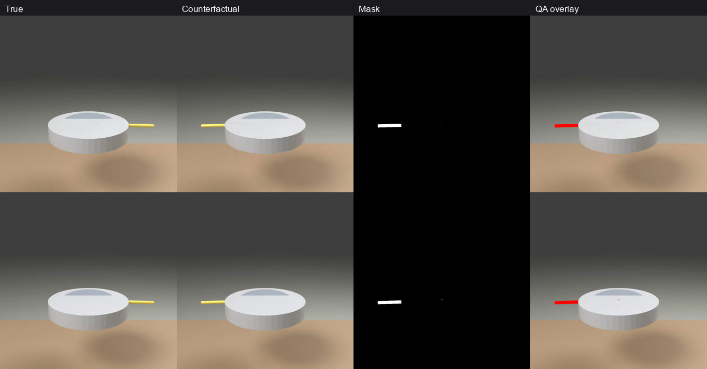

*上排：第一帧能证明违例的画面；下排：片段最后一帧。现象标识 `pencil_tip_balance_topple_direction_reversal`。*

### 扣杆把钢球打飞，或者只把它挤出托座

钢制挡片一松，扭簧驱动扣杆从顶部扫过：真支里杆头从球下面兜住黄球，把它抛成一道弧线落回台面；反事实里挡片同样松开、扣杆同样扫过顶部，但杆头没兜到球下面，只在球的侧面把球挤出托座，黄球直直落到立柱旁边的台面上。同一台机器、同一次释放，差别只在杆头碰到黄球那一刻。

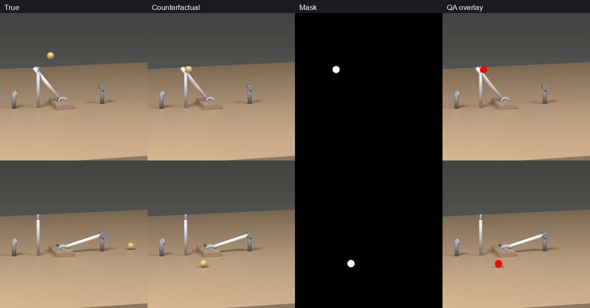

*上排：第一帧能证明违例的画面；下排：片段最后一帧。现象标识 `mousetrap_snap_bar_launch_reversal`。*

### 橡皮筋没有解开，车没有动

释放是实验的、错误在驱动：True 里挡销倒下（脚固定在原地、只有上方翻倒），橡皮筋一圈圈松开并驱动后轮，车从坡顶沿斜坡往下滚、滚到半坡停住；反事实里挡销照样倒下，但橡皮筋始终绷紧、轮子不转，车整段停在坡顶不动。坡度两支相同。

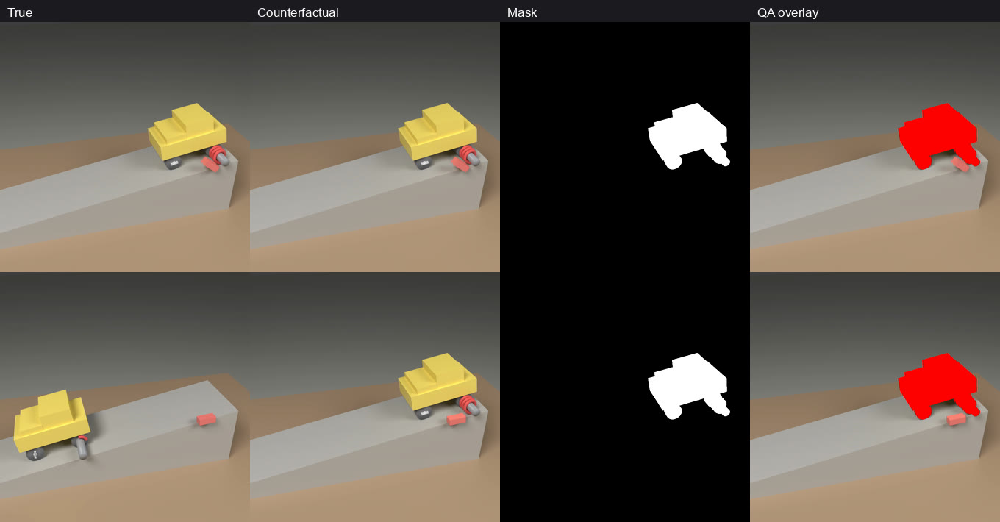

*上排：第一帧能证明违例的画面；下排：片段最后一帧。现象标识 `rubber_band_stored_energy_car_drive_reversal`。*

### 滑行的后轮反过来带动脚踏

自行车后轮在滚筒架上加速，链条松着，牙盘旁边有一个可接通的狗牙离合器。真值里离合器接的是花鼓上的棘轮，滑行时棘轮空转，曲柄和脚踏几乎不动。反事实里离合器把牙盘直接锁在轮上，滑行的轮子反过来驱动曲柄，踏板自己转起来。

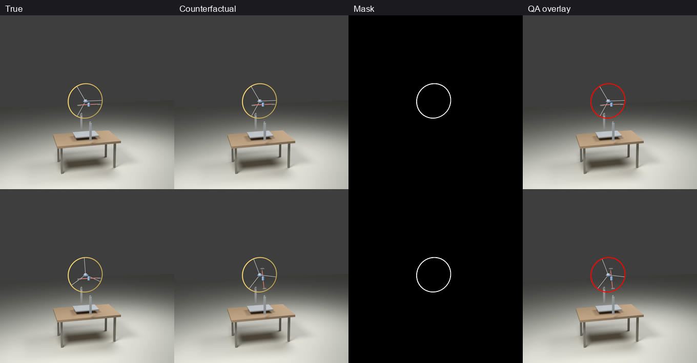

*上排：第一帧能证明违例的画面；下排：片段最后一帧。现象标识 `bicycle_freewheel_coast_drag_reversal`。*

### 负载走了平台却没动

钢制砝码压在弹簧平台上，平台整段上下起伏。True 里推杆把砝码横向推离平台、砝码落进旁边独立支架上的接料盘：负载走了，弹簧回升一截、平台升高一截、振荡周期跟着变短、节拍明显变快；反事实支里推杆照样推、驱动一模一样，平台却完全不理这次转移：弹簧还是被压着的那一档、平台还在原来那个低位上、振荡还是砝码在时那个慢节拍。

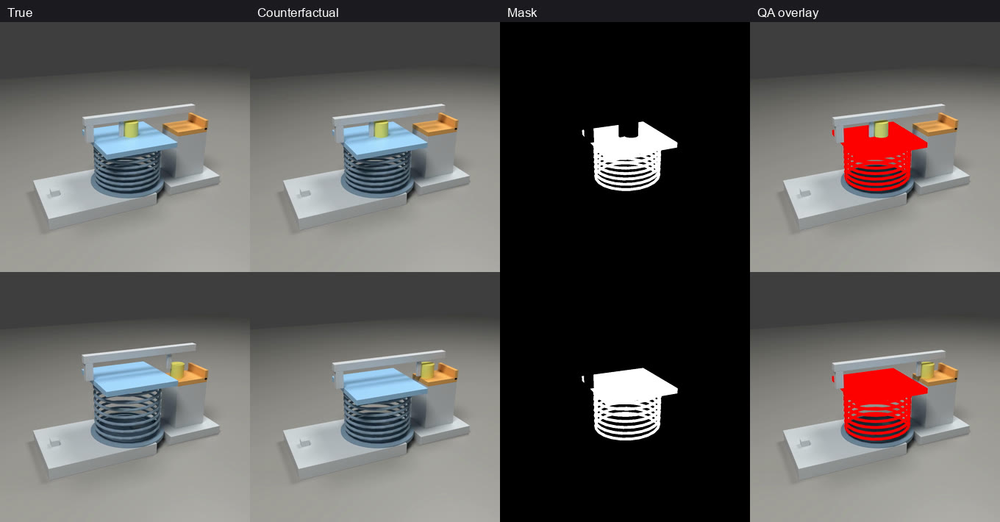

*上排：第一帧能证明违例的画面；下排：片段最后一帧。现象标识 `spring_platform_weight_transfer_period_shortening`。*

### 演示机芯的秒针倒着走

工坊墙上一只钟表匠的镂空演示机芯：六十秒刻度盘（黄铜圈、12 根刻线、0/15/30/45 四个凸起数字），盘后是带辐条的大轮（其中一根辐条漆成红色），盘前是蓝钢秒针，带配重尾与配重。真值支里秒针每秒走 6 度、从正上的 0 刻度顺时针扫向 15 再往下扫向 30，红辐条跟针同向转；反事实支里机芯的驱动接到另一边，秒针掉头往回扫、退回 0 刻度继续朝 45 刻度走，红辐条同时反向转。

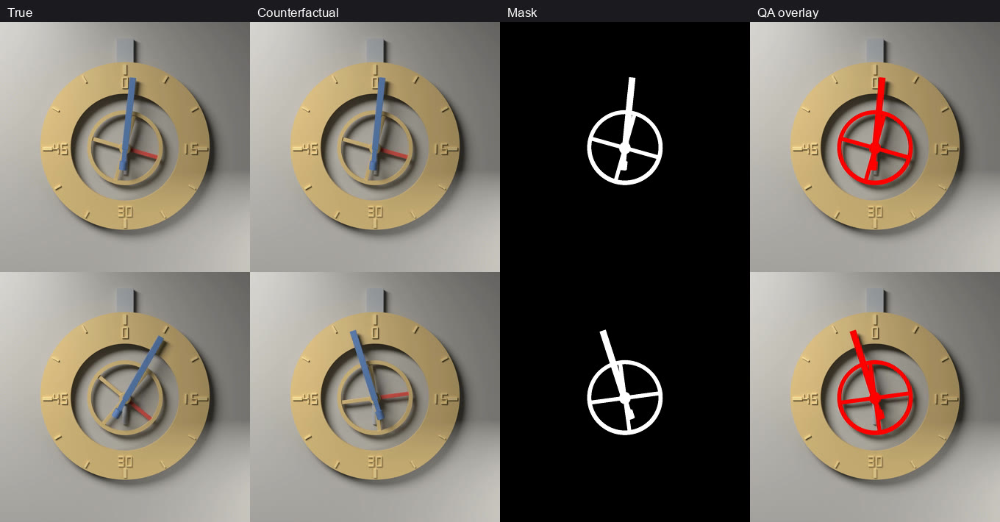

*上排：第一帧能证明违例的画面；下排：片段最后一帧。现象标识 `clock_seconds_hand_runs_backwards`。*

### 车床切螺纹切不出来

小台车用卡盘夹着一根钢杆，主轴带着它转，一支黄色圆杆车刀沿轴向朝尾座进给，刀尖正好切在杆面上；靠卡盘那一端有一小段深色漆划痕，让旋转看得见。真值支里刃口是好的，刀尖后面在杆面上切出一条连续的螺旋槽：槽底是刀尖的宽度，两道直 flank 升到杆面，槽口比刀宽得多，两圈之间立着螺纹牙，牙顶与杆面齐平，是钢杆自己被切出来的那块金属；反事实支里两支走的方向和转向完全一样，从介入帧起刀刃崩了一块、切不动了，刃口在杆面上打滑，同一条槽里横着堆起一团撕裂的暗色金属，边是毛的、有断口，螺纹没有成形。

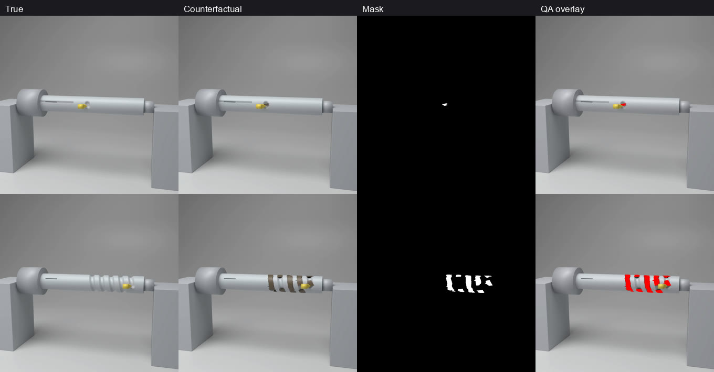

*上排：第一帧能证明违例的画面；下排：片段最后一帧。现象标识 `lathe_thread_not_cut`。*

### 气流托不住乒乓球

True 里风机维持全速、气柱一直托得住球，球在气流里上下晃动整段不落地；反事实气流衰减到托不住，球脱出气流掉进接球盘。

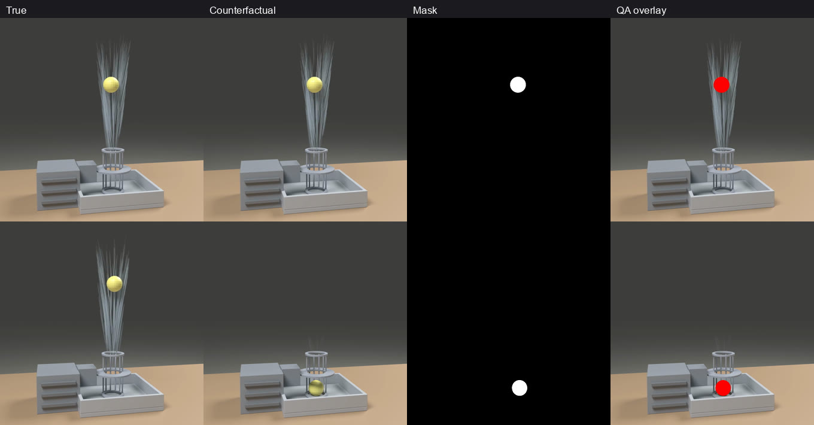

*上排：第一帧能证明违例的画面；下排：片段最后一帧。现象标识 `air_jet_ping_pong_ball_lift_failure`。*

### 接触面冻住两块冰被一起拖走

两块冰并排立在钢制工作台上，右边那块被一只钢制夹爪咬住、夹爪的爪压在外侧面上、指压在顶面上、底脚踩在台面的导轨上，导轨左端立着一只钢制气缸，气缸的活塞杆顶在夹爪的立柱上、把夹爪和右边那块一起向右推。True 里两块的接触面没有结成冻结键合，右边那块直接从接触面滑脱，左边那块留在台面上没有动过；反事实里接触面长出一道白色的冻结缝，键合承住左边那块冰与台面之间的摩擦以后，左边那块被拖着和右边那块一起向右走。

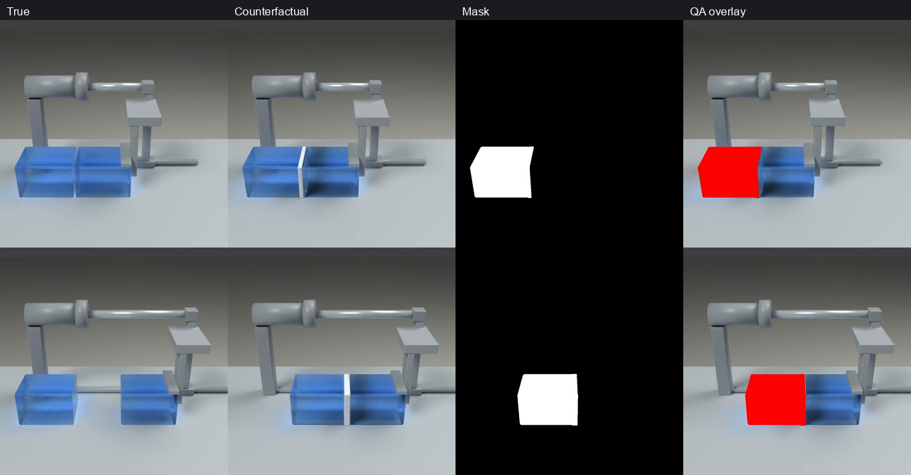

*上排：第一帧能证明违例的画面；下排：片段最后一帧。现象标识 `two_ice_cubes_regelation_bond_drag_reversal`。*

### 坡角越过静止角塌落

粗砂经漏斗倒在浅圆托盘上，堆成比砂能静止的坡角更陡的锥。True 里倒完之后锥面撑不住，顶点塌下、底盘摊开，最后停在砂真正能静止的浅角上；反事实里砂粒之间不滑，锥体保持原来的陡度和高度。

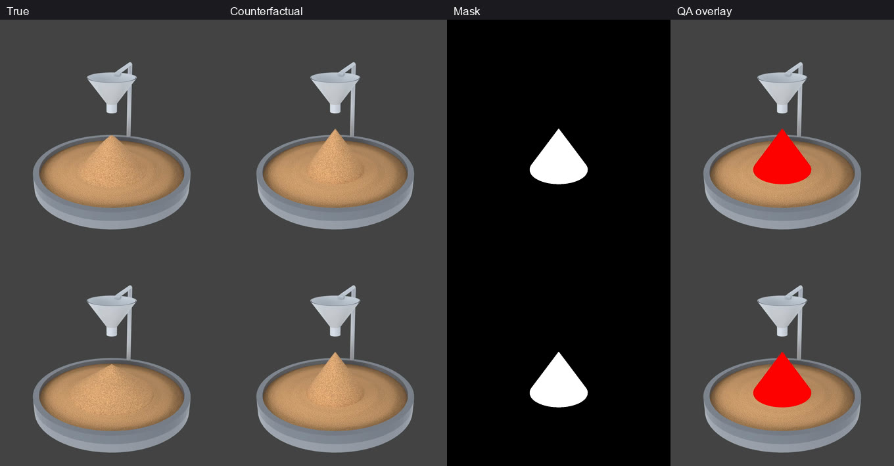

*上排：第一帧能证明违例的画面；下排：片段最后一帧。现象标识 `sand_pile_angle_of_repose_slope_reversal`。*

### 纸飞机自己摊开了

折好的纸飞机放在深色桌垫上，两个小夹翼爪松开并退开。真值里飞机保持机头、机身和两翼，整段不变。反事实里没有任何操作，折叠结构突然一下松开，摊成桌垫上的一张纸。

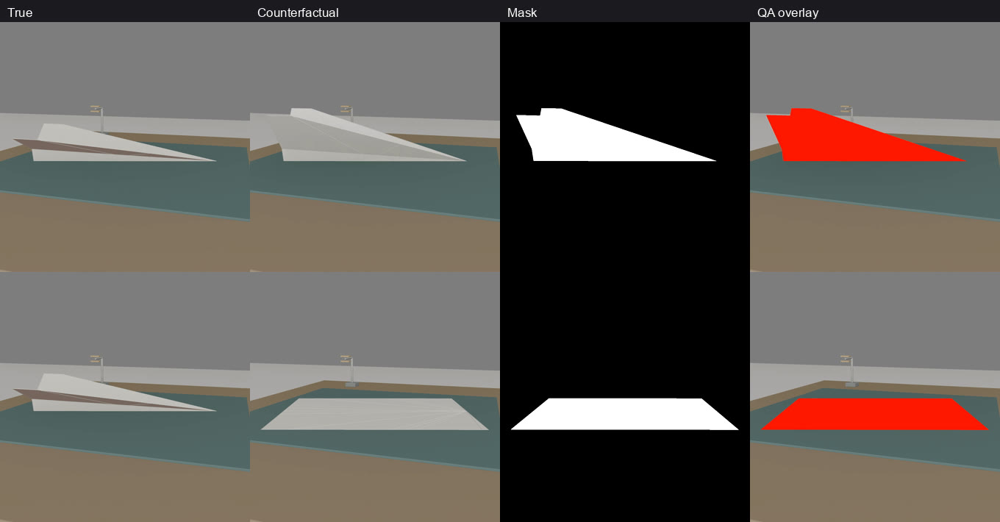

*上排：第一帧能证明违例的画面；下排：片段最后一帧。现象标识 `paper_airplane_spontaneous_unfolding`。*

### 墙钉上的画歪着停住

一幅画用一枚钉子和一根钢丝挂在灰泥墙上，重心正好落在钉子正下方，所以它横平竖直地挂着、整段一动不动；反事实在同一幅画上给出一个平衡偏移，画面绕钉子转开、摆起来，最后歪着停在右下角低的一侧。

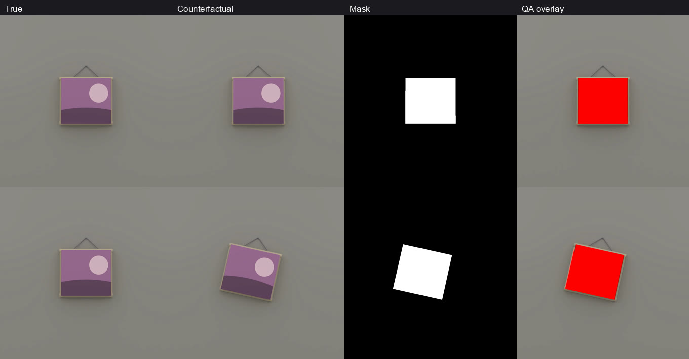

*上排：第一帧能证明违例的画面；下排：片段最后一帧。现象标识 `hanging_picture_hook_tilt_reversal`。*

### 旗子顺风往下游飘

风按旗方程把旗面兜着往下游吹，True 里旗边低过挂杆；反事实只把旗面横风升力的符号取反，同一面旗子被朝反方向掀起，掀到旗杆上方去。

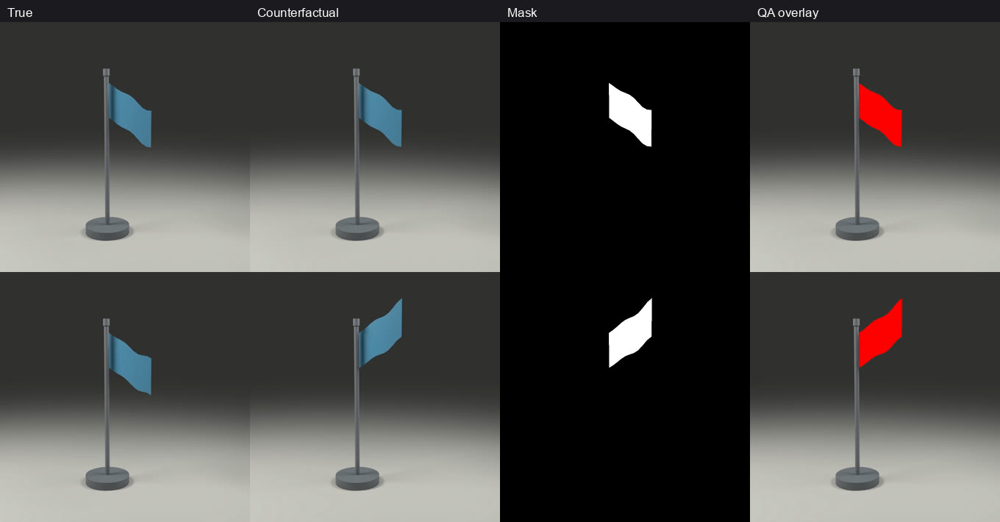

*上排：第一帧能证明违例的画面；下排：片段最后一帧。现象标识 `wind_flag_deflection_reversal`。*

### 带电气球从墙上掉下来了

一只充了静电的气球贴在灰泥墙上，穿堂风经过时它只是歪一点，继续挂着；反事实里干燥气流把橡胶表面的电荷带走，气球脱墙，被风推着落到地上。地板上那只木箱是给气球当尺度的道具，不是抽样出来的轴。

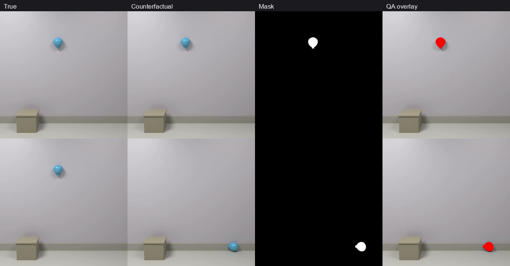

*上排：第一帧能证明违例的画面；下排：片段最后一帧。现象标识 `static_balloon_wall_stick_failure`。*

### 衣夹夹住毛巾，夹口没了摩擦

一条晾衣绳横过画面，一只木衣夹夹在绳上，毛巾的一角被夹在夹口里。真值支里夹口与布之间的摩擦托住毛巾的重量，毛巾挂在绳上、随着夹口里的余力慢慢往下挪一点；反事实支里只去掉这一条摩擦，毛巾从夹口里滑出来掉到地上，落成地上的一堆。夹子、绳子、毛巾、灯光与机位两支完全相同。

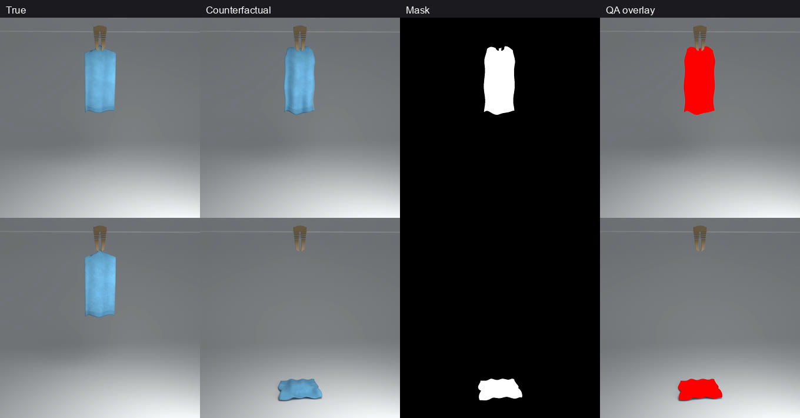

*上排：第一帧能证明违例的画面；下排：片段最后一帧。现象标识 `clothespin_grip_loss_towel_falls_off_line_reversal`。*

### 凿子顺木纹把木料劈开

一根木料横放在工作台上，表面有顺着木纹的深色纹路；一把凿子斜着抵在木料的端面上被推进去。真值支里木料顺着木纹裂开，一道长缝顺着木料长度走到底，缝口张开；反事实支里木料的纤维之间不再咬合，凿子沿纤维滑过去，木料始终是一整根，端面上只留一个浅坑。

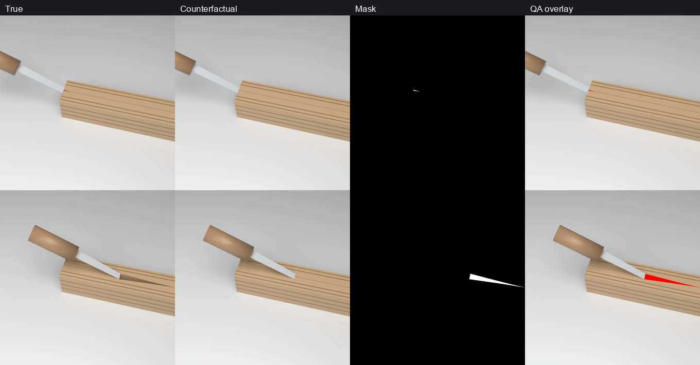

*上排：第一帧能证明违例的画面；下排：片段最后一帧。现象标识 `chisel_grain_split_along_fiber_reversal`。*

### 手刨推出连续薄花

一块木板平放在工作台上，一把木柄手刨沿着板子的近侧边缘被推过去，刨刃斜着嵌在刨身里，刃口就设在板子的那条边上，所以刨出来的薄花从刨口越过板子边缘、顺着板子的侧面垂到台面上。真值支里刨刃把木头整片剪下来，出来的是一条不断的薄花，挂在板子边上再落在台面上；反事实支里刃口前的木头不是被剪下而是崩碎，同一条带上出来的是一颗颗小碎屑，落在板子边上与台面上，画面上没有那条连续的带子。

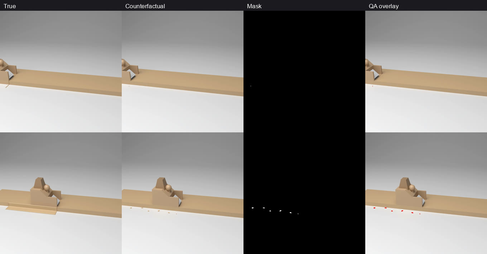

*上排：第一帧能证明违例的画面；下排：片段最后一帧。现象标识 `hand_plane_continuous_shaving_reversal`。*

### 冰壶在冰面上拐弯

一整片淡蓝色的冰面铺满画面，一块花岗岩冰壶带着红色把手滑出去，壶体一边自转一边滑行。真值支里冰壶越滑越慢，旋转的刃口把它推向侧面，它划出一条弯的路线，末了把手偏离了出发时的那条线；反事实支里旋转的刃口不再把冰壶推向侧面，冰壶直着走完，把手一直指着出发时的那条线。

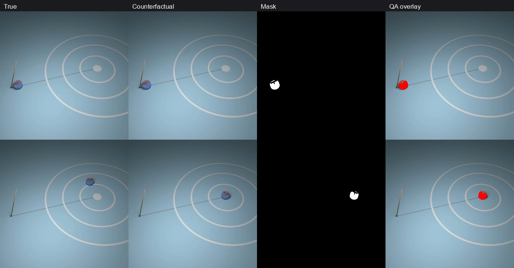

*上排：第一帧能证明违例的画面；下排：片段最后一帧。现象标识 `curling_stone_curl_reversal`。*

### 立着的硬币自己倒平

一张桌面上立着一枚硬币，硬币竖着边缘立在桌面上，一边自转一边微微倾斜。真值支里硬币的边缘磨着桌面，转速被磨掉，倾角越来越大，最后硬币拍平躺在桌面上；反事实支里硬币的边缘不再磨桌面，转速不掉，倾角不再变大，硬币整段直立着转完，末了仍然立在边缘上。

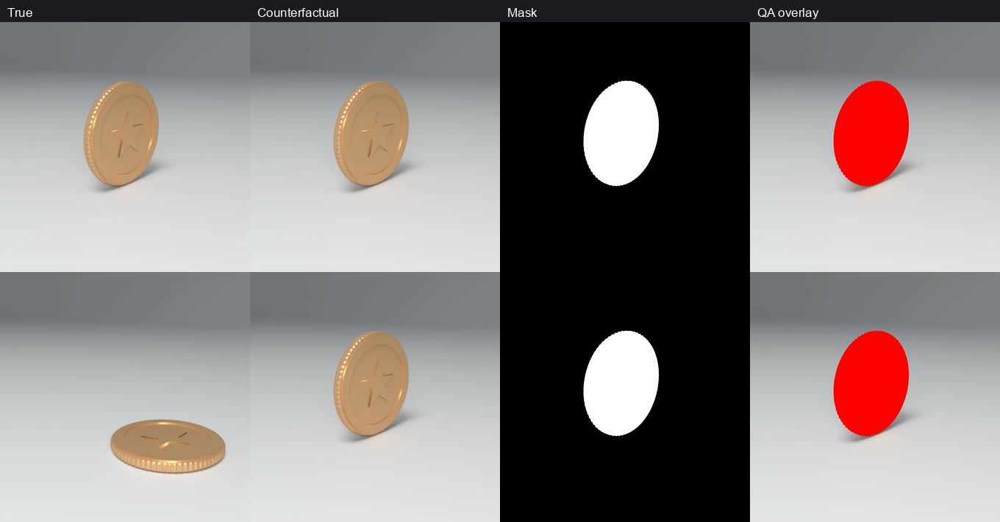

*上排：第一帧能证明违例的画面；下排：片段最后一帧。现象标识 `spinning_coin_falls_flat_edge_friction_reversal`。*

## 七、这批数据想解决什么

反事实样本是给"判断"用的：模型看一段视频，要能指出这里违反了哪条规律，并且给出位置。

光有正例做不到这件事。一个模型可以在几百万条正常视频上训练得很好，却从没见过"物体穿过墙"；它不会知道自己看到的东西不对，因为训练分布里根本没有这种东西。

反事实对把这件事变成可学的：同一段画面，只改一条规律，模型看到的差异就是规律本身，掩膜告诉它差异在哪里。

这也是我最后留下的判断：**这类数据的难点不在渲染，在审核。** 物理写错了，模型学到的是错的物理；画面拍错了，模型学到的是错误的视觉证据；而这两件事在成片里都长得"挺像那么回事"。唯一有效的防线是把每一件事都变成一条能自动判定的判据，然后让人去看那些判据看不到的地方。

## 关于这篇

这些画面都由我自己写的生成器渲出来，脚本和评审材料在团队的内部空间里。图里的每一条都是真实跑出来的样本，掩膜是正式交付的那份二值标签，红色叠加层只是给人看的质检视图——正式训练用的是掩膜本身。可播放的真值与反事实成对样本在[作品样本页](/sample-of-work/)。
