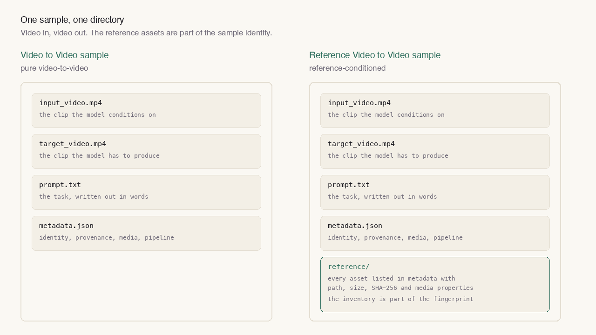
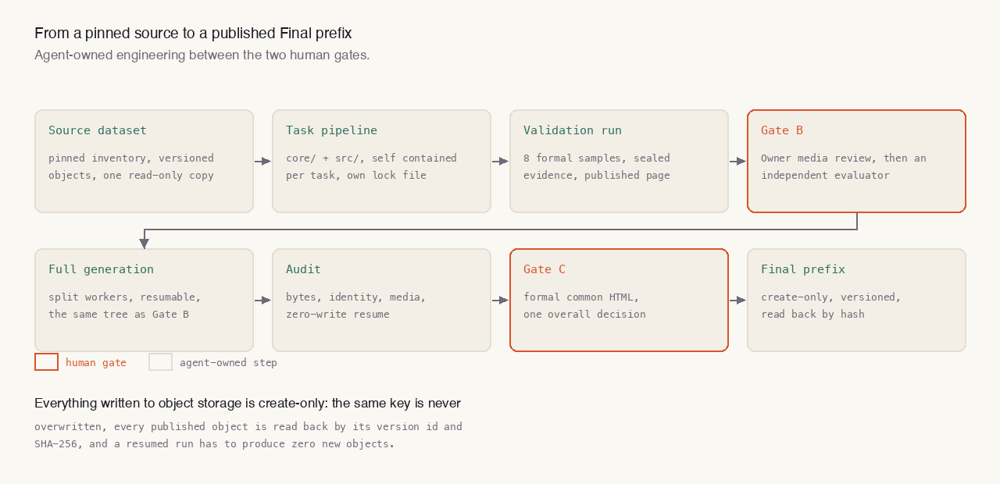

A video reasoning model has to learn one specific thing: given this clip, what happens next. For that signal to be learnable, the training data has to satisfy three conditions at once. The input is a video and the output is a video. The target video is decided by a rule the model can actually learn, not by whatever happened to look plausible. And every sample can be verified on its own instead of merely looking right.

I spent the better part of a year on this, in two repositories that run side by side: one for Video to Video, and one for Reference Video to Video — the same thing with a set of reference assets attached. Below is the method, the evidence, and a few things that went wrong on the way.

## 1. The unit of work

One sample is one directory with four files: the input video, the target video, a natural-language description of the task, and structured metadata. A Reference Video to Video sample adds a `reference/` directory, and every asset in it is declared in the metadata with its relative path, media type, byte size, SHA-256 digest and media properties.



Two rules are worth stating on their own.

**A sample ID is the task prefix plus nine digits**, and the prefix has to match the task identity declared in the same metadata record. The upstream dataset keeps its own ID in `source.sample_id`, where it cannot be confused with the sample identity. Pull one sample directory out on its own and it still says which task it belongs to.

**The reference inventory is part of the identity.** In a Reference Video to Video sample the complete reference inventory feeds the `sample_fingerprint`, so changing any reference asset changes the identity of the sample. This is not tidiness: if reference assets can change silently, the training set and inference time are no longer looking at the same task.

Some tasks start life as a single image. Those are extended into video instead of being special-cased: for image-to-image tasks both the input and the target image become static-frame videos, and for image-to-video only the input is extended. The model always meets a video on both sides, and the image origin is recorded in the provenance rather than leaking into the sample structure.

## 2. One real sample

Here is an excerpt of a real metadata record, from a two-handed manipulation task. The model has to render the human hands and the manipulated object as flat semantic colours while preserving the timing, background and occlusion of the source video.

```json
{
  "schema_version": "1.2",
  "sample_id": "Task_275_contact-aware_bimanual_manipulation_video_generation_000000001",
  "task": { "id": "Task_275", "name": "contact-aware_bimanual_manipulation_video_generation", "modality": "v2v" },
  "source": { "dataset": "<public hand-object dataset>", "split": "train", "sample_id": "scene_01__A001++seq__07bb164dc3d3873d6389" },
  "media": {
    "input":  { "file": "input_video.mp4",  "width": 848, "height": 480, "fps": 30, "num_frames": 81 },
    "target": { "file": "target_video.mp4", "width": 848, "height": 480, "fps": 30, "num_frames": 81 }
  },
  "pipeline": { "name": "contact-aware_bimanual_manipulation_video_generation", "version": "0.9.1", "commit": "<the commit that generated this batch>" },
  "optional": {
    "selection_stratum": "single-object-rearrange-known-alignment",
    "annotations": {
      "human": "rendered from the recorded SMPL-X reconstruction as one human entity, including both hands",
      "object_identity_unit": "the natural object description from the source catalogue; equal descriptions share one colour in the prompt",
      "background": "unannotated pixels keep the source RGB"
    }
  },
  "identity": { "sample_fingerprint": "<SHA-256 of the sample identity>" }
}
```

The first version of this sample was wrong, and wrong in a very typical way.

The original implementation rendered the recorded hand skeletons and object axes, while the task asked for flat semantic colours. The first visual review returned a plain FAIL: the target was a grey, semi-transparent mesh overlay instead of the required semantic visualisation, one object had been split into several colours, a bowl and a computer frame that do not exist in the video had been painted in, and the object actually being grasped had been missed.

The cause was not the renderer. It was the definition of the annotation scope. The old code coloured every entry of the annotation file's object list, but the task only wants the object instances the current primitive actually takes part in. The rule after the fix: the complete human gets one stable colour, each visible object instance involved in the current action gets its own stable colour, everything else in the scene keeps its original RGB. The same object must not be split into several colours without reason, while real parts that carry their own part IDs in the dataset may keep distinct stable colours.

Two lessons from that round matter more than the picture.

**The prompt is part of the artefact.** The old pipeline treated the prompt as "the fourth file"; validation only checked that it was non-empty, and no renderer or model code ever read it. After the fix every prompt has to name the action, the object, the tool or target, and any colour, size or handedness that matters. Otherwise the sample does not prove that a model would use the condition.

**Visibility has to be written into the contract, not inferred from looking.** "Only label what is actually visible" cannot hold exactly on real data, because the dataset carries no scene geometry. Pushing it anyway pushed labels onto tables, cabinets and equipment. The answer was to narrow the task instead of promising something impossible: the target is a deterministic offline projection that may cover real occluders, and it does not claim to reconstruct hidden surfaces.

## 3. The tasks I owned

Below are the sixteen tasks I owned, covering continuation, repair, re-shooting, generation, localisation and explanation. Each one is a formal task inside the team's video-reasoning benchmark suite: a written task definition, a sample contract and an independent review step.

| Task | Modality | Task name | What the model has to do |
| --- | --- | --- | --- |
| 275 | Video to Video | action_conditioned_bimanual_manipulation_video_continuation | Continue the two-handed action with what actually happened next |
| 278 | Video to Video | action_conditioned_gameplay_stutter_repair | Repair the stutter in the frames against the action sequence |
| 331 | Video to Video | robot_tool_target_semantic_role_highlighting | Mark the roles of the tool and the target in an egocentric view |
| 334 | Video to Video | prompt_guided_single_view_multishot_recinematography | Re-cut several shots of one view according to a written instruction |
| 428 | Video to Video | same_time_background_and_scenery_replacement | Replace the background and the scenery while keeping the timing |
| 552 | Video to Video | street_scene_city_option_selection | Pick the matching city option in a street scene |
| 654 | Video to Video | gps_coordinate_conditioned_rotating_globe_marking | Mark a rotating globe by GPS coordinates |
| 390 | Video to Video | relation_constrained_multi_object_scene_completion | Complete a scene under the relations between its objects |
| 429 | Video to Video | post_handoff_recipient_action_rollout | What the receiving side does after a handover |
| 480 | Video to Video | cave_video_commonsense_anomaly_localization | Locate a commonsense anomaly in cave video |
| 481 | Video to Video | gameplay_commonsense_error_localization_and_explanation | Locate and explain a commonsense error in gameplay footage |
| 483 | Video to Video | egocentric_hand_motion_phase_panel_visualization | A phase panel of egocentric hand motion |
| 328 | Reference Video to Video | bimanual_manipulation_process_panel | Rebuild the process of a two-handed manipulation from a reference |
| 391 | Reference Video to Video | language_grounded_multi_object_grasp_video_generation | Generate the video of a language-specified multi-object grasp |
| 479 | Reference Video to Video | reference_guided_progressive_makeup_transfer | Progressive makeup transfer under a reference |
| 551 | Reference Video to Video | reference_guided_ego_action_skill_comparison | Compare egocentric action skills against a reference |

Every task can be looked at directly: the input video, the target video and the prompt that defines the task are on their own page — [sample of work](/sample-of-work/) — one entry per task, each one labelled with its source dataset, its licence and the line to cite it by.

## 4. Two levels of determinism

Once the sample runs, the hard part is being able to show that running it again produces the same thing.

The first level is semantic: the same candidate set, the same filtering rules, the same window selection. That is guaranteed by writing the intermediate state into the artefacts instead of trusting a log line.

The second level is byte-level, and it produced a very typical bug. In the first reproduction run, a two-core CPU affinity setting changed how the encoder threaded its work, so identical inputs and identical metadata produced different bytes — same frames, different compression parameters. When the requirement is byte-identical payloads, that difference is fatal.

The fix was not to loosen the comparison but to align the environment: first confirm with a one-sample probe under the formal environment that byte-identical output is reachable, then re-run the whole batch under that same environment. 32 payload files came out byte-identical, and 16 decoded videos matched frame for frame. The lesson is blunt: determinism is a property of the environment, not only of the code.

There was also a plainer problem. 300 frames is too long. A human reviewing a 300-frame sample keeps dragging the timeline and loses attention. That feedback sent the task back to Draft, withdrew the review request that had already been sent, and changed the window to a deterministic 81-frame (2.7 second) action-centred window with ten frames of context on each side, scored by the official action-object translation and rotation. After that, everything downstream of the old batch was void: the producing commit, the samples, the evidence, the published page, the review conclusion. Withdrawing a review request you already sent is more painful than any of the technical work.

## 5. From gates to delivery

A task travels from source data to a deliverable Final prefix through two human gates. Everything in between is engineering owned by the agent.



Gate B is a formal review page: the Owner plays every sample, checks the prompt against the picture, and only then does an independent reviewer look at the same material. Both steps have to pass before a Full run is allowed. Gate C is a different formal page built on the samples that were actually delivered, not on intermediate material.

The Full stage belongs to the agent: split the fixed candidate set into disjoint shards, hand them to several workers, audit everything that comes out, and read each published object back. A failed run has to be resumable, and resumption has to be able to prove that nothing was written twice.

On the delivery side I hold to a few hard rules.

- **Object storage is written once.** A key is never overwritten, and every published object is read back by its version id and SHA-256.
- **A resumed run has to recompute.** Running the same path again must produce zero new samples, skip every valid sample, reproduce every exclusion, and leave the payloads byte-identical.
- **Every artefact names the commit that produced it.** Any number in a report has to be traceable to the run that generated it.

## 6. What the reference variant adds

A Video to Video sample is four files. A Reference Video to Video sample adds the reference assets, and the extra engineering sits in two places.

First, counting the references. Each asset is registered with its path, type, byte size, digest and media properties, the inventory is ordered by POSIX relative path, and the complete inventory takes part in the sample fingerprint.

Second, multiple sources. One task may bind two unrelated raw datasets. Each keeps its own versioned inventory, its own adapter semantic contract and its own census, formal validation is stratified by source, and the aggregated manifest identity has to survive all the way to Gate C.

Two real tasks for scale:

- **An event-guided depth reconstruction task**: 32 windows of 81 frames, 128 core objects plus 32 reference objects, 160 payload objects in total, around 126 MB. Two full audits, independent reproduction, a 32-unit zero-write resume and exact-version-id SHA-256 checks all passed.
- **A temporally consistent video panoptic segmentation task**: 3,137 clips, 74,787 frames per role, 12,548 core files plus 3,137 JSON references, 15,685 payload objects, around 17.4 GB. The train and validation splits hold 2,797 and 340 clips, and ten complete pairs were reproduced byte for byte from a separate clean checkout.

One export to a downstream model team covered 15 tasks, 100,843 samples and 403,372 source objects, about 95 GB of source data and 100,854 exported files. 70,212 of the samples are editing tasks and 30,631 are continuations. The export also carried 243,602 expected model-side warnings — short sources, short targets, source and target frame-count mismatches, continuations that need sequential packing. Those are not errors; they are the conditions the consumer has to know about.

## 7. What I would carry forward

**Contract before implementation.** Decide what a sample looks like, how the ID is assembled and what counts towards identity, then write the executable validator before the generator. The other order costs a whole batch.

**"Looks right" is the most expensive kind of review.** A human review is not there to pick the prettiest frame; it decides whether the sample proves what it was supposed to prove. A prompt that describes a process the picture never shows is still a FAIL.

**Determinism is cheap to buy and expensive to lack.** Pin the encoder environment, the thread affinity and the window selection, and you can prove at any time that the batch has not been touched.

**Publishing is a one-way action.** Versioned object storage plus a read-back of every object turns "re-publish" into something that needs explicit permission instead of a slip of the hand.

## About this post

The two repositories and their evidence live inside the team's workspace, so this post covers the contract, the workflow and the numbers that can be published. The samples themselves have a page of their own: [sample of work](/sample-of-work/), one entry per task and one entry per counterfactual generator, each labelled with its source dataset and licence. The counterfactual physics video work is a different case: those pictures come out of generators I wrote, so they can be shown directly.
