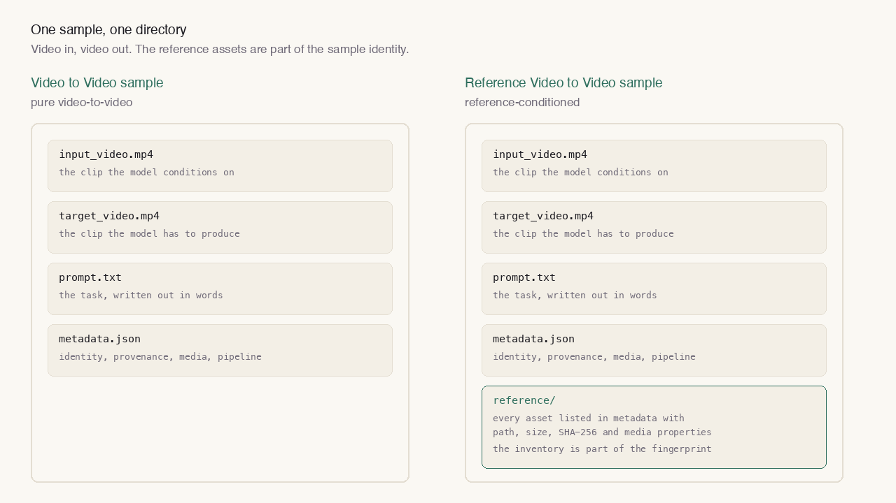
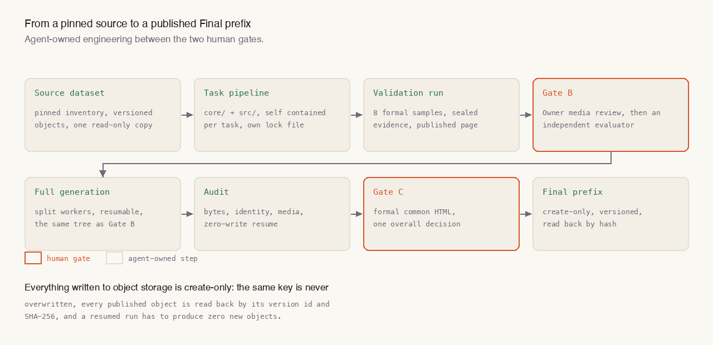

视频推理模型要学的东西很具体：看到一段视频，接下来会发生什么。要让这个信号真的可学，训练数据必须同时满足三件事——输入是一段视频，输出也是一段视频；目标视频由一条模型能学会的规则决定，而不是碰巧好看；每个样本都能被独立验证，而不是"看起来像"。

这套工作我做了大半年，产出是两套并行运行的仓库：TV2V 是纯视频到视频，RV2V 在此之上多一组参考素材。下面写方法、写证据，也写几个踩过的坑。

## 一、样本的最小单位

一条样本就是一个目录，四个文件：输入视频、目标视频、自然语言任务描述、结构化元数据。RV2V 再加一个 `reference/` 目录，里面每个参考素材都要在元数据里登记相对路径、媒体类型、字节数、SHA-256 和媒体属性。



两个约束值得单独说：

**样本 ID 必须是任务前缀加九位数字**，前缀要和同一份元数据里声明的任务身份一致。源数据集自己的 ID 另放在 `source.sample_id`，不能顶替样本 ID。这样任何一个样本目录被单独拎出来，都还能说清它属于哪个任务。

**参考素材清单参与身份。** RV2V 的 `sample_fingerprint` 把完整的参考素材清单算进去，改动任何一个参考素材，样本身份就变。这条不是洁癖：如果参考素材可以悄悄换，同一个 ID 下训练过的和推理时看到的就不是同一个任务。

还有一类样本天生来自单张图像。处理办法是把它"延长"成视频：图生图任务把输入图延长成静止帧视频，目标图同样延长；图生视频任务只延长输入，目标保持真实视频。模型永远只面对"视频进、视频出"，图像来源记录在来源信息里，不污染样本结构。

## 二、真实的一条样本

下面是一条真实样本的元数据节选，来自一个双手操作任务。它要求模型把人手和操作物体渲染成扁平的语义颜色，同时保持源视频的时间、背景和遮挡关系：

```json
{
  "schema_version": "1.2",
  "sample_id": "Task_275_contact-aware_bimanual_manipulation_video_generation_000000001",
  "task": { "id": "Task_275", "name": "contact-aware_bimanual_manipulation_video_generation", "modality": "v2v" },
  "source": { "dataset": "<公开的 手-物交互 数据集>", "split": "train", "sample_id": "scene_01__A001++seq__07bb164dc3d3873d6389" },
  "media": {
    "input":  { "file": "input_video.mp4",  "width": 848, "height": 480, "fps": 30, "num_frames": 81 },
    "target": { "file": "target_video.mp4", "width": 848, "height": 480, "fps": 30, "num_frames": 81 }
  },
  "pipeline": { "name": "contact-aware_bimanual_manipulation_video_generation", "version": "0.9.1", "commit": "<生成这一批样本的 commit>" },
  "optional": {
    "selection_stratum": "single-object-rearrange-known-alignment",
    "annotations": {
      "human": "用录制的 SMPL-X 重建渲染成一个人体实体，包含双手",
      "object_identity_unit": "取自来源目录的自然物体描述；描述相同就共用同一个提示词里的颜色",
      "background": "未被标注的像素保留源 RGB"
    }
  },
  "identity": { "sample_fingerprint": "<样本身份的 SHA-256>" }
}
```

这条样本的第一版是错的，而且错得很典型。

原实现渲染的是录制下来的手部骨架和物体轴线，而任务要求的是扁平的语义颜色。第一轮视觉审核直接判 FAIL：目标画面是一层灰色半透明网格，不是要求的语义可视化；一个物体被拆成了好几种颜色；画面里根本不存在的碗和电脑外框被涂上了色；真正被抓握的物体反而漏标。

根因不在渲染器，在"标注范围"的定义：旧代码把标注文件里所有场景物体的清单都上了色，但这个任务真正该标的是"当前 primitive 实际参与的那些物体实例"。改完之后的规则是：完整人物一种稳定颜色，当前动作涉及的每个可见物体实例各一种稳定颜色，场景里其它东西保留原始 RGB；同一物体不能被无依据地拆成多色，但数据集里本来就带独立部件 ID 的真实部件可以保留各自的稳定色。

这一轮还留下了两条我觉得比画面更重要的经验。

**提示词也是产物的一部分。** 旧流程把提示词当成"四个文件之一"，校验只检查它非空，没有任何渲染或模型代码读它。改好以后，每条提示词必须写明动作、物体、工具或目标，以及必要的颜色、尺寸、左右手属性——否则这条样本证明不了模型会用条件。

**可见性范围必须写进契约，而不是靠观察。** "只标注真正可见的部分"这句话在真实数据上无法精确成立，因为数据集没有给出场景几何。硬撑的结果是标注溢出到桌子、柜子和设备上。与其补一个做不到的承诺，不如把任务定义收窄：投影是确定性的离线投影，允许遮挡真实存在的物体，但不去声称重建了被遮挡表面。

## 三、我做过的任务

下面是我自己负责的十六个任务，覆盖续写、修复、重拍、生成、定位与解释等不同类型。每一个都是团队视频推理基准套件里的正式任务：有明确的任务定义、样本契约和独立的评审环节。

| 任务 | 模态 | 任务名 | 要求模型做什么 |
| --- | --- | --- | --- |
| 275 | 视频到视频 | action_conditioned_bimanual_manipulation_video_continuation | 双手动作之后，续写真实发生的那一段 |
| 278 | 视频到视频 | action_conditioned_gameplay_stutter_repair | 按操作序列修掉画面里的卡顿 |
| 331 | 视频到视频 | robot_tool_target_semantic_role_highlighting | 在第一视角里标出工具和目标物的角色 |
| 334 | 视频到视频 | prompt_guided_single_view_multishot_recinematography | 按文字指令重排同一视角下的多个镜头 |
| 428 | 视频到视频 | same_time_background_and_scenery_replacement | 保持时间一致，换掉背景和场景 |
| 552 | 视频到视频 | street_scene_city_option_selection | 街道场景里选出对应的城市选项 |
| 654 | 视频到视频 | gps_coordinate_conditioned_rotating_globe_marking | 按 GPS 坐标在旋转的地球上做标记 |
| 390 | 视频到视频 | relation_constrained_multi_object_scene_completion | 按物体之间的关系约束补全场景 |
| 429 | 视频到视频 | post_handoff_recipient_action_rollout | 交接之后接收方该有的动作 |
| 480 | 视频到视频 | cave_video_commonsense_anomaly_localization | 洞穴视频里定位常识性异常 |
| 481 | 视频到视频 | gameplay_commonsense_error_localization_and_explanation | 定位并解释画面里的常识错误 |
| 483 | 视频到视频 | egocentric_hand_motion_phase_panel_visualization | 第一人称手部动作的相位面板 |
| 328 | 参考到视频 | bimanual_manipulation_process_panel | 借助参考素材还原双手操作的过程 |
| 391 | 参考到视频 | language_grounded_multi_object_grasp_video_generation | 用语言指定的多物体抓取，生成对应视频 |
| 479 | 参考到视频 | reference_guided_progressive_makeup_transfer | 参考引导的渐进式妆容迁移 |
| 551 | 参考到视频 | reference_guided_ego_action_skill_comparison | 参考引导的第一人称动作技能对比 |

每个任务都可以直接看：输入视频、目标视频和那条定义任务的提示词放在另一页——[视频推理任务样本](/v2v-task-samples/)——一条一个任务，逐条标注来源数据集与授权。

## 四、确定性的两个层次

样本跑通之后，真正的难点是"再跑一遍能不能得到同样的东西"。

第一层是语义层的确定：同一批候选、同一套过滤规则、同样的窗口选择。这靠把中间状态写进产物来保证，而不是靠跑一次记一个日志。

第二层是字节层的确定，这里踩了一个很典型的坑。第一轮复现时，两个 CPU 核心的亲和性设置改变了编码器的多线程行为，于是同样的输入、同样的元数据，压缩出来的字节却不一样——帧内容一致，压缩参数不同。要求"逐字节一致"时，这个差异是致命的。

处理方式不是放宽比较，而是把环境对齐：先在正式环境下用单样本探针确认能字节一致，再在同样的环境下重跑整批，32 个载荷文件逐字节一致，16 段解码后的视频逐帧一致。教训很直接：确定性是环境的属性，不只是代码的属性。

还有一个更朴素的问题：300 帧太长了。人类审核一条 300 帧的样本要反复拖进度条，注意力很快就没了。这个反馈把任务改回 Draft、撤掉了已经发出的评审请求，然后把窗口改成确定性的 81 帧（2.7 秒）动作中心窗口，前后各留十帧上下文，评分改用官方的动作物体平移与旋转。改完之后，旧的一切——生成 commit、样本、证据、页面、审核结论——全部作废重做。已发出去的评审请求要撤，结论要作废，这条比技术问题更麻烦。

## 五、从闸门到交付

一个任务从源数据走到可交付的 Final，中间隔着两道人工闸门，中间的工程全部由 Agent 承担。



闸门 B 是正式评审页：先由 Owner 完整播放样本、逐条核对提示词与画面，再由一位独立评审者复核，两步都通过才允许做 Full。闸门 C 是另一份正式页面，用的是最终交付的那批样本，不是中间产物。

Full 阶段由 Agent 负责：把固定候选集合切成互不重叠的分片交给多个 worker，生成完做全量审计，再逐对象回读校验。中途失败可以续跑，续跑的前提是它必须能证明"这次没有重复写"。

交付侧我坚持几条硬规则：

- **对象存储只写一次。** 同一个键不覆盖，已发布的对象用版本号和 SHA-256 逐个回读。
- **续跑必须真的重算。** 同一路径再跑一次，应该生成 0 个新样本、跳过全部有效样本、复现全部排除项，而且载荷字节不变。
- **每一份产物都绑定生成它的 commit。** 报告里出现的任何一个数字，都要能追回到产生它的那次运行。

## 六、两个模态的差别

TV2V 的样本是四个文件，RV2V 多一组参考素材，后者的工程量主要在两处。

一是参考素材的清点。每个参考素材都要登记路径、类型、字节数、摘要和媒体属性，清单按 POSIX 相对路径排序，完整地参与样本指纹。

二是多来源。一个任务可以绑定两份互不相干的原始数据集，各自保留自己的版本清单、适配器语义契约和统计口径，正式验证按来源分层做，聚合后的清单身份要一路带到闸门 C。

两个真实任务的长度：

- **一个事件引导的深度重建任务**：32 条 81 帧窗口，128 个核心对象加 32 个参考对象，合计 160 个载荷对象，约 126 MB。两次全量审计、独立复现、32 条零写入续跑和逐版本号 SHA-256 校验全部通过。
- **一个时序一致的视频全景分割任务**：3,137 段裁剪、每段 74,787 帧，12,548 个核心文件加 3,137 份 JSON 参考，合计 15,685 个载荷对象，约 17.4 GB。训练与验证切分为 2,797 / 340，十对完整样本在另一份干净检出里逐字节复现。

交付给下游模型团队的一次导出，覆盖 15 个任务、100,843 条样本、403,372 个源对象，源数据约 95 GB，导出产物 100,854 个文件。其中 70,212 条是编辑类样本，30,631 条是续写类。导出同时带着 243,602 条模型侧的预期告警——源序列偏短、目标偏短、源与目标帧数不一致、需要顺序打包——这些不是错误，是交给消费方必须知道的前提。

## 七、几条能带走的经验

**契约先于实现。** 样本长什么样、ID 怎么拼、什么参与身份，先写成可执行的校验器，再写生成代码。反过来做，返工成本是整批样本。

**"看起来对"是最贵的评审。** 人工审核的作用不是挑画面好不好看，而是判断它证明了想证明的那件事。提示词里写了过程、画面里没发生，一样是 FAIL。

**确定性的成本比想象的低，收益比想象的高。** 把编码环境、线程亲和性、窗口选择固定下来，换来的是随时能证明这批数据没被动过。

**发布是一次性动作。** 版本化的对象存储配上逐对象回读，让"重新发布"变成一个需要额外授权的动作，而不是一次手滑。

## 关于这篇

两套仓库和它们的证据都在团队的内部空间里，所以这篇讲的是契约、流程和可公开的量级数字。样本本身另有一页：[视频推理任务样本](/v2v-task-samples/)，每个任务一条，逐条标注来源数据集与授权。反事实物理视频那一篇是另一件事：那些画面是我自己的生成器渲出来的，可以直接看。
